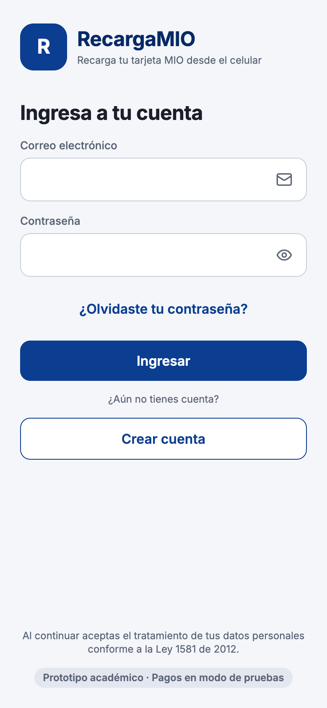
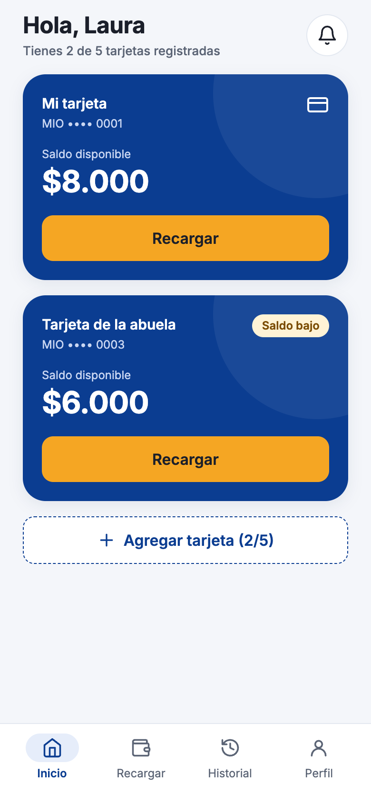
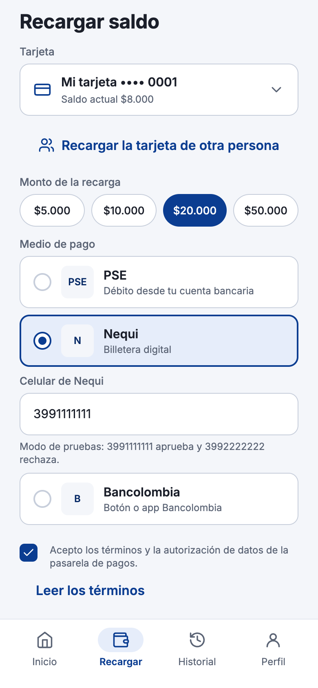
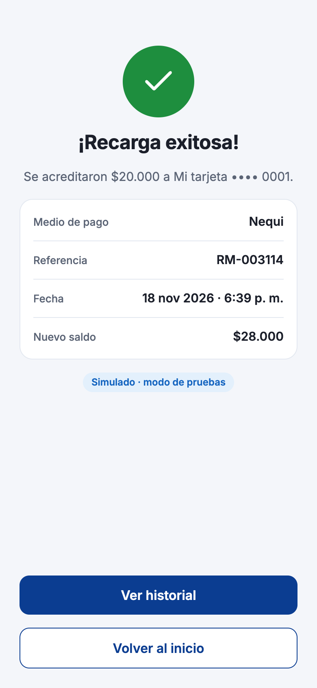
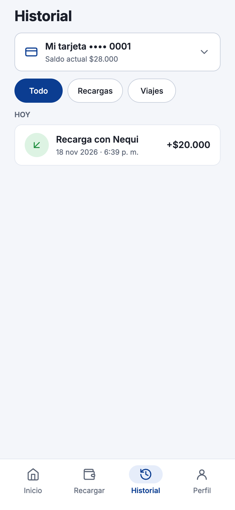

# RecargaMIO

[](https://github.com/josemina/RecargaMio/actions/workflows/ci.yml)

Prototipo académico de una app móvil para recargar la tarjeta MIO de Cali desde el celular, con PSE, Nequi y Bancolombia, en **modo de pruebas**: **nunca se mueve dinero real**. Proyecto de grado de Ingeniería de Sistemas de la Universidad Nacional Abierta y a Distancia (UNAD).

<p>
  
  
  
  
  
</p>

## Qué hace

| Historia | Qué puede hacer la persona |
|---|---|
| HU-06 | Crear su cuenta autorizando el tratamiento de datos (Ley 1581 de 2012), ingresar y recuperar la contraseña |
| HU-07 | Registrar hasta cinco tarjetas MIO |
| HU-01 y HU-02 | Recargar con PSE, Nequi o Bancolombia y ver la confirmación |
| HU-04 | Recargar la tarjeta de otra persona |
| HU-03 | Consultar el saldo y el historial de recargas y viajes |
| HU-05 | Recibir alertas de saldo bajo |

Además, la persona puede ver, corregir y eliminar sus datos desde la app (RNF-04).

## Cómo está hecho

```text
App móvil (Expo + React Native)  →  API REST (Node.js + Express + Prisma)  →  PostgreSQL
                                       ├── Pasarela de pagos Wompi en modo de pruebas (o simulada)
                                       └── Recaudo simulado del MIO (saldos, recargas y viajes)
```

Todo, salvo la app, corre en Docker con un solo comando. La arquitectura completa, los endpoints y los controles de seguridad están en el [capítulo de arquitectura](docs/manual/02-arquitectura.md); el porqué de cada decisión, en los [ADR](docs/adr/README.md).

## Instalación paso a paso

**Requisitos:** Docker Desktop, Node.js 22 y git. Para abrir la app en el teléfono: Expo Go en Android y el teléfono en la misma red Wi-Fi que el computador.

1. **Clonar el repositorio:**

   ```bash
   git clone https://github.com/josemina/RecargaMio.git
   cd RecargaMio
   ```

2. **Crear el archivo de variables** y cambiar los valores marcados (contraseñas y llaves locales). **Nunca subas `.env` al repositorio.**

   ```bash
   cp .env.example .env
   ```

3. **Instalar las dependencias:**

   ```bash
   npm install
   ```

4. **Levantar todo, migrar y sembrar la base, y dejar la app apuntando a este computador:**

   ```bash
   npm run demo
   ```

5. **Comprobar** que la API responde: `curl localhost:3000/health` devuelve `{"estado":"ok",…}`.

6. **Abrir la app** y escanear el código QR con Expo Go:

   ```bash
   cd apps/mobile && npx expo start --clear
   ```

7. **Ingresar** con la usuaria de demostración (`viviana@recargamio.test` y la contraseña que pusiste en `SEMILLA_CONTRASENA`) o crear una cuenta. Para pagar con Nequi en modo de pruebas usa el celular `3991111111`, que aprueba, o `3992222222`, que rechaza.

El paso a paso detallado, con capturas y la solución de problemas, está en el [manual de instalación y operación](docs/manual/01-instalacion-y-operacion.md).

| Servicio | Dirección |
|---|---|
| API | http://localhost:3000 |
| Documentación de la API (Swagger, solo fuera de producción) | http://localhost:3000/docs |
| Recaudo simulado | http://localhost:4000 |
| Correos de prueba (Mailpit) | http://localhost:8025 |

## Resultados de las pruebas

Corrida del 18 de noviembre de 2026 con la pasarela simulada, frente a las metas de la Tabla 9 del documento maestro. El detalle está en [docs/metricas/resultados.md](docs/metricas/resultados.md).

| Indicador | Meta | Resultado |
|---|---|---|
| Tiempo de recarga (percentil 95) | ≤ 180 s | 4,0 s |
| Éxito de pagos | ≥ 98 % | 200 de 200 (100 %) |
| Tiempo de respuesta con 100 usuarios (percentil 95) | ≤ 2 s | 0,02 s |
| Seguridad (OWASP ZAP y MASVS) | 0 vulnerabilidades críticas o altas | 0 |
| Accesibilidad (WCAG 2.1 AA) | 0 incumplimientos críticos | 0 en las pruebas automáticas; falta la revisión con TalkBack |
| Usabilidad (SUS) | ≥ 68 | Pendiente: prueba con 15 personas |

## Comandos

| Tarea | Comando |
|---|---|
| Preparar el entorno de pruebas o una demostración | `npm run demo` |
| Lint y tipos | `npm run lint && npm run typecheck` |
| Pruebas de la API / del recaudo | `docker compose run --rm api npm test` / `docker compose run --rm recaudo-sim npm test` |
| Pruebas de la app (incluye la accesibilidad de las 20 pantallas) | `npm test --workspace apps/mobile` |
| Pruebas de la Tabla 18 (Newman, 200 recargas, JMeter, ZAP, `npm audit`, registros) y métricas | `npm run pruebas` |
| Revisar que no se suba ningún secreto | `npm run revisar:secretos` |
| Manual en Word y PDF / capturas del manual | `npm run manual` / `npm run manual:capturas` |
| Paquete para el Release de la entrega | `npm run entrega:paquete` |
| Apagar todo | `docker compose down` |

Cada *push* y cada *pull request* corren la [integración continua](.github/workflows/ci.yml): revisión de secretos, lint, tipos y las pruebas de los tres paquetes.

## Documentación

| Documento | Contenido |
|---|---|
| [Manual de instalación y operación](docs/manual/01-instalacion-y-operacion.md) | Requisitos, instalación, operación, pruebas y solución de problemas |
| [Arquitectura](docs/manual/02-arquitectura.md) | Componentes, datos, endpoints y controles de seguridad |
| [Manual de usuario](docs/manual/03-manual-de-usuario.md) | Cómo usar la app, pantalla por pantalla |
| [Pruebas y resultados](docs/manual/04-pruebas-y-resultados.md) | Plan de pruebas y resultados frente a las metas |
| [Validación TRL 5](docs/manual/05-validacion-trl5.md) | Entorno de pruebas, accesibilidad, lista OWASP MASVS y protocolo de usabilidad |
| [Manual completo en PDF](docs/manual/entregables/Manual_RecargaMIO.pdf) | Todo lo anterior en formato APA 7 (el Word está en el Release) |
| [Bitácora de tareas](docs/sprints/bitacora.md) | Qué se hizo en cada tarea, decisiones, pruebas y problemas |
| [Decisiones de arquitectura (ADR)](docs/adr/README.md) | Por qué se tomó cada decisión técnica |
| [Entrega](docs/entrega/) | Guion del video, lista para la grabación e insumos para el documento maestro |
| [Plan de implementación](docs/PLAN_IMPLEMENTACION_RecargaMIO.md) | Alcance, tareas y calendario |

## Estructura

```text
apps/mobile            App Expo + React Native (pantallas de Figma 1.1 a 5.3)
services/api           API REST: Express + TypeScript + Prisma
services/recaudo-sim   Simulador del sistema de recaudo del MIO
infra/db/init          Bases de PostgreSQL (demostración y pruebas)
tests/                 Postman, integración, JMeter, seguridad y accesibilidad
scripts/               Pruebas, métricas, demostración, revisión de secretos y paquete de la entrega
docs/                  Manual, ADR, bitácora, métricas y entrega
.github/workflows      Integración continua
```

## Enlaces

- Prototipo de interfaz en Figma: [RecargaMIO · Prototipo de interfaz](https://www.figma.com/proto/yKHSYSKwagdMvEKL5tA1Xn/RecargaMIO---Prototipo-de-interfaz?node-id=2-2&p=f&scaling=min-zoom&content-scaling=fixed&page-id=0%3A1)
- Video de manejo y funcionamiento (máximo 10 minutos): pendiente.

## Equipo

Viviana Andrea Andrade Torres, Jose Luis Mina Cuero y Julian Andres Ospina Roncancio, estudiantes de Ingeniería de Sistemas de la UNAD.

Proyecto de uso académico. Los pagos usan solo el modo de pruebas de la pasarela y el recaudo del MIO es simulado.
