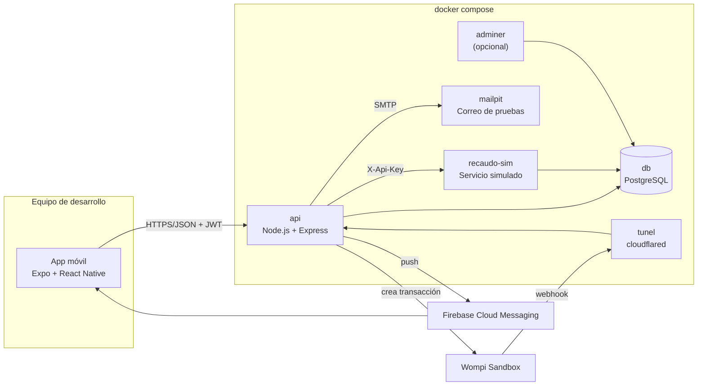

# Plan de implementación de RecargaMIO (Fase 4)

Proyecto de grado · Ingeniería de Sistemas · UNAD
Equipo: Viviana Andrea Andrade Torres, Jose Luis Mina Cuero y Julian Andres Ospina Roncancio
Tutor: Daniel Andrés Guzmán Arévalo

Este plan convierte el documento maestro y el diseño de Figma en un prototipo funcional (TRL 5) que se construye con Claude Code dentro de contenedores Docker, usando exactamente las tecnologías de la Tabla 4 del documento maestro: React Native, Node.js con Express, PostgreSQL, JWT/OAuth 2.0, pasarela con API (Wompi en modo de pruebas), Firebase Cloud Messaging, Jest, Postman, JMeter, OWASP MASVS y WCAG 2.1 AA.

---

## 0. Antes de empezar: fecha límite y decisiones

### La fecha límite cambia el alcance

La Fase 4 cierra el **domingo 22 de noviembre de 2026**. Hoy es martes 17. Quedan **cinco días** para entregar prototipo, repositorio en GitHub y video. El cronograma de seis meses del documento maestro sigue siendo el plan formal del proyecto, pero para esta entrega se construye un **producto mínimo viable (PMV)** que cubre el flujo completo de recarga. La sección 13 separa lo que entra en los cinco días de lo que queda para después.

### Decisiones técnicas (confirmen antes de arrancar)

| # | Decisión | Propuesta | Por qué | Alternativa |
|---|---|---|---|---|
| D1 | Marco de React Native | **Expo** (flujo administrado) con TypeScript | Es React Native; compila Android e iOS sin Mac, trae navegación, almacenamiento seguro y notificaciones. | React Native CLI (más configuración nativa). |
| D2 | Lenguaje del backend | **TypeScript** sobre Node.js + Express | Menos errores en un equipo de tres y con código generado por IA. | JavaScript puro. |
| D3 | Acceso a datos | **Prisma** con migraciones | Esquema legible, migraciones versionadas, tipos automáticos. | `pg` + `node-pg-migrate`. |
| D4 | Qué corre en Docker | Backend, base de datos, recaudo simulado, correo de pruebas, túnel de webhooks y herramientas de prueba | Un solo `docker compose up` levanta todo. | — |
| D5 | Qué **no** corre en Docker | La app móvil se ejecuta en el equipo anfitrión con Expo y un teléfono o emulador | Los emuladores de Android/iOS no funcionan bien dentro de contenedores. Docker se usa para la app solo en lint y pruebas. | — |
| D6 | Integración de pagos | **API directa de Wompi** desde el backend (Nequi y PSE primero; Bancolombia si alcanza el tiempo) | Cumple "pasarela con API" y permite medir el tiempo de recarga en los registros. | Web Checkout de Wompi en un navegador dentro de la app. |
| D7 | Notificaciones | FCM en **Android** con `firebase-admin`; iOS queda fuera del PMV | iOS exige cuenta de Apple Developer y certificados APNs. | Servicio de notificaciones de Expo. |
| D8 | Confirmación del pago | Webhook de Wompi **y** consulta periódica (reconciliación) | Si el túnel falla, el pago igual se confirma; además es buena práctica. | Solo webhook. |

---

## 1. Alcance: historias, pantallas y servicios

El diseño de alta fidelidad está en Figma, página **03 · Prototipo alta fidelidad**, y el sistema de diseño en la página **02 · Sistema de diseño** del archivo `yKHSYSKwagdMvEKL5tA1Xn`.

| Historia | Pantallas de Figma | Endpoints principales | PMV (22 nov) |
|---|---|---|---|
| HU-06 Autenticación y cuenta segura | 1.1, 1.2, 1.3, 1.4 | `/auth/*` | Sí |
| HU-07 Hasta cinco tarjetas | 2.1, 2.2, 2.3, 2.4 | `/tarjetas` | Sí |
| HU-01 Recarga desde el celular | 3.1, 3.3, 3.4, 3.5 | `/recargas` | Sí |
| HU-02 Pago con PSE, Nequi o Bancolombia | 3.1, 3.3 | `/recargas`, `/webhooks/wompi` | Nequi y PSE sí; Bancolombia si alcanza |
| HU-03 Saldo e historial | 2.1, 4.1 | `/tarjetas/:id/movimientos` | Sí |
| HU-04 Recarga a terceros | 3.2 | `/recargas` con `numeroDestino` | Sí (es poco trabajo extra) |
| HU-05 Alertas de saldo bajo | 2.3, 4.2, 4.3 | `/tarjetas/:id/alerta`, `/dispositivos` | Configuración sí; notificación push en Android si alcanza |
| Privacidad y PQR (Ley 1581, Ley 1480) | 5.1, 5.2, 5.3 | `/me`, `/me/datos`, `/pqr` | Perfil y eliminar cuenta sí; exportar y PQR después |

---

## 2. Arquitectura en Docker



| Servicio | Imagen | Puerto | Función |
|---|---|---|---|
| `db` | `postgres:16-alpine` | 5432 | Bases `recargamio` y `recaudo` |
| `api` | Construida desde `services/api` | 3000 | API REST, webhooks, tareas programadas |
| `recaudo-sim` | Construida desde `services/recaudo-sim` | 4000 | Emula el sistema de recaudo de la UTRYT |
| `mailpit` | `axllent/mailpit` | 8025 (web), 1025 (SMTP) | Recibe los correos de recuperación de contraseña |
| `tunel` | `cloudflare/cloudflared` | — | URL pública temporal para el webhook de Wompi (perfil `webhooks`) |
| `adminer` | `adminer` | 8080 | Ver la base de datos (perfil `herramientas`) |
| `newman` | `postman/newman` | — | Ejecuta la colección de Postman (perfil `pruebas`) |
| `jmeter` | `justb4/jmeter` | — | Prueba de carga (perfil `pruebas`) |
| `zap` | `ghcr.io/zaproxy/zaproxy:stable` | — | Escaneo de seguridad de la API (perfil `pruebas`) |

---

## 3. Estructura del repositorio

```text
recargamio/
├── CLAUDE.md                  # Instrucciones para Claude Code
├── README.md                  # Cómo levantar y probar el proyecto
├── docker-compose.yml
├── .env.example
├── apps/
│   └── mobile/                # Expo + React Native + TypeScript
│       ├── app/               # Rutas (expo-router), una por pantalla de Figma
│       ├── src/components/    # Equivalentes a los componentes de Figma
│       ├── src/theme/         # Tokens copiados de las variables de Figma
│       ├── src/api/           # Cliente HTTP y hooks de TanStack Query
│       └── __tests__/
├── services/
│   ├── api/
│   │   ├── prisma/schema.prisma
│   │   ├── src/modules/       # auth, tarjetas, recargas, alertas, perfil, pqr
│   │   ├── src/integrations/  # wompi, recaudo, fcm, correo
│   │   ├── src/jobs/          # reconciliación de pagos, saldo bajo
│   │   ├── src/middleware/    # jwt, errores, límites de peticiones
│   │   ├── openapi.yaml
│   │   ├── Dockerfile
│   │   └── tests/
│   └── recaudo-sim/
│       ├── src/
│       ├── Dockerfile
│       └── tests/
├── infra/
│   └── db/init/01-crear-bases.sql
├── tests/
│   ├── postman/RecargaMIO.postman_collection.json
│   ├── jmeter/recargas.jmx
│   └── seguridad/masvs-checklist.md
└── docs/
    ├── adr/                   # Registro de decisiones (D1 a D8)
    ├── sprints/               # Planeación, revisión y retrospectiva por sprint
    └── metricas/              # Resultados de pruebas para el documento maestro
```

Se usan **npm workspaces** para manejar `apps/*` y `services/*` desde la raíz.

---

## 4. Tecnologías y librerías

### Backend (`services/api`)

| Necesidad | Librería |
|---|---|
| Servidor | `express`, `helmet`, `cors`, `express-rate-limit` |
| Validación de entradas | `zod` |
| Base de datos | `prisma`, `@prisma/client` |
| Contraseñas | `argon2` |
| Tokens | `jsonwebtoken` (acceso 15 min, renovación 7 días, rotación) |
| Registro de eventos | `pino`, `pino-http` (con identificador por petición) |
| Tareas programadas | `node-cron` |
| Correo | `nodemailer` hacia Mailpit |
| Notificaciones | `firebase-admin` |
| Documentación | `openapi.yaml` + `swagger-ui-express` en `/docs` |
| Pruebas | `jest`, `ts-jest`, `supertest` |

**Sobre OAuth 2.0:** el prototipo usa el esquema de tokens de portador de OAuth 2.0 (token de acceso corto y token de renovación rotativo, enviados como `Authorization: Bearer`), firmados como JWT. No se integra un proveedor externo como Google; si el tutor lo pide, se agrega después.

### App móvil (`apps/mobile`)

| Necesidad | Librería |
|---|---|
| Base | Expo SDK estable más reciente, TypeScript |
| Navegación | `expo-router` (pestañas Inicio, Recargar, Historial, Perfil) |
| Datos del servidor | `@tanstack/react-query` |
| Formularios | `react-hook-form` + `zod` |
| Tokens | `expo-secure-store` (nunca AsyncStorage) |
| Pago PSE y Bancolombia | `expo-web-browser` + enlace profundo de regreso |
| Notificaciones | `expo-notifications` (requiere *development build*, no Expo Go) |
| Íconos | `lucide-react-native` (mismo estilo que los íconos de Figma) |
| Pruebas | `jest-expo`, `@testing-library/react-native` |

### Tokens de diseño (copiados de Figma)

`apps/mobile/src/theme/tokens.ts` debe reproducir las variables de la colección **RecargaMIO · Color** y **RecargaMIO · Medidas**:

```ts
export const color = {
  marca: { primario: '#0B3D91', primarioOscuro: '#072A66', primarioSuave: '#E6EDFA', primarioBorde: '#C9D6F2' },
  acento: { principal: '#F5A623', suave: '#FFF3D6', texto: '#7A4B00' },
  texto: { principal: '#1B1F2A', secundario: '#5B6475', terciario: '#6F7889', invertido: '#FFFFFF' },
  superficie: { fondo: '#F4F6FA', tarjeta: '#FFFFFF', deshabilitado: '#E9ECF2' },
  borde: { predeterminado: '#C7CEDB', sutil: '#E3E8F0' },
  estado: { exito: '#1E8E3E', exitoSuave: '#DDF3E3', error: '#C62828', errorSuave: '#FDE8E8', info: '#1565C0', infoSuave: '#E3F0FC' },
} as const;
export const espacio = { 1: 4, 2: 8, 3: 12, 4: 16, 5: 20, 6: 24, 8: 32 } as const;
export const radio = { sm: 8, md: 12, lg: 16, xl: 24, total: 999 } as const;
// Tipografía Inter: Display 32/40 Bold · Título 1 24/30 Bold · Título 2 18/24 SemiBold ·
// Título 3 16/22 SemiBold · Cuerpo 15/22 Regular · Etiqueta 13/18 Medium · Pequeño 12/16 · Botón 16/20 SemiBold · Saldo 32/38 Bold
```

Componentes de React Native que deben existir, uno por componente de Figma: `Boton`, `CampoTexto`, `TarjetaMIO`, `OpcionPago`, `Chip`, `Interruptor`, `Casilla`, `Insignia`, `Aviso`, `Movimiento`, `FilaAjuste`, `FilaDetalle`, `SelectorTarjeta`, `BarraSuperior`. La barra de navegación inferior la da `expo-router`.

---

## 5. Modelo de datos

Corresponde a la Figura 5 del documento maestro, con tres agregados necesarios para la seguridad: sesiones (tokens de renovación), dispositivos (FCM) y PQR.

```prisma
model Usuario {
  id              String   @id @default(uuid())
  nombre          String
  correo          String   @unique
  hashContrasena  String
  intentosFallidos Int     @default(0)
  bloqueadoHasta  DateTime?
  creadoEn        DateTime @default(now())
  eliminadoEn     DateTime?
  autorizaciones  AutorizacionDatos[]
  tarjetas        Tarjeta[]
  recargas        Recarga[]
  sesiones        Sesion[]
  dispositivos    Dispositivo[]
  auditoria       Auditoria[]
}
model AutorizacionDatos { id String @id @default(uuid()); usuarioId String; versionPolitica String; aceptadoEn DateTime @default(now()); ip String?; usuario Usuario @relation(fields: [usuarioId], references: [id]) }
model Sesion { id String @id @default(uuid()); usuarioId String; hashToken String @unique; expiraEn DateTime; revocadaEn DateTime?; usuario Usuario @relation(fields: [usuarioId], references: [id]) }
model Tarjeta {
  id String @id @default(uuid())
  usuarioId String
  numero String            // 10 dígitos; se cifra en reposo o se guarda con hash + últimos 4
  ultimos4 String
  alias String
  activa Boolean @default(true)
  creadaEn DateTime @default(now())
  alerta Alerta?
  recargas Recarga[]
  usuario Usuario @relation(fields: [usuarioId], references: [id])
  @@unique([usuarioId, numero])
}
model Alerta { id String @id @default(uuid()); tarjetaId String @unique; umbral Int; activa Boolean @default(true); ultimaNotificacion DateTime?; tarjeta Tarjeta @relation(fields: [tarjetaId], references: [id]) }
enum EstadoRecarga { PENDIENTE APROBADA ACREDITADA RECHAZADA ERROR FALLA_ACREDITACION }
enum MedioPago { NEQUI PSE BANCOLOMBIA_TRANSFER }
model Recarga {
  id String @id @default(uuid())
  referencia String @unique          // RM-000123, también es la referencia en Wompi
  usuarioId String
  tarjetaId String?                  // nulo cuando es a un tercero
  numeroDestino String               // tarjeta destino (propia o de tercero)
  monto Int                          // en pesos
  medioPago MedioPago
  estado EstadoRecarga @default(PENDIENTE)
  iniciadaEn DateTime @default(now())
  confirmadaEn DateTime?             // pasarela aprobó
  acreditadaEn DateTime?             // recaudo confirmó
  transacciones TransaccionPasarela[]
  usuario Usuario @relation(fields: [usuarioId], references: [id])
  tarjeta Tarjeta? @relation(fields: [tarjetaId], references: [id])
}
model TransaccionPasarela { id String @id @default(uuid()); recargaId String; idExterno String; estado String; checksumEvento String?; cuerpo Json; recibidaEn DateTime @default(now()); recarga Recarga @relation(fields: [recargaId], references: [id]); @@unique([idExterno, estado]) }
model Dispositivo { id String @id @default(uuid()); usuarioId String; tokenFcm String @unique; plataforma String; usuario Usuario @relation(fields: [usuarioId], references: [id]) }
model Auditoria { id String @id @default(uuid()); usuarioId String?; accion String; detalle Json?; fecha DateTime @default(now()); usuario Usuario? @relation(fields: [usuarioId], references: [id]) }
model Pqr { id String @id @default(uuid()); usuarioId String; tipo String; mensaje String; radicado String @unique; estado String @default("RADICADA"); creadaEn DateTime @default(now()) }
```

Los **viajes** no se guardan en la base de RecargaMIO: los entrega el recaudo simulado, igual que lo haría el sistema real. El historial combina las recargas propias con los viajes que devuelve `recaudo-sim`.

**La métrica principal del proyecto sale de aquí:** tiempo de recarga = `acreditadaEn − iniciadaEn` (meta ≤ 180 s). Tasa de éxito = recargas `ACREDITADA` / recargas iniciadas, sin contar rechazos por fondos (meta ≥ 98 %).

---

## 6. API REST

Todas las rutas, salvo `/auth/*`, `/health` y `/webhooks/*`, exigen `Authorization: Bearer <token>`.

| Método | Ruta | Descripción | Reglas |
|---|---|---|---|
| GET | `/health` | Estado de la API y de la base | Usado por Docker |
| POST | `/auth/registro` | Crea usuario y registra la autorización de datos | `aceptaPolitica` debe ser `true` (Ley 1581) |
| POST | `/auth/ingreso` | Devuelve token de acceso y de renovación | 5 intentos fallidos → bloqueo de 15 min |
| POST | `/auth/renovar` | Rota el token de renovación | El anterior queda revocado |
| POST | `/auth/salir` | Revoca la sesión | — |
| POST | `/auth/recuperar` | Envía enlace por correo (Mailpit) | Respuesta igual exista o no el correo |
| POST | `/auth/restablecer` | Cambia la contraseña con el token | Token de un uso, 30 min |
| GET | `/me` · PATCH `/me` · DELETE `/me` | Perfil, actualizar y eliminar cuenta | Eliminar = borrado lógico + anonimización |
| GET | `/me/datos` | Exporta los datos del usuario en JSON | Fuera del PMV |
| GET | `/tarjetas` | Lista tarjetas con saldo (consultado al recaudo) | — |
| POST | `/tarjetas` | Registra tarjeta | Máximo 5 activas; el recaudo debe reconocer el número |
| PATCH | `/tarjetas/:id` · DELETE `/tarjetas/:id` | Renombrar y eliminar | Solo el dueño |
| GET | `/tarjetas/:id/movimientos?tipo=todo\|recargas\|viajes` | Historial | Paginado |
| PUT | `/tarjetas/:id/alerta` | `{ umbral, activa }` | Umbral entre 3.500 y 50.000 |
| GET | `/pasarela/bancos` | Bancos PSE (desde Wompi) | Cache de 1 hora |
| POST | `/recargas` | Inicia una recarga | Ver sección 7 |
| GET | `/recargas/:id` | Estado de la recarga (la app consulta cada 3 s en 3.3) | — |
| POST | `/webhooks/wompi` | Eventos de Wompi | Verifica checksum; idempotente |
| POST | `/dispositivos` | Registra token FCM | — |
| POST | `/pqr` | Radica una PQR | Fuera del PMV |

Formato de error único: `{ "error": { "codigo": "LIMITE_TARJETAS", "mensaje": "Ya tienes 5 de 5 tarjetas." } }`.

---

## 7. Integración con Wompi (modo de pruebas)

### Credenciales

En el panel de Wompi, en modo Sandbox, sección Desarrollo → Programadores, se obtienen cuatro valores. Todos deben empezar con prefijos de prueba (`pub_test_`, `prv_test_`, `test_events_`, `test_integrity_`). Van solo en `.env`, nunca en el repositorio ni en la app.

### Flujo de una recarga

1. La app envía `POST /recargas` con `{ tarjetaId | numeroDestino, monto, medioPago, datosMedio }`.
2. La API valida: monto permitido, tarjeta del usuario o número de tercero reconocido por el recaudo, y que no haya otra recarga pendiente idéntica en los últimos 60 s.
3. La API crea la recarga en estado `PENDIENTE` con referencia `RM-xxxxxx`.
4. La API obtiene el token de aceptación del comercio (`GET /v1/merchants/{llave_publica}`), calcula la firma de integridad y crea la transacción (`POST /v1/transactions`) con la llave privada.
   - Firma de integridad: `SHA256(referencia + monto_en_centavos + "COP" + secreto_integridad)`.
   - Nequi: `payment_method: { type: "NEQUI", phone_number }`.
   - PSE: `payment_method: { type: "PSE", user_type, user_legal_id_type, user_legal_id, financial_institution_code, payment_description }`; la respuesta trae una URL de pago asíncrona que la app abre con `expo-web-browser`.
5. La app muestra la pantalla 3.3 y consulta `GET /recargas/:id` cada 3 segundos.
6. Wompi envía el evento `transaction.updated` al webhook. La API:
   - Concatena los valores de `signature.properties`, el `timestamp` y el secreto de eventos, calcula SHA256 y lo compara con `X-Event-Checksum`. Si no coincide, responde 401 y registra el intento.
   - Guarda el evento en `TransaccionPasarela` (la restricción única `idExterno + estado` evita procesarlo dos veces).
   - Si el estado es `APPROVED`, llama a `recaudo-sim` para acreditar (idempotente por referencia) y marca `ACREDITADA`. Si es `DECLINED` o `ERROR`, marca el estado y no toca el saldo.
7. **Reconciliación:** una tarea cada 30 s consulta `GET /v1/transactions/{id}` para recargas pendientes con más de 20 s. Así funciona aunque el túnel del webhook no esté activo.
8. La app pasa a 3.4 (acreditada) o 3.5 (rechazada).

Antes de implementar, verifiquen en la documentación oficial de Wompi (docs.wompi.co) los campos obligatorios vigentes de `POST /v1/transactions`, en particular el token de aceptación y si su cuenta exige además la autorización de datos personales.

### Datos de prueba de Wompi Sandbox

| Medio | Resultado aprobado | Resultado rechazado |
|---|---|---|
| Nequi | Celular `3991111111` | Celular `3992222222` |
| PSE | Banco "Banco que aprueba" | Banco "Banco que rechaza" |
| Cualquier otro dato | Termina en estado `ERROR` | — |

Con estos datos se cumplen las 200 transacciones de prueba de la Tabla 9 sin dinero real.

---

## 8. Servicio simulado de recaudo (`recaudo-sim`)

Emula lo que sería el sistema de la UTRYT. Se comunica con la API mediante una llave compartida en el encabezado `X-Api-Key`.

| Método | Ruta | Uso |
|---|---|---|
| GET | `/tarjetas/:numero` | Existe, activa y saldo |
| POST | `/tarjetas/:numero/creditos` | `{ monto, referencia }`. Idempotente: la misma referencia no acredita dos veces |
| GET | `/tarjetas/:numero/viajes?desde=` | Viajes para el historial |
| POST | `/simulacion/viaje` | Descuenta $3.500 (para la demostración y para disparar alertas) |
| POST | `/simulacion/latencia` | Fija una demora o tasa de fallos (pruebas de resiliencia) |

Datos semilla, coherentes con Figma: `1234564821` (saldo $12.400), `1234567730` ($3.200), `9087654321` (tercero, $1.000), y dos tarjetas más para probar el límite de cinco.

---

## 9. Seguridad (OWASP MASVS) y privacidad

| Control | Cómo se cumple | Prueba |
|---|---|---|
| MASVS-STORAGE | Tokens en `expo-secure-store`; nada sensible en registros | Revisión de código y de registros |
| MASVS-CRYPTO | Contraseñas con argon2; firmas SHA256 de Wompi | Pruebas unitarias |
| MASVS-AUTH | JWT corto + renovación rotativa; bloqueo tras 5 intentos; cierre de sesión revoca | Pruebas de API |
| MASVS-NETWORK | HTTPS fuera de desarrollo; `helmet`; CORS restringido | ZAP |
| MASVS-PLATFORM | Enlaces profundos validados; WebView solo para la pasarela | Revisión |
| MASVS-CODE | Validación con `zod` en toda entrada; dependencias auditadas (`npm audit`) | CI |
| MASVS-RESILIENCE | Límite de peticiones en `/auth` y `/recargas` | JMeter |
| MASVS-PRIVACY | Autorización expresa, borrado de cuenta, nunca se guardan datos bancarios | Revisión con Ley 1581 |

Además: auditoría de ingresos, recargas y cambios de tarjetas (RF-12); el número completo de la tarjeta nunca se muestra en la app (solo `•••• 4821`).

---

## 10. Pruebas y métricas para el documento maestro

| Prueba | Herramienta | Comando | Meta (Tabla 9) |
|---|---|---|---|
| Unitarias | Jest | `docker compose run --rm api npm test` | Todas en verde |
| De API | Postman + Newman | `docker compose --profile pruebas run --rm newman` | Contrato cumplido |
| Integración con pasarela | Script `tests/integracion/200-recargas.ts` | `docker compose run --rm api npm run prueba:recargas` | ≥ 98 % aprobadas |
| Carga | JMeter, 100 usuarios simultáneos | `docker compose --profile pruebas run --rm jmeter` | Percentil 95 ≤ 2 s |
| Seguridad | OWASP ZAP (escaneo de API) + lista MASVS | `docker compose --profile pruebas run --rm zap` | 0 hallazgos críticos o altos |
| Accesibilidad | TalkBack, VoiceOver, lista WCAG 2.1 AA | Manual | 0 incumplimientos críticos |
| Usabilidad | Cuestionario SUS con 15 usuarios | Manual | SUS ≥ 68 |
| Tiempo de recarga | Consulta SQL sobre `Recarga` | `npm run metricas` | ≤ 180 s |

`npm run metricas` debe generar `docs/metricas/resultados.md` con media, mediana y percentil 95 del tiempo de recarga y la tasa de éxito con su intervalo de confianza del 95 %. Esos números van directo a la sección "Resultados de las pruebas" del documento maestro.

---

## 11. `docker-compose.yml` de referencia

```yaml
services:
  db:
    image: postgres:16-alpine
    environment:
      POSTGRES_USER: recargamio
      POSTGRES_PASSWORD: ${DB_PASSWORD}
      POSTGRES_DB: recargamio
    volumes:
      - pgdata:/var/lib/postgresql/data
      - ./infra/db/init:/docker-entrypoint-initdb.d:ro
    ports: ["5432:5432"]
    healthcheck:
      test: ["CMD-SHELL", "pg_isready -U recargamio"]
      interval: 5s
      retries: 10

  recaudo-sim:
    build: ./services/recaudo-sim
    environment:
      DATABASE_URL: postgresql://recargamio:${DB_PASSWORD}@db:5432/recaudo
      RECAUDO_API_KEY: ${RECAUDO_API_KEY}
    depends_on: { db: { condition: service_healthy } }
    ports: ["4000:4000"]

  api:
    build: ./services/api
    env_file: .env
    environment:
      DATABASE_URL: postgresql://recargamio:${DB_PASSWORD}@db:5432/recargamio
      RECAUDO_URL: http://recaudo-sim:4000
      SMTP_HOST: mailpit
      SMTP_PORT: 1025
    depends_on:
      db: { condition: service_healthy }
      recaudo-sim: { condition: service_started }
    ports: ["3000:3000"]
    volumes:
      - ./services/api/src:/app/src
    healthcheck:
      test: ["CMD", "wget", "-qO-", "http://localhost:3000/health"]
      interval: 10s
      retries: 5

  mailpit:
    image: axllent/mailpit
    ports: ["8025:8025", "1025:1025"]

  tunel:
    image: cloudflare/cloudflared:latest
    command: tunnel --no-autoupdate --url http://api:3000
    depends_on: [api]
    profiles: ["webhooks"]

  adminer:
    image: adminer
    ports: ["8080:8080"]
    profiles: ["herramientas"]

  newman:
    image: postman/newman
    volumes: ["./tests/postman:/etc/newman"]
    command: run RecargaMIO.postman_collection.json --env-var baseUrl=http://api:3000
    depends_on: [api]
    profiles: ["pruebas"]

  jmeter:
    image: justb4/jmeter
    volumes: ["./tests/jmeter:/tests"]
    command: -n -t /tests/recargas.jmx -l /tests/resultados.jtl -e -o /tests/reporte -Jhost=api -Jport=3000
    depends_on: [api]
    profiles: ["pruebas"]

  zap:
    image: ghcr.io/zaproxy/zaproxy:stable
    volumes: ["./tests/seguridad:/zap/wrk"]
    command: zap-api-scan.py -t http://api:3000/docs/openapi.json -f openapi -r reporte-zap.html
    depends_on: [api]
    profiles: ["pruebas"]

volumes:
  pgdata:
```

`infra/db/init/01-crear-bases.sql`: `CREATE DATABASE recaudo;`

### `.env.example`

```dotenv
DB_PASSWORD=cambiar
JWT_SECRETO_ACCESO=cambiar-por-uno-largo
JWT_SECRETO_RENOVACION=cambiar-por-otro-largo
RECAUDO_API_KEY=cambiar
WOMPI_URL=https://sandbox.wompi.co/v1
WOMPI_LLAVE_PUBLICA=pub_test_xxx
WOMPI_LLAVE_PRIVADA=prv_test_xxx
WOMPI_SECRETO_EVENTOS=test_events_xxx
WOMPI_SECRETO_INTEGRIDAD=test_integrity_xxx
APP_URL_RETORNO=recargamio://recarga
FIREBASE_CREDENCIALES_JSON=./secrets/firebase.json
```

Para la app: `apps/mobile/.env` con `EXPO_PUBLIC_API_URL=http://<IP-del-equipo-en-la-red-local>:3000`. El teléfono y el computador deben estar en la misma red Wi-Fi.

---

## 12. Preparación (lo hacen ustedes, no Claude Code)

Estas tareas requieren cuentas personales y deben estar listas antes de la primera sesión con Claude Code:

1. Instalar Docker Desktop, Node.js LTS, Git y Claude Code en el equipo de quien programe.
2. Crear el repositorio `recargamio` en GitHub y dar **acceso de lectura al tutor** (lo exige la guía de la Fase 4).
3. Crear la cuenta de comercio en Wompi, pasar a Sandbox y copiar las cuatro credenciales de prueba.
4. Crear el proyecto en Firebase, registrar la app Android y descargar la cuenta de servicio (solo si van a hacer las notificaciones push).
5. Crear la cuenta en Expo (expo.dev) para compilar la app de desarrollo.
6. Conectar el servidor MCP de Figma en Claude Code, para que pueda leer las pantallas directamente:
   `claude mcp add --transport http figma https://mcp.figma.com/mcp`
7. Copiar `CLAUDE.md` (entregado junto con este plan) a la raíz del repositorio.

---

## 13. Plan de trabajo con Claude Code

### Cómo dar cada tarea

Una tarea por sesión o por bloque. Para cada una: pedir primero el plan (modo de planeación de Claude Code), revisarlo, aprobarlo, dejar que implemente y verificar con los comandos del criterio de aceptación antes de hacer *commit*. Un *commit* por tarea, con el código de la historia en el mensaje (por ejemplo `feat(HU-06): bloqueo tras 5 intentos`).

### Calendario comprimido hasta el 22 de noviembre

| Día | Fecha | Tareas | Resultado del día |
|---|---|---|---|
| 1 | mar 17 | Preparación (sección 12), T0, T1, T2 | `docker compose up` levanta todo con datos semilla |
| 2 | mié 18 | T3, T4, T9 | Registro, ingreso y tarjetas funcionando desde la app |
| 3 | jue 19 | T5, T10 (recarga) | Recarga con Nequi en Sandbox de punta a punta |
| 4 | vie 20 | T6, T10 (historial, alertas, perfil), PSE | Todas las pantallas del PMV conectadas |
| 5 | sáb 21 | T8, T11, T12 | Pruebas ejecutadas, métricas, README, video grabado |
| — | dom 22 | Entrega | Documento maestro actualizado con enlaces y resultados |

### Tareas

**T0 · Esqueleto del monorepo y Docker**
Crear la estructura de la sección 3, workspaces de npm, `docker-compose.yml`, `.env.example`, Dockerfiles multietapa y `GET /health`.
*Acepta cuando:* `docker compose up -d` deja `db`, `api`, `recaudo-sim` y `mailpit` en estado sano y `curl localhost:3000/health` responde 200.

**T1 · Base de datos**
Escribir `schema.prisma` (sección 5), la primera migración y un *seed* con la usuaria Viviana y sus dos tarjetas.
*Acepta cuando:* `docker compose run --rm api npx prisma migrate deploy && npm run seed` termina sin errores y Adminer muestra las tablas.

**T2 · Recaudo simulado**
Implementar `recaudo-sim` (sección 8) con su propia base, semilla e idempotencia por referencia; pruebas con Jest.
*Acepta cuando:* acreditar dos veces la misma referencia suma una sola vez (prueba automatizada).

**T3 · Autenticación (HU-06)**
Registro con autorización de datos, ingreso, renovación rotativa, salida, bloqueo tras 5 intentos por 15 minutos, recuperación por correo a Mailpit, límite de peticiones.
*Acepta cuando:* las pruebas cubren los cinco criterios de aceptación de HU-06 y el correo aparece en `localhost:8025`.

**T4 · Tarjetas (HU-07, HU-03)**
CRUD de tarjetas, límite de cinco, validación contra el recaudo, saldo en vivo, movimientos combinados (recargas + viajes) con filtro.
*Acepta cuando:* registrar la sexta tarjeta devuelve `LIMITE_TARJETAS` y el historial filtra por tipo.

**T5 · Recargas y Wompi (HU-01, HU-02, HU-04)**
Cliente de Wompi, firma de integridad, token de aceptación, creación de transacción Nequi y PSE, webhook con verificación de checksum, idempotencia, reconciliación cada 30 s, acreditación en el recaudo, recarga a terceros.
*Acepta cuando:* con `3991111111` la recarga llega a `ACREDITADA` en menos de 180 s; con `3992222222` llega a `RECHAZADA` y el saldo no cambia; un webhook con checksum falso devuelve 401. Probar con y sin el túnel.

**T6 · Alertas (HU-05)**
Configuración del umbral, tarea que revisa saldos cada 5 minutos y después de cada viaje simulado, envío por FCM a Android con un aviso como máximo cada 12 horas por tarjeta.
*Acepta cuando:* `POST /simulacion/viaje` sobre la tarjeta de mamá dispara la notificación en el teléfono (o queda registrada si FCM no está configurado).

**T7 · Perfil, privacidad y PQR (fuera del PMV si falta tiempo)**
`/me`, eliminar cuenta con anonimización, exportar datos, PQR con número de radicado.

**T8 · Documentación y pruebas de la API**
`openapi.yaml` completo, `/docs`, colección de Postman con pruebas, plan de JMeter con 100 hilos, configuración de ZAP, script de 200 recargas y `npm run metricas`.
*Acepta cuando:* los cuatro perfiles de prueba corren desde Docker y generan reportes en `tests/` y `docs/metricas/`.

**T9 · Base de la app móvil**
Crear la app con Expo y TypeScript, `tokens.ts`, fuente Inter, los catorce componentes de la sección 4 leyendo los componentes de Figma, cliente HTTP con renovación automática del token, almacenamiento seguro, navegación con cuatro pestañas.
*Acepta cuando:* existe una pantalla de catálogo que muestra todos los componentes y coincide con la página 02 de Figma.

**T10 · Pantallas de la app**
Implementar las pantallas de Figma en este orden: 1.1 a 1.4, 2.1 a 2.4, 3.1 a 3.5, 4.1 y 4.2, 5.1 y 5.2. Para cada una, pedir a Claude Code que lea el nodo de Figma con el MCP y lo construya con los componentes de T9, con etiquetas de accesibilidad y objetivos táctiles de 44 px.
*Acepta cuando:* el flujo 1.1 → 2.1 → 3.1 → 3.3 → 3.4 → 4.1 funciona en un teléfono Android real contra la API en Docker.

**T11 · Validación TRL 5**
Despliegue en el entorno de pruebas, ejecución de todas las pruebas de la sección 10, revisión con TalkBack, lista MASVS diligenciada y resultados en `docs/metricas/`.

**T12 · Entrega**
README con instrucciones de instalación paso a paso, capturas de la app, enlace del repositorio y guion del video.

### Guion sugerido para el video (máximo 10 minutos, con cámaras encendidas)

| Minuto | Contenido | Quién |
|---|---|---|
| 0:00–1:00 | Presentación del equipo y del problema | Integrante 1 |
| 1:00–2:30 | Arquitectura y Docker: `docker compose up` en vivo | Integrante 2 |
| 2:30–6:30 | Demostración en el teléfono: registro, tarjetas, recarga con Nequi aprobada, recarga rechazada, historial, alerta | Integrante 3 |
| 6:30–8:30 | Webhook y métricas: estado en la base, tiempo de recarga, resultados de pruebas | Integrante 2 |
| 8:30–10:00 | Metodología Scrum + CDIO aplicada, TRL alcanzado y conclusiones | Integrante 1 |

---

## 14. Riesgos

| Riesgo | Probabilidad | Mitigación |
|---|---|---|
| No alcanzar todo en cinco días | Alta | Respetar el PMV de la sección 1; T7 y PSE/Bancolombia son recortables |
| Cuenta de Wompi Sandbox tarda en habilitarse | Media | Crearla el día 1; mientras tanto, un simulador de pasarela con el mismo contrato |
| El webhook no llega por el túnel | Media | Reconciliación por consulta (D8) |
| La app no conecta a la API desde el teléfono | Media | Misma red Wi-Fi, IP del equipo en `EXPO_PUBLIC_API_URL`, puerto abierto en el firewall |
| Notificaciones push no funcionan en Expo Go | Alta | Usar *development build* o dejar la alerta visible dentro de la app |
| Código generado sin revisar | Media | Una tarea por vez, pruebas como criterio de aceptación, revisión humana antes de cada *commit* |
| Secretos subidos a GitHub | Media | `.env` en `.gitignore`, revisión con `git diff --staged`, rotación si ocurre |

---

## 15. Lista de verificación de la entrega de la Fase 4

- [ ] Repositorio en GitHub con acceso de lectura para el tutor; enlace en el Anexo E del documento maestro.
- [ ] Video de máximo 10 minutos con las cámaras encendidas; enlace en el Anexo E.
- [ ] Documento maestro con la tabla de sprints (Tabla 17) diligenciada, capturas del prototipo (Figura 9) y resultados de pruebas.
- [ ] Capturas de Figma insertadas en las Figuras 7 y 8 (exportar desde la página 03).
- [ ] Encuesta aplicada a mínimo 30 personas, con tabulación y análisis (pendiente de la retroalimentación de la Fase 3).
