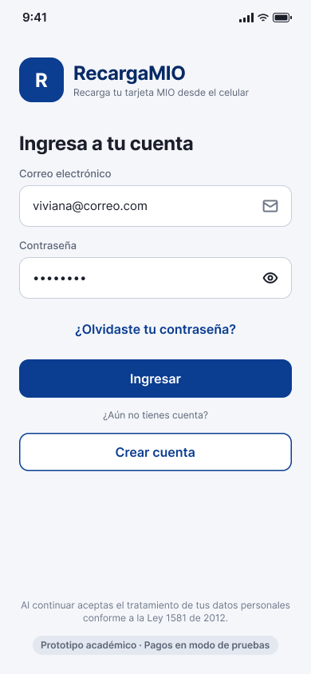
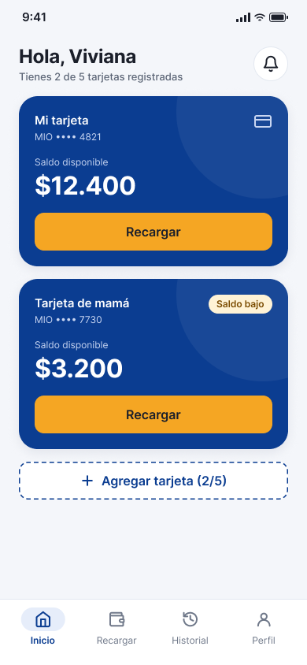
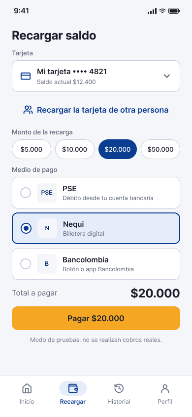
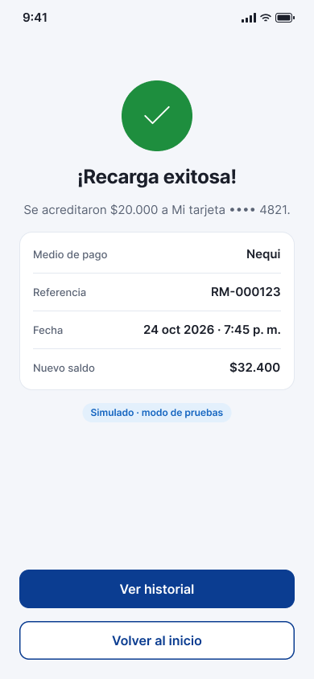
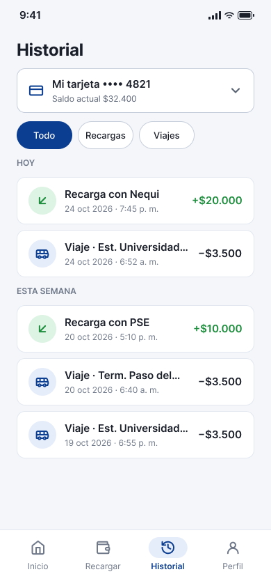
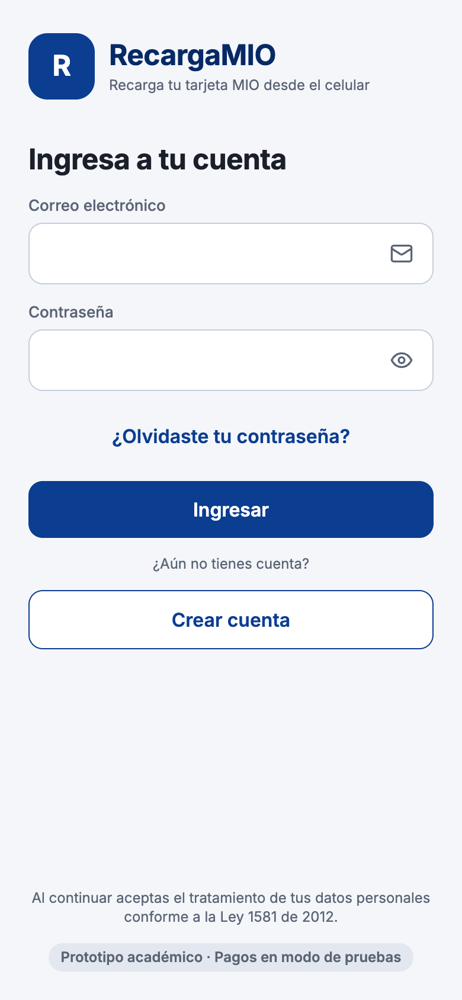
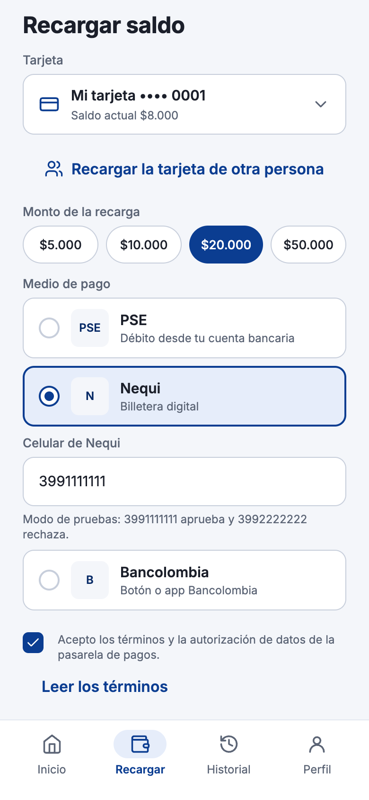
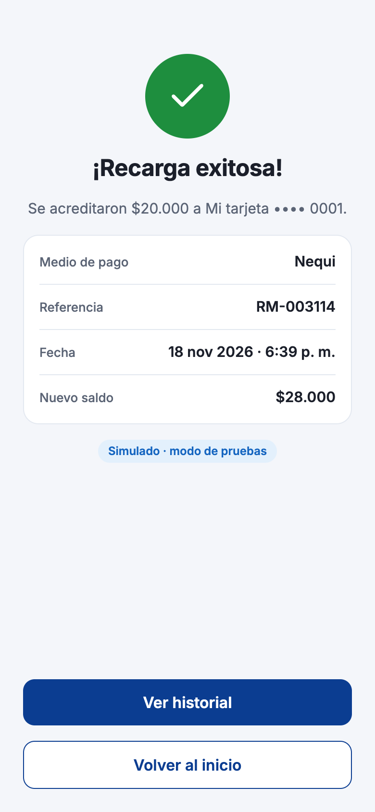
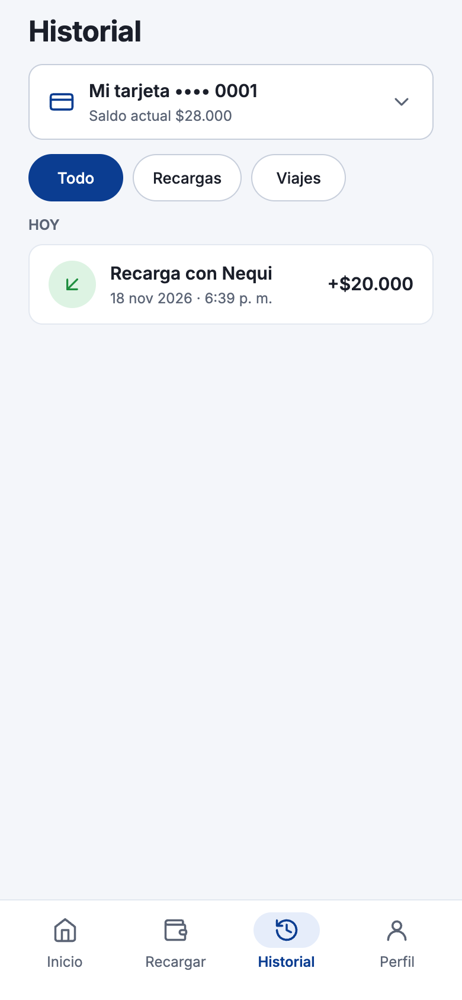

# Insumos para el documento maestro

Este documento reúne lo que falta en el documento maestro de la Fase 4 (*Fase_4_-_Documento_maestro_RecargaMIO_corregido.docx*), listo para copiar en el lugar de cada marcador «[PENDIENTE]». El documento maestro no se modificó: lo actualiza el equipo. Todas las cifras salen de la bitácora y de `docs/metricas/`, con fecha del 18 de noviembre de 2026.

<!-- tabla: Dónde va cada insumo en el documento maestro -->
| Insumo | Dónde va en el documento maestro |
|---|---|
| Ajuste del texto sobre el despliegue | «Desarrollo del prototipo funcional», primer párrafo, y Tabla 14 (fila HT-03) |
| Tabla 17 diligenciada y un párrafo por sprint | «Desarrollo del prototipo funcional», Tabla 17 y el marcador que la sigue |
| Capturas de Figma | Figuras 7 y 8 |
| Capturas de la app | Figura 9 |
| Ajuste de la Tabla 18 | «Plan de pruebas» |
| Resultados de las pruebas | «Resultados de las pruebas» |
| Enlaces | Anexo E |

## 1. Ajuste sugerido: dónde se valida el prototipo

El documento maestro dice que TRL 5 se demuestra con los componentes «desplegados en la nube», y la Tabla 14 llama a HT-03 «Despliegue en la nube y datos de prueba». En la implementación, el equipo decidió validar en un **entorno de pruebas local**: el computador del equipo corre los servicios en Docker y los teléfonos se conectan por la red Wi-Fi (decisión A del ADR 0019). Así se evitan costos, secretos en otro proveedor y un servidor expuesto con datos de personas.

**Hay que elegir una de dos opciones** y, si es necesario, consultarlo con el tutor:
- **Ajustar el texto**, con el párrafo sugerido abajo y la fila de HT-03 como «Despliegue en el entorno de pruebas y datos de prueba».
- **Desplegar en la nube** antes de la validación con usuarios, como una tarea nueva que no está en el plan de implementación.

Párrafo sugerido para el primer párrafo de «Desarrollo del prototipo funcional»:

> El prototipo debe alcanzar el nivel de madurez TRL 5, que corresponde a la validación de los componentes en un entorno relevante (Mankins, 1995). En este proyecto, ese nivel se demuestra cuando la aplicación, la API, la base de datos, la pasarela en modo de pruebas y el servicio simulado de recaudo funcionan integrados en un entorno de pruebas que reproduce el de operación (servicios en contenedores Docker a los que los teléfonos se conectan por la red), y son usados por personas de la población objetivo en teléfonos reales. La Tabla 17 registra el avance de cada sprint y la evidencia que lo respalda.

## 2. Tabla 17 diligenciada

Las columnas son las mismas del documento maestro. Los commits están en el repositorio `https://github.com/josemina/RecargaMio`, y la bitácora explica cada tarea en detalle (Anexo A del manual).

<!-- tabla: Registro de los sprints de desarrollo (Tabla 17 diligenciada) -->
| Sprint | Objetivo del sprint | Incremento esperado | Estado y evidencia |
|---|---|---|---|
| Sprint 0 | Concebir el producto | Diagnóstico, requerimientos y Product Backlog en Jira | [PENDIENTE: lo completa el equipo con la captura del tablero de Jira, que no está en el repositorio] |
| Sprint de diseño | Diseñar la solución | Arquitectura, modelo de datos, diagramas UML y prototipo en Figma | Terminado. Prototipo de alta fidelidad en Figma con 19 pantallas y su sistema de diseño (Anexo E; Figuras 7 y 8). El modelo de datos quedó implementado con Prisma y migraciones (tarea T1; ADR 0003 y 0009) |
| Sprint 1 | Ingresar de forma segura | Registro, inicio de sesión y recuperación de contraseña (HU-06) | Terminado. HU-06 con sus cinco criterios de aceptación cubiertos por pruebas automatizadas (T3). Repositorio en GitHub con integración continua (HT-01: T0 y T12). Pantallas 1.1 a 1.4 en la app (T9 y T10). Commits `66f4d11`, `718fab6` y `cdb906c`; Figura 9 |
| Sprint 2 | Recargar y pagar | Recarga con PSE, Nequi y Bancolombia en modo de pruebas (HU-01, HU-02) | Terminado con la pasarela simulada, que tiene el mismo contrato que Wompi (T2 y T5a). Los doce criterios de aceptación de HU-01, HU-02 y HU-04 están probados, y 200 de 200 recargas se acreditaron con un percentil 95 de 4,0 s. Falta repetir la prueba con el Sandbox de Wompi (T5b). Commits `47722a7` y `718fab6` |
| Sprint 3 | Consultar y recibir alertas | Saldo, historial y alertas de saldo bajo (HU-03, HU-05) | Terminado (T4 y T6). Historial con filtros por recargas y viajes. Alertas con un aviso cada 12 horas como máximo, que llegan a la bandeja de la app; la notificación push en el teléfono espera el proyecto de Firebase. Commits `718fab6` y `cdb906c` |
| Sprint 4 | Administrar varias tarjetas | Hasta cinco tarjetas y recarga a terceros (HU-07, HU-04) | Terminado (T4 y T5a). Límite de cinco tarjetas (`LIMITE_TARJETAS`) y recarga a otra persona con el número escrito dos veces. Commits `718fab6` y `cdb906c` |
| Cierre | Validar el prototipo | Despliegue e informe de pruebas | En curso (T8, T11 y T12). Informe de pruebas frente a la Tabla 9 (sección 6 de este documento), entorno de pruebas, lista OWASP MASVS y revisión automática de accesibilidad. Faltan la prueba SUS con 15 personas, la revisión con TalkBack y la decisión de la sección 1 |

Nota. Las tareas del plan de implementación (T0 a T12) se ejecutaron entre el 17 y el 18 de noviembre de 2026 en el orden del plan, no sprint por sprint. La equivalencia entre tareas, elementos del backlog y sprints está en la bitácora.

### Párrafos por sprint

Para el marcador «Por cada sprint ejecutado, agregar un párrafo…». Las historias y los puntos salen de la Tabla 14; **la revisión con el tutor y la retrospectiva las escribe el equipo**.

**Sprint 1.**
- Historias comprometidas y terminadas: HT-01 (3 puntos) y HU-06 (5 puntos). Puntos completados: 8 de 8.
- La cuenta se crea solo con la autorización expresa de datos, que guarda la versión de la política. El ingreso se bloquea 15 minutos tras cinco intentos fallidos. La recuperación usa un enlace de un solo uso que vence a los 30 minutos.
- Revisión con el tutor: [PENDIENTE].
- Retrospectiva: [PENDIENTE].

**Sprint 2.**
- Historias comprometidas y terminadas: HT-02 (5 puntos), HU-01 (8 puntos) y HU-02 (8 puntos). Puntos completados: 21 de 21, con la pasarela simulada.
- El saldo solo se acredita cuando la pasarela confirma el pago, verificando la firma del webhook, y una sola vez por referencia.
- Revisión con el tutor: [PENDIENTE].
- Retrospectiva: [PENDIENTE].

**Sprint 3.**
- Historias comprometidas y terminadas: HU-03 (5 puntos) y HU-05 (3 puntos). Puntos completados: 8 de 8.
- Revisión con el tutor: [PENDIENTE].
- Retrospectiva: [PENDIENTE].

**Sprint 4.**
- Historias comprometidas y terminadas: HU-07 (5 puntos) y HU-04 (5 puntos). Puntos completados: 10 de 10.
- Revisión con el tutor: [PENDIENTE].
- Retrospectiva: [PENDIENTE].

**Cierre.**
- Historia comprometida: HT-03 (3 puntos), en curso.
- El informe de pruebas está listo; faltan la validación con usuarios y la decisión sobre el despliegue.
- En total van 47 de 50 puntos terminados.

## 3. Capturas de Figma para las Figuras 7 y 8

Las imágenes son las pantallas de alta fidelidad de la página 03 del archivo de Figma, exportadas a 390 px de ancho. La Tabla 15 del documento maestro describe cinco pantallas; las de la Figura 7 son la 1, la 2 y la 3, y las de la Figura 8, la 4 y la 5.

**Para la Figura 7** (inicio de sesión, mis tarjetas y recargar saldo):

**Para la Figura 8** (confirmación e historial):

Nota para el documento maestro: «Elaboración propia a partir del prototipo en Figma».

## 4. Capturas de la app para la Figura 9

La Figura 9 pide la app funcionando «en un teléfono o emulador» (ingreso, recarga, confirmación e historial). Estas capturas son de la app real, en su versión web con el ancho de un teléfono (390 px), contra la API en Docker y con la pasarela simulada. **Cuando el equipo haga la prueba en el teléfono Android, conviene reemplazarlas por capturas del teléfono**; si no, la nota de la figura debe decir que es la versión web.

Nota sugerida: «Elaboración propia. Versión web de la aplicación a 390 px de ancho, conectada a la API en el entorno de pruebas; los pagos usan la pasarela en modo de pruebas».

## 5. Ajuste sugerido a la Tabla 18

La Tabla 18 está bien en sus criterios; solo cambian algunas herramientas frente a lo que se usó. Filas sugeridas:

<!-- tabla: Filas de la Tabla 18 con las herramientas usadas -->
| Tipo de prueba | Alcance | Herramienta | Criterio de aceptación |
|---|---|---|---|
| De API | Puntos de acceso de autenticación, tarjetas, recargas e historial | Postman con Newman (87 aserciones) y contrato OpenAPI | Respuestas y códigos de estado según el contrato |
| De integración | Flujo completo de recarga con la pasarela en modo de pruebas y el recaudo simulado | Script de 200 recargas; pasarela simulada y, después, Sandbox de Wompi | Al menos 200 transacciones; 98 % o más aprobadas |
| De seguridad | Almacenamiento, comunicación, autenticación, manejo de sesiones, dependencias y registros | OWASP ZAP, lista OWASP MASVS, `npm audit` y revisión de registros | Cero hallazgos críticos o altos |
| De accesibilidad | Las 20 pantallas y estados de la app | Prueba automática con Jest, axe-core y TalkBack (VoiceOver queda fuera: iOS no está en el producto mínimo viable) | Cero incumplimientos críticos de nivel A y AA |

## 6. Resultados de las pruebas

Para la sección «Resultados de las pruebas». Las tablas salen de `npm run metricas`.

**Interpretación:**
- Las metas de **tiempo de recarga, éxito de pagos, tiempo de respuesta y seguridad se cumplen** con amplio margen en el entorno de pruebas.
- Con la pasarela simulada, el éxito de pagos mide que el flujo completo no pierde recargas, no la confiabilidad de Wompi. Por eso se repetirá con el Sandbox.
- En accesibilidad, las pruebas automáticas no encuentran incumplimientos críticos después de las correcciones de T11; falta la revisión con TalkBack.
- La **usabilidad (SUS)** queda pendiente de la prueba con 15 personas.

<!-- incluir: ../metricas/resultados.md -->

## 7. Anexo E: enlaces

<!-- tabla: Enlaces del proyecto para el Anexo E -->
| Enlace | Valor |
|---|---|
| Prototipo de interfaz en Figma | El que ya tiene el Anexo E |
| Repositorio del código en GitHub | `https://github.com/josemina/RecargaMio` |
| Video de manejo y funcionamiento | [PENDIENTE: enlace del video] |

**Acceso del tutor al repositorio.** En una cuenta personal de GitHub, un colaborador siempre recibe permiso de escritura. Para darle al tutor solo lectura, el repositorio debe estar en una organización (rol *Read*) o ser público.

## 8. Consentimiento informado

El protocolo de la prueba de usabilidad (capítulo «Validación TRL 5» del manual) usa el consentimiento del **Anexo D** del documento maestro para la firma, y su propio texto para explicarle la prueba a cada participante. Así no hay dos formatos distintos.
