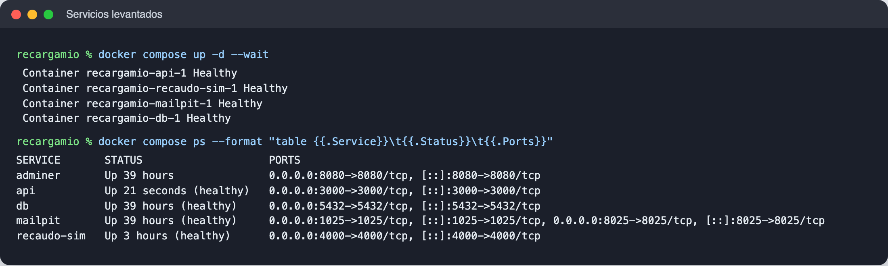
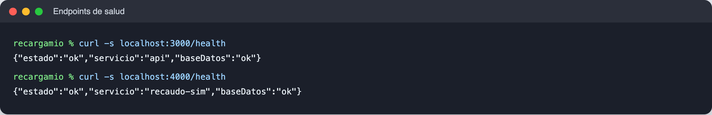
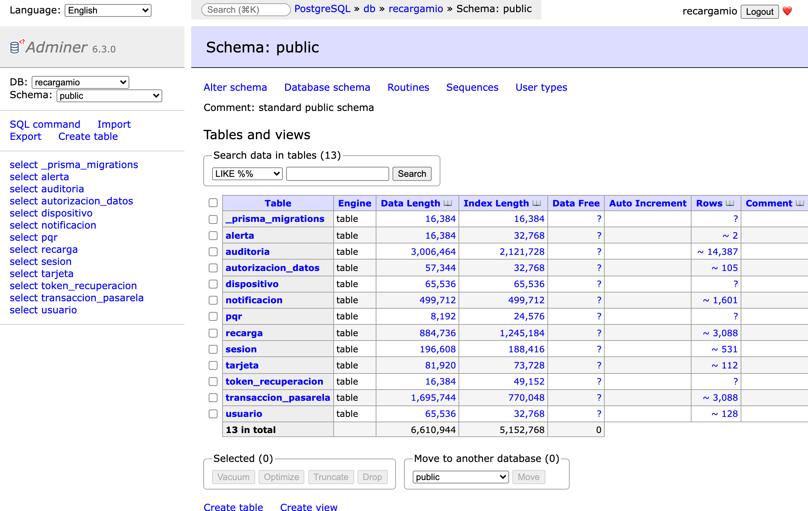
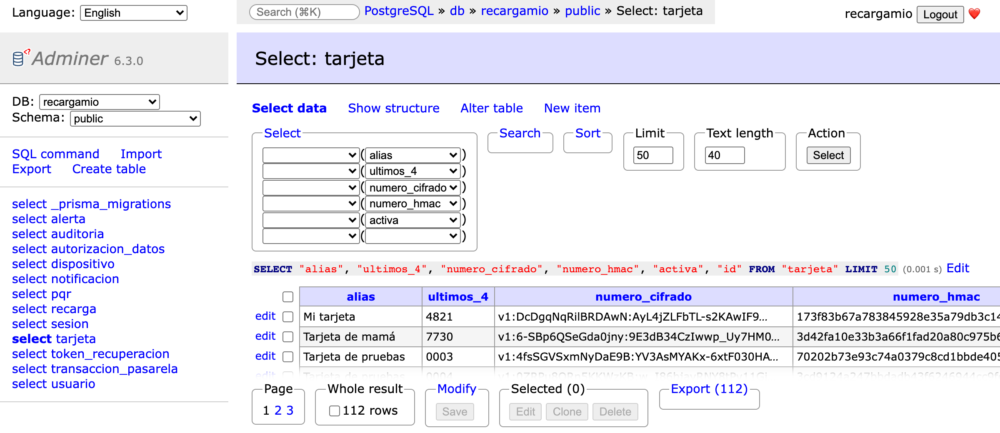
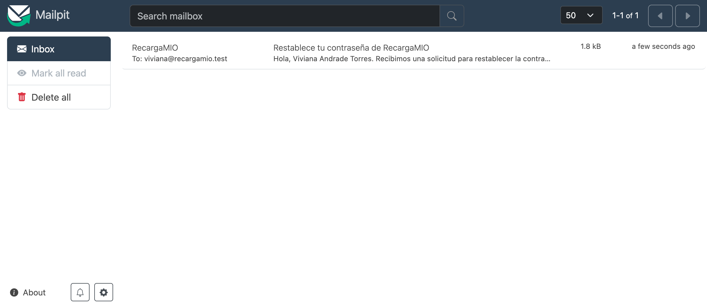
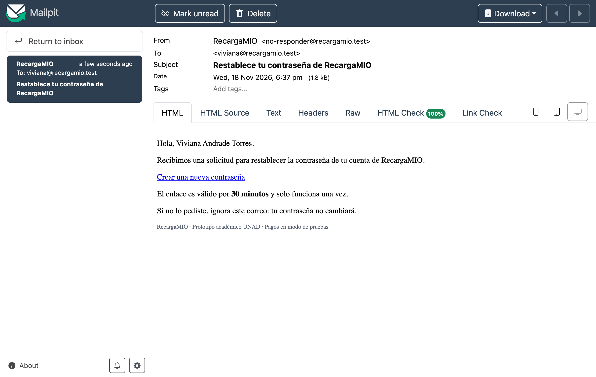
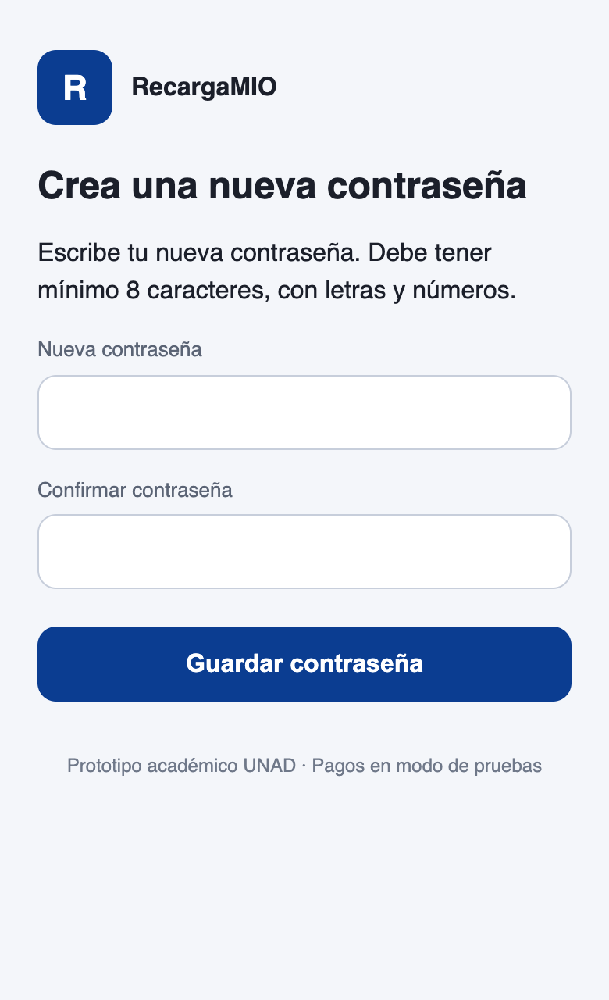
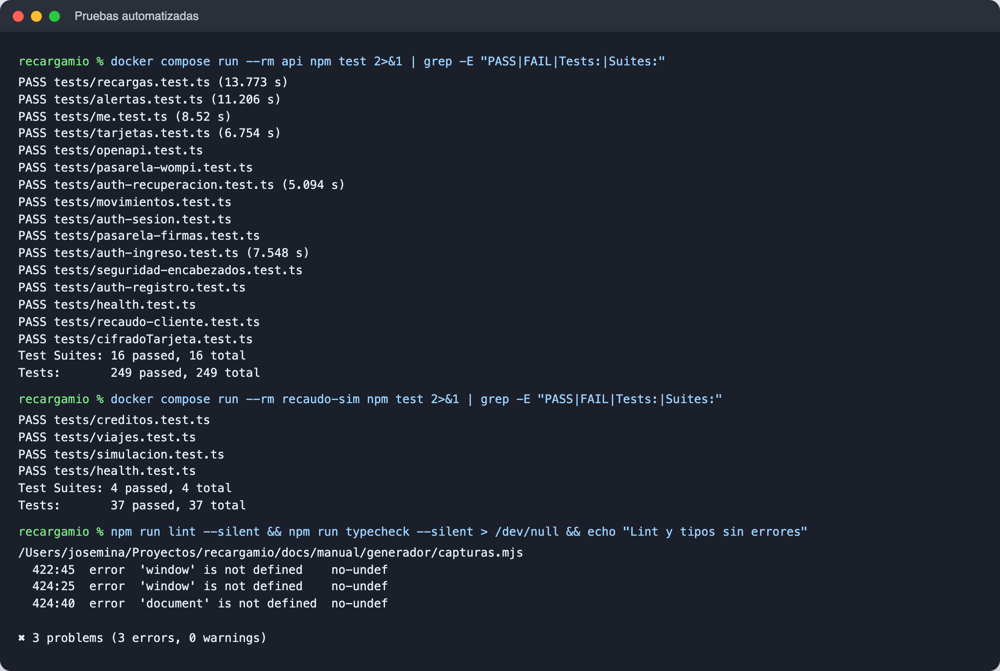
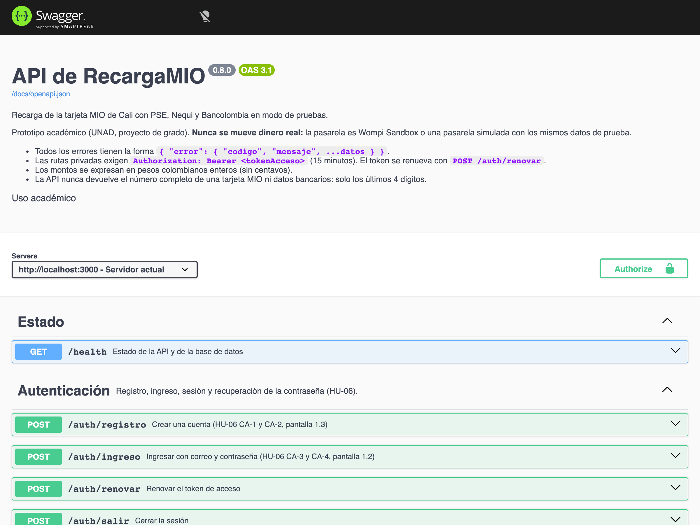

# Manual de instalación y operación

Este capítulo explica cómo instalar, levantar, operar y probar RecargaMIO en un computador de desarrollo. Está escrito para cualquier integrante del equipo, el tutor o un jurado que reciba el repositorio sin haber participado en su construcción.

> **Modo de pruebas.** RecargaMIO es un prototipo académico. Todos los pagos se hacen contra el entorno de pruebas (Sandbox) de la pasarela Wompi y nunca se mueve dinero real.

## Requisitos

<!-- tabla: Requisitos de software -->
| Herramienta | Versión probada | Para qué se usa |
|---|---|---|
| Docker Desktop | 29.9 | Levanta la base de datos, la API, el recaudo simulado y el correo de pruebas |
| Node.js | 22 LTS (22.13 o posterior) | Lint, verificación de tipos, generación del manual y la app móvil |
| npm | 11 | Gestor de paquetes (viene con Node.js) |
| Git | 2.50 | Control de versiones |
| Google Chrome | Cualquiera reciente | Para generar el PDF y las capturas del manual, y para ver el catálogo de la app en la web |
| Expo Go | Compatible con la SDK 58 | App de Android (Play Store) para abrir RecargaMIO en el teléfono durante el desarrollo |

El equipo trabaja en macOS, pero los mismos pasos sirven en Windows (con WSL 2) y en Linux.

> **No guardes el proyecto en OneDrive, iCloud o Google Drive.** La sincronización bloquea archivos mientras Docker y npm escriben, y sube miles de archivos de `node_modules`. Usa una carpeta local, por ejemplo `~/Proyectos/recargamio`, y GitHub como copia de respaldo.

## Instalación paso a paso

### 1. Obtener el código

```bash
git clone <url-del-repositorio> ~/Proyectos/recargamio
cd ~/Proyectos/recargamio
```

### 2. Crear el archivo de variables de entorno

El archivo `.env` guarda las contraseñas y llaves. **Nunca se sube al repositorio** (está en `.gitignore`). Se crea a partir de la plantilla:

```bash
cp .env.example .env
```

Después, reemplaza cada valor `cambiar` por uno propio. Las llaves se generan con `openssl`:

```bash
openssl rand -hex 32
```

<!-- tabla: Variables del archivo .env -->
| Variable | Qué es | Cómo generarla |
|---|---|---|
| `DB_PASSWORD` | Contraseña del usuario `recargamio` de PostgreSQL | `openssl rand -hex 16` |
| `JWT_SECRETO_ACCESO` | Firma de los tokens de acceso (mínimo 32 caracteres) | `openssl rand -hex 32` |
| `JWT_SECRETO_RENOVACION` | Llave del HMAC de los tokens de renovación y de recuperación (mínimo 32 caracteres) | `openssl rand -hex 32`, distinta de la anterior |
| `API_URL_PUBLICA` | Dirección de la API que aparece en el enlace del correo de recuperación | `http://localhost:3000`, o la IP del equipo en la red local para abrirlo desde el teléfono |
| `RECAUDO_API_KEY` | Llave compartida entre la API y el recaudo simulado (mínimo 16 caracteres) | `openssl rand -hex 24` |
| `TARJETA_LLAVE_CIFRADO` | Llave AES-256 para cifrar el número de la tarjeta MIO (64 caracteres hexadecimales) | `openssl rand -hex 32` |
| `TARJETA_LLAVE_HMAC` | Llave para detectar tarjetas repetidas (64 caracteres hexadecimales, distinta de la anterior) | `openssl rand -hex 32` |
| `SEMILLA_CONTRASENA` | Contraseña de la usuaria de prueba que crea el seed (mínimo 8 caracteres) | La que quieras |
| `PASARELA` | `simulada` (por defecto, sin llaves) o `wompi` (Sandbox real) | Déjala en `simulada` hasta tener las llaves |
| `PASARELA_SIMULADA_DEMORA_MS` | Milisegundos que tarda la pasarela simulada en confirmar el pago | `4000` |
| `WOMPI_*` | Llaves del Sandbox de Wompi. Solo se necesitan con `PASARELA=wompi` | Panel de Wompi → Desarrollo → Programadores |
| `FIREBASE_CREDENCIALES_JSON` | Ruta al archivo de la cuenta de servicio de Firebase, para las notificaciones push. Opcional | Déjala como está. En Docker se usa `/app/secrets/firebase.json` |
| `INTERVALO_ALERTAS_MS` | Cada cuánto se revisan las alertas de saldo bajo | `300000` (5 minutos) |
| `PRUEBAS_CONTRASENA` | Contraseña de los usuarios de las pruebas automatizadas (`carga001`…`carga100`, `integracion` y `zap` `@recargamio.test`). Mínimo 8 caracteres con letras y números | La que quieras, distinta de `SEMILLA_CONTRASENA` |
| `CORS_ORIGENES` | Orígenes web a los que la API permite CORS, separados por comas. Vacía por defecto: la app nativa no lo necesita | Déjala vacía. Solo para probar desde un navegador, por ejemplo `http://localhost:8081` |
| `LIMITES_PETICIONES` | `normal` (por defecto) o `desactivados`. No la pongas en `.env`: `npm run pruebas` la cambia y la restaura sola. En producción no se aceptan límites desactivados | No se genera |

> **Llaves de Wompi.** Solo se aceptan llaves de prueba, que empiezan por `pub_test_`, `prv_test_`, `test_events_` y `test_integrity_`. Si ves una llave con otro prefijo, no la uses y avisa al equipo.

> **Si pierdes `TARJETA_LLAVE_CIFRADO`,** las tarjetas ya registradas no se pueden descifrar. En desarrollo basta con reiniciar la base (ver «Reiniciar desde cero»).

### 3. Encender Docker Desktop

Abre Docker Desktop y espera a que diga *Engine running*. Puedes comprobarlo con:

```bash
docker info
```

### 4. Levantar los servicios

```bash
docker compose up -d --wait
```

La primera vez tarda varios minutos porque construye las imágenes. Al terminar, los cuatro servicios deben aparecer como sanos (`healthy`):

```bash
docker compose ps
```



### 5. Crear las tablas de la API y cargar los datos de prueba

El recaudo simulado crea sus tablas solo al arrancar. La API se migra a mano:

```bash
docker compose run --rm api npm run migrar
docker compose run --rm api npm run seed
```

El seed se puede correr varias veces sin duplicar datos.

### 6. Comprobar que todo responde

```bash
curl localhost:3000/health
curl localhost:4000/health
```

Ambos deben responder `"estado":"ok"` con `"baseDatos":"ok"`.



## Servicios y direcciones

<!-- tabla: Servicios y direcciones locales -->
| Servicio | Dirección | Descripción |
|---|---|---|
| API de RecargaMIO | http://localhost:3000 | API REST que usará la app móvil |
| Recaudo simulado | http://localhost:4000 | Emula el sistema de recaudo del MIO |
| PostgreSQL | localhost:5432 | Bases `recargamio` y `recaudo`, más `recargamio_pruebas` y `recaudo_pruebas` para las pruebas |
| Mailpit | http://localhost:8025 | Bandeja que recibe los correos de prueba (recuperar contraseña) |
| Adminer | http://localhost:8080 | Visor de la base de datos (perfil `herramientas`) |
| Documentación de la API | http://localhost:3000/docs | Swagger UI con el contrato OpenAPI (`services/api/openapi.yaml`). No existe en producción |

### Ver la base de datos con Adminer

```bash
docker compose --profile herramientas up -d adminer
```

Abre http://localhost:8080 y entra con estos datos:

<!-- tabla: Datos de acceso a Adminer -->
| Campo | Valor |
|---|---|
| Sistema | PostgreSQL |
| Servidor | `db` |
| Usuario | `recargamio` |
| Contraseña | El valor de `DB_PASSWORD` en tu `.env` |
| Base de datos | `recargamio` (o `recaudo` para el simulador) |





### Ver los correos de prueba con Mailpit

Abre http://localhost:8025. Allí llegan los correos de recuperación de contraseña que envía la API. Ningún correo sale a Internet. El envío tarda uno o dos segundos.





## Datos de prueba

### Usuaria de la API

<!-- tabla: Usuaria de prueba de la API -->
| Campo | Valor |
|---|---|
| Nombre | Viviana Andrade Torres |
| Correo | `viviana@recargamio.test` |
| Contraseña | El valor de `SEMILLA_CONTRASENA` en tu `.env` |
| Autorización de datos | Política versión `1.0` (Ley 1581 de 2012) |
| Tarjetas | `•••• 4821` (Mi tarjeta) y `•••• 7730` (Tarjeta de mamá), con alerta en $5.000 |

### Tarjetas del recaudo simulado

<!-- tabla: Tarjetas del recaudo simulado -->
| Número | Saldo inicial | Uso en las pruebas |
|---|---|---|
| `1234564821` | $12.400 | Tarjeta principal de Viviana |
| `1234567730` | $3.200 | Tarjeta de la mamá (saldo bajo) |
| `9087654321` | $1.000 | Tarjeta de un tercero (recarga a otra persona) |
| `1234560001` | $8.000 | Extra, para probar el límite de 5 tarjetas |
| `1234560002` | $20.000 | Extra, para probar el límite de 5 tarjetas |
| `1234560003` | $6.000 | Sexta tarjeta válida: demuestra que la API rechaza la sexta |
| `1234560009` | $0 | Inactiva o bloqueada |
| `7700000001` a `7730000001` | $10.000 | Reservadas para las pruebas automatizadas de T8 (carga, integración, ZAP y Postman) |
| `7740000001` a `7740000015` | $5.000 | Reservadas para los 15 participantes de la prueba de usabilidad (T11) |

### Probar la autenticación con curl

Estos comandos usan la usuaria de prueba. La contraseña se toma del `.env`, sin escribirla en la terminal:

```bash
export $(grep -E '^SEMILLA_CONTRASENA=' .env)
curl -s -H 'Content-Type: application/json' \
  -d "{\"correo\":\"viviana@recargamio.test\",\"contrasena\":\"$SEMILLA_CONTRASENA\"}" \
  localhost:3000/auth/ingreso
```

La respuesta trae `tokenAcceso` y `tokenRenovacion`. Con el token de acceso se consulta el perfil:

```bash
curl -s -H "Authorization: Bearer <tokenAcceso>" localhost:3000/me
```

Para probar la recuperación de contraseña:

```bash
curl -s -H 'Content-Type: application/json' -d '{"correo":"viviana@recargamio.test"}' localhost:3000/auth/recuperar
```

Luego abre el correo en Mailpit y el enlace. Si cambias la contraseña de Viviana, actualiza `SEMILLA_CONTRASENA` o reinicia la base.

### Probar una recarga con curl

Con la pasarela simulada, el celular de Nequi `3991111111` aprueba y el `3992222222` rechaza:

```bash
curl -s -H "Authorization: Bearer <tokenAcceso>" -H 'Content-Type: application/json' \
  -d '{"tarjetaId":"<id>","monto":20000,"medioPago":"NEQUI","datosMedio":{"celular":"3991111111"},"aceptaTerminosPasarela":true}' \
  localhost:3000/recargas
```

En unos 4 segundos la recarga pasa a `ACREDITADA`. Consulta su estado y el comprobante:

```bash
curl -s -H "Authorization: Bearer <tokenAcceso>" localhost:3000/recargas/<idRecarga>
```

<!-- tabla: Datos de prueba de la pasarela -->
| Medio | Aprueba | Rechaza | Otro valor |
|---|---|---|---|
| Nequi (`datosMedio.celular`) | `3991111111` | `3992222222` | `ERROR` |
| PSE (`datosMedio.codigoBanco`) | `1` (Banco que aprueba) | `2` (Banco que rechaza) | `ERROR` |
| Bancolombia | Siempre aprueba en la pasarela simulada | — | — |

### Probar las alertas de saldo bajo con curl

1. Activa la alerta de la tarjeta de mamá en $5.000. La respuesta trae `saldoBajo: true` porque su saldo es $3.200:

   ```bash
   curl -s -X PUT -H "Authorization: Bearer <tokenAcceso>" -H 'Content-Type: application/json' \
     -d '{"umbral":5000,"activa":true}' localhost:3000/tarjetas/<idTarjetaMama>/alerta
   ```

2. Simula un viaje. El recaudo descuenta el pasaje y avisa a la API en el acto:

   ```bash
   curl -s -X POST -H "X-Api-Key: $(grep ^RECAUDO_API_KEY .env | cut -d= -f2)" -H 'Content-Type: application/json' \
     -d '{"numero":"1234567730"}' localhost:4000/simulacion/viaje
   ```

3. Consulta la bandeja: aparece el aviso «Saldo bajo en Tarjeta de mamá».

   ```bash
   curl -s -H "Authorization: Bearer <tokenAcceso>" localhost:3000/notificaciones
   ```

Un segundo viaje no genera otro aviso: como máximo hay uno cada 12 horas por tarjeta. Para repetir la demostración, desactiva y vuelve a activar la alerta (`"activa":false` y luego `true`), o cambia su valor.

### Probar el perfil y la eliminación de la cuenta con curl

Usa una cuenta de prueba propia, no la de Viviana: eliminar una cuenta no se puede deshacer.

```bash
curl -s -X PATCH -H "Authorization: Bearer <tokenAcceso>" -H 'Content-Type: application/json' \
  -d '{"nombre":"Nombre corregido"}' localhost:3000/me
curl -s -X DELETE -H "Authorization: Bearer <tokenAcceso>" -H 'Content-Type: application/json' \
  -d '{"contrasena":"<tu contraseña>"}' localhost:3000/me
```

La segunda respuesta dice cuántas tarjetas se borraron y cuántas recargas quedaron anonimizadas. El correo de confirmación aparece en Mailpit. Si eliminaste a Viviana por error, vuelve a sembrar la base (ver «Reiniciar desde cero»).

### Activar las notificaciones push (FCM)

Sin Firebase, los avisos quedan en la bandeja de la app (`GET /notificaciones`). Para que lleguen también al teléfono Android:

1. En la consola de Firebase, crea un proyecto y registra la app Android de RecargaMIO.
2. En **Configuración del proyecto → Cuentas de servicio**, genera una llave privada nueva. Descarga el JSON.
3. Guárdalo como `secrets/firebase.json` en la raíz del proyecto. **Nunca lo subas al repositorio**: `secrets/` está en `.gitignore`.
4. Reinicia la API con `docker compose up -d api`. Desde ese momento, `POST /dispositivos` responde `envioPush: true`.

### Cambiar a Wompi Sandbox (T5b)

1. Crea la cuenta de comercio en comercios.wompi.co (persona natural basta). Para Sandbox **no** hace falta subir RUT, cédula ni cuenta bancaria: eso es para producción.
2. Cambia el selector de ambiente del panel a **Sandbox** y copia las cuatro llaves de **Desarrollo → Programadores**.
3. Escríbelas en tu `.env`: `WOMPI_LLAVE_PUBLICA`, `WOMPI_LLAVE_PRIVADA`, `WOMPI_SECRETO_EVENTOS` y `WOMPI_SECRETO_INTEGRIDAD`. Deben empezar por `pub_test_`, `prv_test_`, `test_events_` y `test_integrity_`. **Si alguna tiene otro prefijo, la API no arranca:** no la uses y avisa al equipo.
4. Cambia `PASARELA=wompi` y reinicia la API: `docker compose up -d api`.
5. Para recibir el webhook, levanta el túnel con `docker compose --profile webhooks up tunel`. Copia la URL `https://….trycloudflare.com` que imprime y pégala en el panel de Wompi como URL de eventos, terminada en `/webhooks/wompi`.
6. Sin túnel también funciona: la reconciliación consulta a Wompi cada 30 segundos.

### Probar las tarjetas con curl

Con el `tokenAcceso` del ingreso:

```bash
curl -s -H "Authorization: Bearer <tokenAcceso>" localhost:3000/tarjetas
curl -s -H "Authorization: Bearer <tokenAcceso>" -H 'Content-Type: application/json' \
  -d '{"numero":"9087654321","alias":"Tarjeta de Juan"}' localhost:3000/tarjetas
curl -s -H "Authorization: Bearer <tokenAcceso>" "localhost:3000/tarjetas/<id>/movimientos?tipo=viajes"
```

Para que aparezca un viaje nuevo en el historial, simúlalo en el recaudo:

```bash
curl -s -X POST -H "X-Api-Key: $(grep ^RECAUDO_API_KEY .env | cut -d= -f2)" -H 'Content-Type: application/json' \
  -d '{"numero":"1234564821","ruta":"P47"}' localhost:4000/simulacion/viaje
```

> **Cuidado con el bloqueo.** Cinco contraseñas equivocadas seguidas bloquean el ingreso de esa cuenta durante 15 minutos. Para desbloquearla antes, restablece la contraseña con el enlace del correo.



## App móvil

La app (`apps/mobile`) está hecha con Expo SDK 58, React Native y TypeScript. **No corre en Docker** (decisión D5): se ejecuta en el computador con Expo, y se abre en el teléfono con la app Expo Go o en el navegador. Docker solo se usa para su lint, sus tipos y sus pruebas.

### 1. Instalar las dependencias

Desde la raíz del repositorio (instala la app junto con los servicios):

```bash
npm install
```

### 2. Decirle a la app dónde está la API

```bash
cp apps/mobile/.env.example apps/mobile/.env
```

`npm run demo` hace este paso solo (ver «Preparar la validación con usuarios»). A mano: en `apps/mobile/.env`, cambia `EXPO_PUBLIC_API_URL` por la IP del computador en la red local, por ejemplo `http://192.168.1.10:3000`. En macOS la IP se ve con `ipconfig getifaddr en0`. **No uses `localhost`:** para el teléfono, `localhost` es el propio teléfono. El teléfono y el computador deben estar en la misma red Wi-Fi.

### 3. Abrir la app

```bash
cd apps/mobile && npx expo start
```

<!-- tabla: Formas de abrir la app móvil -->
| Dónde | Cómo | Para qué |
|---|---|---|
| Teléfono Android | Abre Expo Go y escanea el código QR que muestra la terminal | Usar y probar la app de verdad |
| Navegador | Presiona `w` en la terminal, o abre http://localhost:8081 | Revisar el diseño y el catálogo. No es la app final: en la web la sesión no se guarda al recargar |
| Catálogo de componentes | http://localhost:8081/catalogo en el navegador, o el enlace «Ver el catálogo de componentes» en la app | Ver los componentes de la página 02 de Figma. Solo existe en desarrollo |

Las notificaciones push no funcionan en Expo Go: necesitan una *development build* (`npx eas-cli@latest build --profile development --platform android`, con una cuenta de Expo y el archivo `google-services.json` del proyecto de Firebase). Sin ella, los avisos se ven en la campana de la pantalla de inicio.

**Para usar la versión web contra la API** agrega `CORS_ORIGENES=http://localhost:8081` al `.env` de la raíz y reinicia la API (`docker compose up -d api`). En la web la sesión vive en memoria: al recargar la página hay que volver a ingresar. Los datos de prueba de la pasarela simulada son: Nequi `3991111111` aprueba y `3992222222` rechaza; PSE banco «Banco que aprueba».

Las capturas del catálogo, junto a las imágenes de Figma, están en el capítulo de arquitectura (sección «App móvil», «Sistema de diseño»).

### 4. Probar la app

<!-- tabla: Pruebas de la app móvil -->
| Prueba | Comando | Resultado esperado |
|---|---|---|
| Pruebas, en el computador | `npm test --workspace apps/mobile` | Todas en verde |
| Lint, tipos y pruebas, en Docker | `docker compose --profile app run --rm app-pruebas` | Todas en verde |

## Operación diaria

<!-- tabla: Comandos de operación diaria -->
| Tarea | Comando |
|---|---|
| Levantar todo | `docker compose up -d --wait` |
| Ver el estado | `docker compose ps` |
| Ver los registros de la API | `docker compose logs -f api` |
| Ver los registros del recaudo | `docker compose logs -f recaudo-sim` |
| Apagar (conserva los datos) | `docker compose down` |
| Reconstruir después de instalar librerías | `docker compose build && docker compose up -d --wait` |
| Crear una migración nueva de la API | `docker compose run --rm api npx prisma migrate dev --name <nombre>` |

### Reiniciar desde cero

Este comando **borra todos los datos** de las bases locales. Úsalo solo en desarrollo:

```bash
docker compose --profile herramientas down -v
docker compose up -d --wait
docker compose run --rm api npm run migrar
docker compose run --rm api npm run seed
```

### Preparar una demostración

Para devolver los saldos del recaudo simulado a sus valores iniciales sin borrar la base de la API:

```bash
curl -X POST -H "X-Api-Key: $(grep ^RECAUDO_API_KEY .env | cut -d= -f2)" localhost:4000/simulacion/reiniciar
```

### Preparar la validación con usuarios (T11)

Para las sesiones con personas y la revisión con TalkBack, desde la raíz:

```bash
npm run demo
```

Levanta Docker, migra y siembra la base, escribe la IP del computador en `apps/mobile/.env` y comprueba que la API responde en la red local. Después abre la app con `cd apps/mobile && npx expo start --clear`. Al terminar las sesiones, `npm run demo:limpiar` guarda los tiempos de los participantes (sin correos) y borra sus cuentas. El protocolo completo está en el capítulo «Validación TRL 5».

## Pruebas

<!-- tabla: Comandos de prueba -->
| Prueba | Comando | Resultado esperado |
|---|---|---|
| Unitarias de la API | `docker compose run --rm api npm test` | Todas en verde |
| Unitarias del recaudo simulado | `docker compose run --rm recaudo-sim npm test` | Todas en verde |
| Lint y tipos (servicios y app) | `npm install && npm run lint && npm run typecheck` (desde la raíz) | Sin errores |
| Pruebas de la app móvil | `npm test --workspace apps/mobile` o `docker compose --profile app run --rm app-pruebas` | Todas en verde |
| De API, integración, carga, seguridad, accesibilidad, dependencias y registros, más las métricas | `npm run pruebas` (desde la raíz) | Todos los pasos en «OK» y `docs/metricas/resultados.md` actualizado |
| Solo una o algunas | `npm run pruebas -- newman`, `recargas`, `jmeter` o `zap` | La elegida en «OK» |
| Solo las métricas, con los reportes que ya existen | `npm run metricas` | `docs/metricas/resultados.md` actualizado |
| Accesibilidad de las pantallas de la app (T11) | `npm run accesibilidad` | 20 pantallas sin problemas de rol, etiqueta ni tamaño |
| Dependencias (T11) | `npm run dependencias` | Ningún aviso alto o crítico sin justificar |
| Datos sensibles en los registros (T11) | `npm run registros` | Cero coincidencias |
| axe-core sobre la versión web (T11) | `npm run manual:capturas`, con la versión web de Expo levantada | `docs/metricas/datos/axe.json` actualizado |

Las pruebas unitarias usan sus propias bases, `recargamio_pruebas` y `recaudo_pruebas`, y se niegan a correr en cualquier base cuyo nombre no termine en `_pruebas`. Así nunca tocan los datos de la demostración. Las pruebas se llaman igual que los criterios de aceptación del documento maestro, por ejemplo `HU-06 · CA-1` o `HU-05 · CA-2`.



### Pruebas de API, integración, carga y seguridad (T8)

`npm run pruebas` corre las cuatro pruebas de la Tabla 18 desde Docker, en este orden:
1. Reinicia la API con los límites de peticiones desactivados, porque todas las pruebas salen de la misma IP.
2. Crea o restablece los usuarios de pruebas (`npm run seed:pruebas`).
3. **API:** la colección de Postman con Newman.
4. **Integración:** 200 recargas.
5. **Carga:** JMeter con 100 usuarios simultáneos.
6. **Seguridad:** el escaneo de OWASP ZAP.
7. **Accesibilidad de la app** (T11): la prueba automática de las 20 pantallas.
8. **Dependencias** (T11): `npm audit`; falla si hay un aviso alto o crítico sin justificar en `tests/seguridad/dependencias-aceptadas.json`.
9. **Registros** (T11): busca tokens, contraseñas, celulares, correos y llaves en los registros de la API y del recaudo.
10. Calcula las métricas y escribe `docs/metricas/resultados.md`.
11. Restaura la API con los límites normales, aunque alguna prueba falle.

Detalles y decisiones en el ADR 0016.

<!-- tabla: Pruebas de la Tabla 18 que corren desde Docker -->
| Prueba | Servicio de Docker | Usuario | Reporte completo | Meta |
|---|---|---|---|---|
| De API | `newman` | Una cuenta desechable que la colección crea y elimina | `tests/postman/reportes/` | Todas las aserciones en verde |
| De integración | `recargas` | `integracion@recargamio.test` | `docs/metricas/datos/recargas.json` | 200 recargas, 98 % o más acreditadas, tiempo ≤ 180 s |
| De carga | `jmeter` | `carga001` a `carga100@recargamio.test` | `tests/jmeter/reportes/html/index.html` | Percentil 95 ≤ 2 s con 100 usuarios |
| De seguridad | `zap` | `zap@recargamio.test` | `tests/seguridad/reportes/zap.html` | 0 hallazgos altos |

Antes de la primera corrida:
- Agrega `PRUEBAS_CONTRASENA` a `.env` (ver el paso 2 de la instalación).
- Ten espacio libre: la primera vez se descargan las imágenes de Newman, Node, JMeter y ZAP, y la de ZAP ocupa unos 3,5 GB.
- **No cierres la tapa ni suspendas el equipo** mientras corren. Si el equipo entra en reposo, Docker se congela y los tiempos medidos dejan de servir. En macOS, el comando ya evita el reposo por inactividad.

Los reportes completos no se suben a GitHub (están en `.gitignore`), porque pesan y cambian en cada corrida. Lo que se sube es el resumen:
- `docs/metricas/resultados.md`.
- Los JSON pequeños de `docs/metricas/datos/`.

Para la entrega, adjunta los reportes de la corrida final a un *Release* de GitHub.

La colección `tests/postman/RecargaMIO.postman_collection.json` también se puede importar en la app de Postman. Cambia la variable `baseUrl` a `http://localhost:3000` y córrela con *Run collection*.



## Generar este manual

El manual se escribe en Markdown dentro de `docs/manual/` y se convierte a Word y PDF con:

```bash
npm run manual
```

Los archivos quedan en `docs/manual/entregables/`. Para volver a tomar las capturas de evidencia, con los servicios levantados (y, para las capturas de la app, la versión web de Expo en el puerto 8081 y `CORS_ORIGENES=http://localhost:8081` en `.env`; el script crea una cuenta desechable y la elimina al final):

```bash
npm run manual:capturas
```

## Solución de problemas

<!-- tabla: Solución de problemas frecuentes -->
| Síntoma | Causa | Solución |
|---|---|---|
| `Cannot connect to the Docker daemon` | Docker Desktop está apagado | Abre Docker Desktop y espera a *Engine running* |
| `npm error EACCES ... ~/.npm/_cacache` | La caché de npm tiene archivos de `root` (por un `sudo npm` antiguo) | `sudo chown -R $(id -u):$(id -g) ~/.npm` |
| `Bind for 0.0.0.0:5432 failed: port is already allocated` | Hay otro PostgreSQL u otro servicio en ese puerto | Detén el otro servicio o cambia el puerto publicado en `docker-compose.yml` |
| `Falta DB_PASSWORD en .env` al levantar | No existe `.env` o le falta la variable | Repite el paso 2 de la instalación |
| `Configuración inválida: TARJETA_LLAVE_CIFRADO...` | La llave no tiene 64 caracteres hexadecimales | Genérala con `openssl rand -hex 32` |
| La API queda en `unhealthy` | La base no responde o falta una variable | Revisa `docker compose logs api` |
| `api` no arranca y espera a `recaudo-sim` | El recaudo está aplicando sus migraciones | Espera unos segundos. Si falla, revisa `docker compose logs recaudo-sim` |
| `The table ... does not exist` | No se migró la base de la API | `docker compose run --rm api npm run migrar` |
| Las pruebas dicen `Falta DATABASE_URL_PRUEBAS` | Se corrieron fuera de Docker sin `.env` | Córrelas con `docker compose run --rm api npm test` o `docker compose run --rm recaudo-sim npm test` |
| `database "recargamio_pruebas" does not exist` | El volumen de la base se creó antes de T3 | Las pruebas la crean solas con `prisma migrate deploy`. Si falla, reinicia desde cero |
| La API no arranca: `WOMPI_…: debe empezar por …` | Hay una llave de Wompi que no es de prueba | No la uses. Revisa el `.env` y avisa al equipo (regla 1) |
| La API no arranca: `con PASARELA=wompi se necesitan las cuatro llaves` | `PASARELA=wompi` sin las llaves del Sandbox | Agrega las cuatro llaves o vuelve a `PASARELA=simulada` |
| La recarga se queda en `PENDIENTE` | Con Wompi, el webhook no llega (túnel apagado) | Espera la reconciliación (máximo 30 s) o consulta `GET /recargas/:id?actualizar=1` |
| `FALLA_ACREDITACION` | El pago se aprobó pero el recaudo no respondió | Se reintenta sola cada 30 segundos. Revisa `docker compose logs recaudo-sim` |
| `409 RECARGA_EN_CURSO` | Hay una recarga igual pendiente de hace menos de un minuto | Espera su resultado |
| Después de cambiar `schema.prisma`, error de columnas que no existen | El cliente de Prisma de la imagen está desactualizado | `docker compose build api && docker compose up -d api` |
| `503 RECAUDO_NO_DISPONIBLE` al agregar una tarjeta, o saldo «no disponible» en el inicio | El contenedor `recaudo-sim` está apagado o reiniciándose | `docker compose ps` y `docker compose logs recaudo-sim` |
| `422 TARJETA_NO_EXISTE` con un número correcto | El número no está en la semilla del recaudo simulado | Usa una de las tarjetas de la tabla de datos de prueba |
| `409 LIMITE_TARJETAS` | La cuenta ya tiene 5 tarjetas activas | Elimina una con `DELETE /tarjetas/:id` |
| `423 CUENTA_BLOQUEADA` al ingresar | Hubo cinco contraseñas equivocadas seguidas | Espera 15 minutos o usa la recuperación de contraseña |
| `429 DEMASIADAS_PETICIONES` | Se superó el límite de peticiones por IP | Espera 15 minutos o reinicia la API: `docker compose restart api` |
| El correo de recuperación no aparece en Mailpit | El envío tarda un momento, o la API no llega a `mailpit` | Recarga la bandeja. Si sigue sin aparecer, revisa `docker compose logs api` |
| Después de un viaje no aparece el aviso de saldo bajo | Ya hubo un aviso de esa tarjeta en las últimas 12 horas, la alerta está desactivada o el saldo no quedó por debajo del valor elegido | Desactiva y vuelve a activar la alerta, o cambia su valor. Revisa `docker compose logs api` |
| En los registros del recaudo: `No se pudo avisar el viaje a la API` | La API estaba apagada o reiniciándose | No se pierde nada: la revisión de cada 5 minutos encuentra el saldo bajo |
| `POST /dispositivos` responde `envioPush: false` | No existe `secrets/firebase.json` | Es normal sin Firebase: los avisos quedan en la bandeja. Ver «Activar las notificaciones push» |
| `409 RECARGA_EN_CURSO` al eliminar la cuenta | Hay una recarga aprobada sin acreditar, o una pendiente de las últimas 24 horas | Espera a que termine. Con la pasarela simulada, tarda unos segundos |
| `403 CONTRASENA_INCORRECTA` en `PATCH /me` o `DELETE /me` | La contraseña escrita no es la de la cuenta | Revísala. Si la olvidaste, usa la recuperación de contraseña |
| `400` al registrar un dispositivo iOS | iOS está fuera del PMV (decisión D7) | Usa un teléfono Android |
| `npm run pruebas`: `Falta PRUEBAS_CONTRASENA en .env` | `.env` es anterior a T8 | Agrega la variable (ver `.env.example`) |
| Las 200 recargas o JMeter fallan con `429 DEMASIADAS_PETICIONES` | Se corrió un servicio del perfil `pruebas` sin `LIMITES_PETICIONES=desactivados`, y compose recreó la API con los límites | Usa `npm run pruebas -- recargas` en vez de `docker compose run` directo |
| Recargas con tiempos de 600 s o más en las métricas | El equipo entró en reposo durante la prueba | Repite la prueba sin suspender el equipo |
| JMeter tarda muchos minutos en arrancar en un Mac con procesador ARM | Se está usando una imagen solo amd64, que corre emulada | Usa la imagen `alpine/jmeter:5.6.3` de `docker-compose.yml` |
| ZAP falla con `Permission denied` al escribir el reporte | La carpeta `tests/seguridad/reportes` no existe o no tiene permisos de escritura | `mkdir -p tests/seguridad/reportes && chmod 777 tests/seguridad/reportes` |
| Desde un navegador: `blocked by CORS policy` | Por seguridad la API no permite CORS por defecto (hallazgo de ZAP) | Agrega el origen a `CORS_ORIGENES` en `.env` y reinicia la API |
| La app en el teléfono dice «No pudimos conectarnos con RecargaMIO» | `EXPO_PUBLIC_API_URL` tiene `localhost`, el teléfono está en otra red Wi-Fi o el firewall bloquea el puerto 3000 | Usa la IP del computador, la misma red y permite el puerto 3000. Después de cambiar `.env`, reinicia con `npx expo start --clear` |
| Expo Go dice que el proyecto es incompatible | La versión de Expo Go no corresponde a la SDK 58 | Actualiza Expo Go desde la Play Store |
| `Unable to resolve module ...svg` al abrir la app | Metro no tomó `metro.config.js` | Reinicia con `npx expo start --clear` |
| `npm run lint` de la app falla con `contextOrFilename.getFilename is not a function` | Se usó el ESLint 10 de la raíz en lugar del ESLint 9 de la app | Córrelo con `npm run lint --workspace apps/mobile` |
| En la web, la app dice «No pudimos conectarnos con RecargaMIO» | Falta `CORS_ORIGENES=http://localhost:8081` en `.env`, o la API no se reinició después de agregarlo | Agrégalo y corre `docker compose up -d api` |
| En la web, al recargar la página vuelve a pedir el ingreso | Es intencional: en la web la sesión vive solo en memoria (ADR 0017) | Ingresa de nuevo. En el teléfono la sesión se guarda en el almacén seguro |
| `npm run demo` dice que la API no responde por la IP de la red | El firewall bloquea el puerto 3000 o macOS no le dio a la terminal el permiso de «Red local» | Permite el puerto 3000 y, en macOS, activa la terminal en **Ajustes del Sistema → Privacidad y seguridad → Red local**; vuelve a correr `npm run demo` |
| `npm run pruebas` falla en «Dependencias» | `npm audit` encontró un aviso alto o crítico nuevo | Actualiza el paquete o, si no aplica al prototipo, justifícalo en `tests/seguridad/dependencias-aceptadas.json` |
| Las capturas de la app fallan con un tiempo agotado | Se superó el límite de 10 ingresos cada 15 minutos (varias corridas seguidas) | Espera 15 minutos o reinicia la API: `docker compose restart api` |
| `/docs` responde 404 | La API corre con `NODE_ENV=production` | Es intencional: el contrato está en `services/api/openapi.yaml` |
| Fuera de Docker: `Cannot find module '../generated/prisma'` | No se ha generado el cliente de Prisma del simulador | `cd services/recaudo-sim && npm run prisma:generate` |
