# Arquitectura técnica

Este capítulo describe cómo está construido RecargaMIO: sus componentes, cómo se comunican, qué guarda cada base de datos y qué controles de seguridad ya están implementados. Se actualiza al cerrar cada tarea del plan.

## Vista general

RecargaMIO tiene cuatro piezas propias y dos servicios externos:

- **App móvil** (Expo + React Native). Corre en el teléfono o el emulador, fuera de Docker. *Se construye desde T9.*
- **API de RecargaMIO** (Node.js + Express + TypeScript). Atiende a la app, guarda usuarios, tarjetas y recargas, habla con la pasarela de pagos y con el recaudo.
- **Recaudo simulado** (`recaudo-sim`). Emula el sistema de recaudo del MIO: conoce las tarjetas, su saldo y sus viajes, y acredita las recargas.
- **PostgreSQL 16.** Una sola instancia con bases separadas para la API y para el recaudo.
- **Wompi Sandbox** (externo). Pasarela de pagos en modo de pruebas para Nequi, PSE y Bancolombia. *Se integra en T5.*
- **Firebase Cloud Messaging** (externo). Notificaciones de saldo bajo en Android. *Se integra en T6.*

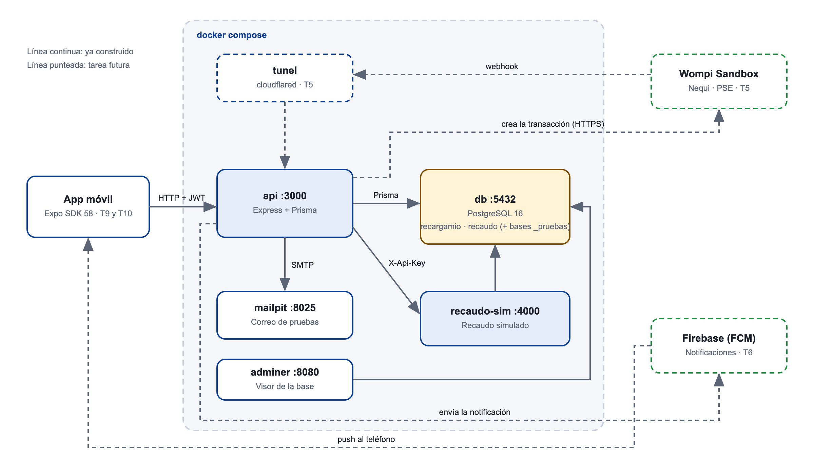

### Servicios en Docker

<!-- tabla: Servicios definidos en docker-compose.yml -->
| Servicio | Imagen | Puerto | Función |
|---|---|---|---|
| `db` | `postgres:16-alpine` | 5432 | Bases `recargamio`, `recaudo`, `recargamio_pruebas` y `recaudo_pruebas` |
| `api` | Construida desde `services/api` | 3000 | API REST |
| `recaudo-sim` | Construida desde `services/recaudo-sim` | 4000 | Recaudo simulado |
| `mailpit` | `axllent/mailpit` | 8025 y 1025 | Correo de pruebas: recibe los enlaces de recuperación de contraseña |
| `adminer` | `adminer` | 8080 | Visor de la base (perfil `herramientas`) |
| `tunel` | `cloudflare/cloudflared` | — | URL pública para el webhook de Wompi (perfil `webhooks`, desde T5) |
| `newman`, `jmeter`, `zap` | Oficiales | — | Pruebas de API, carga y seguridad (perfil `pruebas`, desde T8) |

Las imágenes propias usan un **Dockerfile multietapa**:

- La etapa `desarrollo` recarga el código en caliente y es la que usa `docker compose`.
- La etapa `produccion` compila TypeScript, instala solo las dependencias de ejecución y corre con un usuario sin privilegios (`node`).

### Organización del código

```text
apps/mobile            App Expo SDK 58 + React Native + TypeScript (T9)
  src/app/             Rutas de expo-router: (publico) 1.1–1.4, (app)/(pestanas) 2.1, 3.1, 4.1, 5.1 y catalogo
  src/components/      Los 14 componentes de Figma, la barra de navegación, Icono y Texto
  src/theme/           tokens.ts (variables de Figma) y fuentes.ts (Inter)
  src/api/ y sesion/   Cliente HTTP con renovación del token, errores y almacén seguro
  assets/iconos/       Los 30 íconos SVG exportados de Figma
  __tests__/           Pruebas con jest-expo y Testing Library
services/api           API REST
  prisma/              Esquema, migraciones y seed de la base recargamio
  src/                 Código (app.ts, config.ts, modulos/auth, me (perfil y eliminación), tarjetas, recargas, alertas y notificaciones, middleware/, seguridad/, integraciones/ con pasarela/ y push.ts)
  tests/               Pruebas con Jest y Supertest
  openapi.yaml         Contrato OpenAPI 3.1 de la API (T8)
services/recaudo-sim   Recaudo simulado
  prisma/              Esquema, migraciones y seed de la base recaudo
  src/                 Código (app.ts, servicio.ts, simulacion.ts, semilla.ts)
  tests/               Pruebas contra la base recaudo_pruebas
infra/db/init          Scripts que crean las bases al iniciar PostgreSQL
scripts/               npm run pruebas y npm run metricas (T8)
tests/                 Postman, integración (200 recargas), JMeter y ZAP; reportes en tests/*/reportes/
docs/                  Plan, decisiones (ADR), manual, bitácora y métricas (docs/metricas/)
```

El repositorio es un **monorepo con npm workspaces**: un solo `package-lock.json` en la raíz controla las dependencias de todos los servicios.

## Base de datos de la API (`recargamio`)

<!-- tabla: Tablas de la base de datos recargamio -->
| Tabla | Qué guarda | Notas |
|---|---|---|
| `usuario` | Nombre, correo, hash de la contraseña, intentos fallidos y bloqueo | La contraseña nunca se guarda, solo su hash argon2id. Al eliminar la cuenta, el nombre y el correo se anonimizan (`eliminada_en`, ADR 0015) |
| `autorizacion_datos` | Versión de la política aceptada, fecha e IP | Evidencia de la Ley 1581 de 2012. Nunca se borra |
| `sesion` | HMAC del token de renovación, vencimiento y revocación | Una fila por sesión abierta. La rotación revoca la anterior (ADR 0011) |
| `token_recuperacion` | HMAC del token del enlace de recuperación, vencimiento y uso | Un solo uso y 30 minutos. Nuevo en T3 |
| `tarjeta` | Número cifrado, HMAC del número, últimos 4 dígitos, alias y estado | Máximo 5 activas por usuario. Eliminar es un borrado lógico (`activa = false`) que conserva el historial (ADR 0012) |
| `alerta` | Umbral de saldo bajo y fecha del último aviso | Una por tarjeta. Máximo un aviso cada 12 horas |
| `recarga` | Referencia visible `RM-000123` y referencia en la pasarela `RM-000123-K7Q2`, monto, medio de pago, estado, id de la transacción, URL del banco, motivo, saldo resultante y tiempos | De aquí sale la métrica: `acreditada_en − iniciada_en` ≤ 180 s. Nunca guarda el celular ni el documento del pagador |
| `transaccion_pasarela` | Cada estado informado por la pasarela (webhook, reconciliación o consulta), en una versión saneada | La combinación `id_externo + estado` es única para no procesar un evento dos veces. No guarda el método de pago |
| `dispositivo` | Token de notificaciones FCM por teléfono Android | Un token pertenece a una sola cuenta. Se borra al cerrar sesión o si FCM ya no lo reconoce (ADR 0014) |
| `notificacion` | Avisos al usuario: tipo (`SALDO_BAJO` o `RECARGA_EXITOSA`), título, texto, identificador de la tarjeta o recarga, si se envió por FCM y si se leyó | Bandeja de la app. Existe aunque FCM no esté configurado. Nunca guarda números de tarjeta. Nueva en T6 |
| `auditoria` | Ingresos, recargas, cambios de tarjetas y de alertas | Requisito RF-12. Desde T3 registra registro, ingresos, bloqueos, recuperaciones y salidas |
| `pqr` | Peticiones, quejas y reclamos con número de radicado | Ley 1480 de 2011 |

Estados posibles de una recarga: `PENDIENTE`, `APROBADA`, `ACREDITADA`, `RECHAZADA`, `ERROR` y `FALLA_ACREDITACION`. Medios de pago: `NEQUI`, `PSE` y `BANCOLOMBIA_TRANSFER`.

## Base de datos del recaudo simulado (`recaudo`)

<!-- tabla: Tablas de la base de datos recaudo -->
| Tabla | Qué guarda | Notas |
|---|---|---|
| `tarjeta_recaudo` | Número, saldo y si está activa | El saldo puede quedar negativo después de un viaje (ADR 0010) |
| `credito` | Cada recarga acreditada, con su referencia y el saldo resultante | La `referencia` es única: la misma recarga nunca se suma dos veces |
| `viaje` | Cada validación en un bus o estación, con su ruta y valor | Valor del pasaje: $3.500 |

## Contratos de servicio

### Formato de error

Toda respuesta de error de la API y del recaudo tiene la misma forma:

```json
{ "error": { "codigo": "LIMITE_TARJETAS", "mensaje": "Ya tienes 5 de 5 tarjetas." } }
```

### API de RecargaMIO (estado actual)

El contrato completo, con cuerpos, respuestas y ejemplos, está en `services/api/openapi.yaml` (OpenAPI 3.1) y se consulta en `http://localhost:3000/docs` fuera de producción. Una prueba automatizada exige que el contrato y las rutas del código coincidan (ADR 0016). La tabla resume los endpoints.

<!-- tabla: Endpoints disponibles en la API -->
| Método | Ruta | Qué hace | Respuestas y errores |
|---|---|---|---|
| GET | `/health` | Estado de la API y de la base | 200 o 503 |
| POST | `/auth/registro` | `{ nombre, correo, contrasena, aceptaPolitica: true }`. Crea la cuenta, registra la política 1.0 y abre la sesión | 201. 400 `POLITICA_NO_ACEPTADA` o `DATOS_INVALIDOS`, 409 `CORREO_REGISTRADO` |
| POST | `/auth/ingreso` | `{ correo, contrasena }`. Devuelve el token de acceso (15 min) y el de renovación (7 días) | 200. 401 `CREDENCIALES_INVALIDAS` (con `intentosRestantes`), 423 `CUENTA_BLOQUEADA` (con `desbloqueoEn`) |
| POST | `/auth/renovar` | `{ tokenRenovacion }`. Rota el token y devuelve uno nuevo | 200. 401 `SESION_INVALIDA` o `SESION_EXPIRADA` |
| POST | `/auth/salir` | `{ tokenRenovacion }`. Cierra la sesión | 204 |
| POST | `/auth/recuperar` | `{ correo }`. Envía el enlace por correo. Responde igual exista o no el correo | 200 |
| POST | `/auth/restablecer` | `{ token, contrasena }`. Cambia la contraseña con el enlace | 200. 400 `ENLACE_INVALIDO` |
| GET y POST | `/restablecer?token=` | Página web del enlace del correo, con el formulario de la nueva contraseña | HTML |
| GET | `/me` | Datos del usuario autenticado y versión de la política aceptada. Exige `Authorization: Bearer` | 200. 401 `NO_AUTENTICADO`, `TOKEN_EXPIRADO`, `TOKEN_INVALIDO` o `SESION_INVALIDA` |
| PATCH | `/me` | `{ nombre?, correo?, contrasenaActual? }`. Rectifica los datos. Cambiar el correo exige la contraseña y avisa al correo anterior | 200. 400 `DATOS_INVALIDOS`, 403 `CONTRASENA_INCORRECTA`, 409 `CORREO_REGISTRADO` |
| DELETE | `/me` | `{ contrasena }`. Elimina la cuenta: borra tarjetas, alertas, notificaciones y dispositivos, cierra las sesiones y anonimiza el resto (ADR 0015) | 200 `{ eliminada, tarjetas, recargasAnonimizadas }`. 403 `CONTRASENA_INCORRECTA`, 409 `RECARGA_EN_CURSO` |
| GET | `/tarjetas` | Tarjetas activas con saldo en vivo, `registradas` y `maximo` (HU-07 CA-2, HU-03 CA-1) | 200. Si el recaudo no responde: `saldo: null` y `recaudoDisponible: false` |
| POST | `/tarjetas` | `{ numero, alias }`. Valida con el recaudo y guarda el número cifrado (HU-07 CA-1) | 201. 409 `LIMITE_TARJETAS` o `TARJETA_YA_REGISTRADA`, 422 `TARJETA_NO_EXISTE` o `TARJETA_INACTIVA`, 503 `RECAUDO_NO_DISPONIBLE` |
| GET | `/tarjetas/:id` | Detalle con la última recarga y la alerta (pantalla 2.3) | 200. 404 `TARJETA_NO_ENCONTRADA` |
| PATCH | `/tarjetas/:id` | `{ alias }`. Renombrar (HU-07 CA-4) | 200. 404 |
| DELETE | `/tarjetas/:id` | Eliminar con borrado lógico (HU-07 CA-4) | 204. 404 |
| GET | `/tarjetas/:id/movimientos?tipo=todo\|recargas\|viajes&limite=&antesDe=` | Historial de recargas y viajes con fecha y valor (HU-03 CA-2 y CA-3) | 200, con `siguienteCursor` para paginar |
| GET | `/pasarela/bancos` | Bancos de PSE (caché de 1 hora) | 200 |
| GET | `/pasarela/terminos` | Enlaces a los términos y a la autorización de datos de la pasarela | 200 |
| POST | `/recargas` | `{ tarjetaId \| numeroDestino + confirmacionNumero, monto, medioPago, datosMedio, guardarTarjeta?, aceptaTerminosPasarela: true }`. Inicia el pago | 201 con estado `PENDIENTE` y `urlPago` (PSE y Bancolombia). 400 `NUMEROS_NO_COINCIDEN` o `TERMINOS_PASARELA_NO_ACEPTADOS`, 409 `RECARGA_EN_CURSO`, 422 `TARJETA_NO_EXISTE` o `TARJETA_INACTIVA`, 502 `PASARELA_NO_DISPONIBLE` |
| GET | `/recargas/:id[?actualizar=1]` | Estado, mensaje para la app, tiempo de recarga y comprobante cuando se acredita | 200. 404 `RECARGA_NO_ENCONTRADA` |
| POST | `/webhooks/wompi` | Eventos de la pasarela. Verifica el checksum antes de procesar | 200. 401 `FIRMA_INVALIDA` |
| PUT | `/tarjetas/:id/alerta` | `{ umbral, activa }`. Fija el valor de la alerta entre $3.500 y $50.000, o la desactiva (HU-05 CA-1 y CA-4) | 200 con el detalle de la tarjeta y `saldoBajo`. 400 `DATOS_INVALIDOS`, 404 `TARJETA_NO_ENCONTRADA` |
| POST | `/dispositivos` | `{ token, plataforma: 'android' }`. Registra el token de FCM del teléfono | 201 con `envioPush` (si FCM está configurado). 400 para iOS o un token inválido |
| DELETE | `/dispositivos` | `{ token }`. La app lo quita al cerrar sesión | 204 |
| GET | `/notificaciones?limite=&soloNoLeidas=1` | Bandeja de avisos y cantidad de no leídos (HU-05 CA-2) | 200 |
| POST | `/notificaciones/:id/leida` · `/notificaciones/leidas` | Marca uno o todos como leídos | 204 · 200. 404 `NOTIFICACION_NO_ENCONTRADA` |
| POST | `/internos/recaudo/viajes` | `{ numero }`. Aviso del recaudo después de cada viaje. Exige `X-Api-Key` | 200 `{ revisadas, avisos, sinSaldo }`. 401 `NO_AUTORIZADO` |
| GET | `/docs` · `/docs/openapi.json` | Swagger UI y contrato OpenAPI. Solo fuera de producción (ADR 0016) | 200 |
| `/me/datos`, `/politica`, `/pqr` | — | Fuera del PMV (ADR 0015) | — |

Cualquier ruta responde 429 `DEMASIADAS_PETICIONES` si se supera el límite de peticiones por IP. Solo durante `npm run pruebas` los límites se desactivan con `LIMITES_PETICIONES=desactivados`, que la API no acepta en producción.

### Flujo de la sesión (HU-06)

1. **Ingreso.** La app envía correo y contraseña y recibe dos tokens:
   - **Token de acceso:** dura 15 minutos y va en cada petición como `Authorization: Bearer …`.
   - **Token de renovación:** dura 7 días y se guarda en el almacenamiento seguro del teléfono.
2. **Renovación.** Cuando el token de acceso vence (401 `TOKEN_EXPIRADO`), la app llama a `/auth/renovar`. Recibe un par nuevo y el token de renovación anterior queda revocado.
3. **Cierre por vencimiento.** Si pasan 7 días, o si el usuario cierra sesión o restablece su contraseña, la sesión se cierra y hay que volver a ingresar (HU-06 CA-3).
4. **Reúso sospechoso.** Si alguien intenta usar un token de renovación ya rotado, la API lo trata como un posible robo y cierra todas las sesiones del usuario.

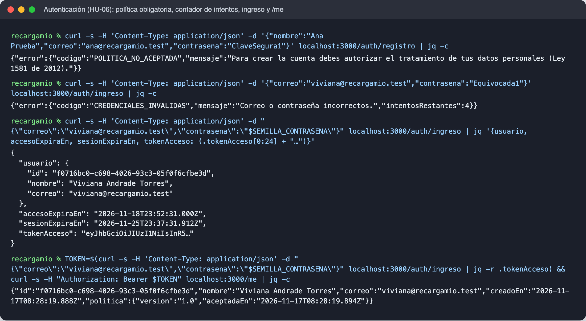

### Tarjetas e historial (HU-07 y HU-03)

- **Cómo se agrega una tarjeta.** Antes de guardarla, la API pregunta al recaudo si existe y está activa. El número se guarda cifrado (ADR 0009) y la app solo recibe los últimos cuatro dígitos.
- **Saldo en vivo.** Se consulta al recaudo cada vez que se abre el inicio.
- **Historial.** Combina dos fuentes, como lo haría el sistema real: las **recargas acreditadas**, que guarda RecargaMIO, y los **viajes**, que solo conoce el recaudo.

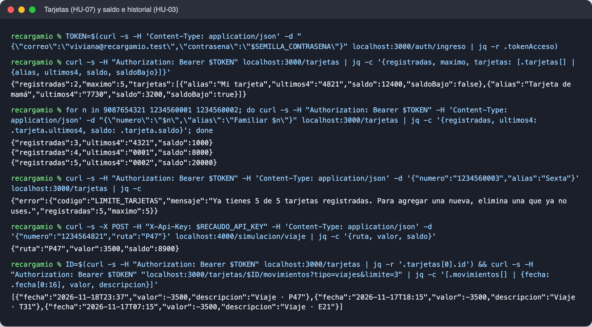

### Flujo de una recarga (HU-01, HU-02 y HU-04)

1. **La app inicia el pago** con `POST /recargas`. La API valida el monto, que la tarjeta exista y esté activa en el recaudo y que no haya una recarga igual en curso. Crea la recarga `PENDIENTE` con la referencia `RM-000123` y la transacción en la pasarela.
2. **El usuario autoriza el pago en su banco o en su billetera**, nunca dentro de la app (HU-02 CA-2):
   - Con **Nequi**, en la app de Nequi.
   - Con **PSE y Bancolombia**, en la página del banco (`urlPago`).
3. **La app muestra «Esperando confirmación»** (pantalla 3.3) y consulta `GET /recargas/:id` cada 3 segundos.
4. **La pasarela avisa al webhook.** La API verifica la firma, guarda el evento sin datos de pago y, si es `APPROVED` con el monto correcto, pide al recaudo acreditar el saldo con la referencia. Esa operación es idempotente.
5. **La recarga queda `ACREDITADA`** con el nuevo saldo, y la app muestra el comprobante (pantalla 3.4). Si el pago se rechazó, queda `RECHAZADA` (pantalla 3.5) y el saldo no cambia.
6. **Si el webhook no llega**, la reconciliación lo resuelve en máximo 30 segundos consultando la pasarela.

La pasarela se elige con `PASARELA`:
- `simulada`: con los datos de prueba de Wompi, sin Internet y sin llaves.
- `wompi`: el Sandbox real.

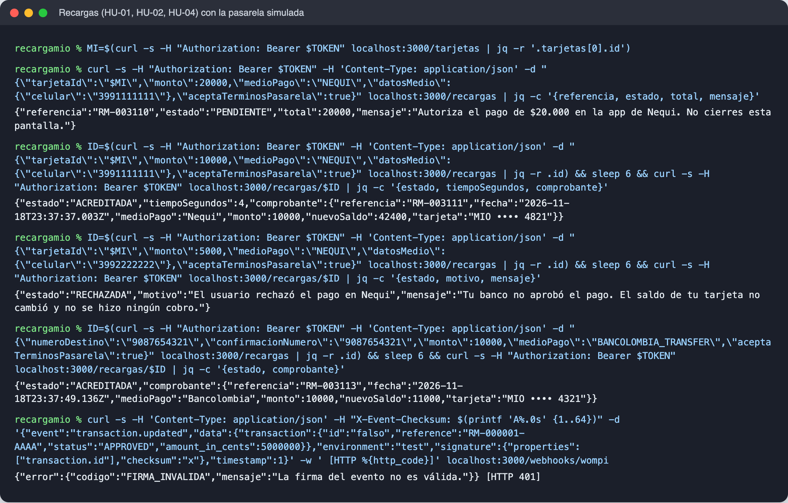

### Alertas de saldo bajo (HU-05)

1. **El usuario fija el valor de la alerta** de cada tarjeta en la pantalla 4.2 (`PUT /tarjetas/:id/alerta`). Desde ese momento, Inicio muestra la etiqueta «Saldo bajo» si el saldo está por debajo (CA-3).
2. **Se revisan los saldos en dos momentos:**
   - **Justo después de cada viaje:** el recaudo avisa a la API con `POST /internos/recaudo/viajes`.
   - **Cada 5 minutos,** como respaldo, para todas las alertas activas.
3. **Si el saldo quedó por debajo y pasaron 12 horas desde el último aviso,** la API reserva el aviso (solo una revisión gana aunque coincidan varias) y lo guarda en la bandeja (`notificacion`).
4. **Si FCM está configurado,** lo envía también a los teléfonos Android de la cuenta (CA-2). Sin FCM, el aviso queda solo en la bandeja de la app (ADR 0007).
5. **Al acreditar una recarga** se usa el mismo camino para el aviso «Recarga exitosa» de la pantalla 4.3.

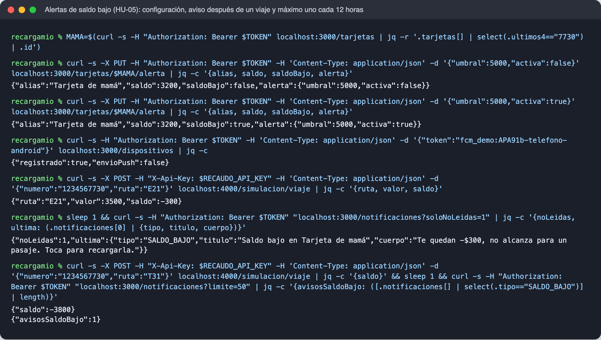

### Perfil y eliminación de la cuenta (T7)

- **Rectificar:** `PATCH /me` cambia el nombre o el correo. El correo exige la contraseña actual.
- **Eliminar:** `DELETE /me`, confirmado con la contraseña, hace en una sola transacción lo que describe la tabla del ADR 0015:
  - **Borra** las tarjetas, las alertas, las notificaciones, los dispositivos y los enlaces de recuperación.
  - **Revoca** todas las sesiones.
  - **Anonimiza** el nombre, el correo y el número de destino de las recargas.
  - **Conserva** la autorización de datos y la auditoría.
- **Recargas en curso:** no se puede eliminar la cuenta mientras haya una recarga aprobada sin acreditar o una pendiente reciente.

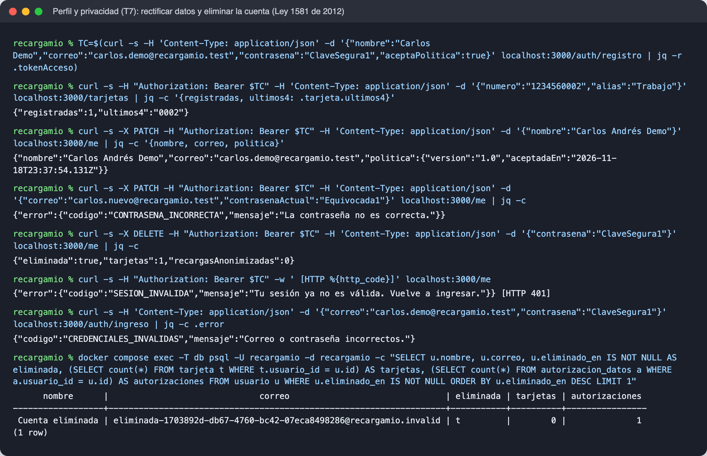

### Recaudo simulado

Todas las rutas, salvo `/health`, exigen el encabezado `X-Api-Key`.

<!-- tabla: Endpoints del recaudo simulado -->
| Método | Ruta | Respuesta | Errores |
|---|---|---|---|
| GET | `/tarjetas/:numero` | `{ numero, existe, activa, saldo }` | 404 `TARJETA_NO_EXISTE` |
| POST | `/tarjetas/:numero/creditos` | 201 si es nuevo, 200 con `duplicado: true` si la referencia ya se aplicó | 409 `REFERENCIA_EN_CONFLICTO`, 422 `TARJETA_INACTIVA`, 503 `FALLA_SIMULADA` |
| GET | `/tarjetas/:numero/viajes?desde=&hasta=&limite=` | `{ numero, viajes: [...] }`, del más reciente al más antiguo. `hasta` es exclusivo y sirve para paginar | 404 |
| POST | `/simulacion/viaje` | Descuenta $3.500, devuelve el saldo nuevo y avisa a la API (`API_AVISOS_URL`) para revisar las alertas | 404, 422 |
| POST | `/simulacion/latencia` | Fija `{ demoraMs, tasaFallos }` para los créditos | 400 |
| POST | `/simulacion/reiniciar` | Devuelve los saldos semilla y borra créditos y viajes | — |

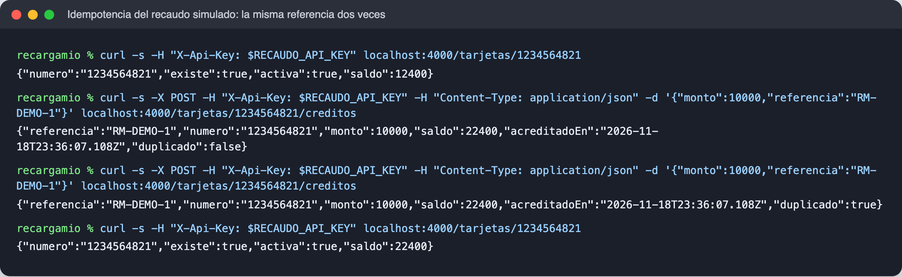

## App móvil (T9)

La app es la capa de presentación de la arquitectura: llama a la API por HTTP con el token de acceso en `Authorization: Bearer` y nunca habla con Wompi ni con el recaudo. Las decisiones están en el ADR 0017.

<!-- tabla: Tecnologías de la app móvil -->
| Necesidad | Librería |
|---|---|
| Base | Expo SDK 58, React Native 0.88, React 19.3 y TypeScript 6 |
| Navegación | `expo-router` con rutas protegidas y pestañas |
| Datos del servidor | `@tanstack/react-query` (caché; no reintenta los pagos) |
| Sesión | `expo-secure-store` para el token de renovación; el token de acceso, solo en memoria |
| Fuente | Inter incluida en la app (`@expo-google-fonts/inter`) |
| Íconos y gráficos | Los SVG de Figma con `react-native-svg` y `react-native-svg-transformer` |
| Pruebas | `jest-expo` y Testing Library 14 |

### Sistema de diseño

`src/theme/tokens.ts` copia las variables de Figma (página 02): 22 colores, 7 espacios, 5 radios, la sombra de la tarjeta y los 11 estilos de texto de Inter. Ningún componente escribe un color o un tamaño a mano.

<!-- tabla: Componentes de la app y su origen en Figma -->
| Componente | Nodo de Figma | Variantes | Accesibilidad |
|---|---|---|---|
| `Boton` | 9:216 | Primario, Acento, Secundario, Texto y Peligro; normal, deshabilitado y cargando | `button`, 48 px de alto |
| `Chip` | 9:223 | Inactivo y activo | `radio`; 40 px dibujados y 44 táctiles |
| `Interruptor` | 9:230 | Activado y desactivado (SVG de Figma) | `switch` con etiqueta obligatoria; 44 táctiles |
| `Casilla` | 9:237 | Marcada y vacía | `checkbox`; área de 44 × 44 |
| `Insignia` | 9:250 | Advertencia, éxito, info, error y neutral | Texto |
| `Aviso` | 9:275 | Info, éxito, advertencia y error | Los errores y advertencias se anuncian solos |
| `CampoTexto` | 11:40 | Normal, foco y error; contraseña con ojo | Etiqueta visible y accesible; el error reemplaza la ayuda |
| `TarjetaMIO` | 11:78 | Saldo normal y bajo; saldo no disponible | Resumen hablado: alias, últimos 4 dígitos y saldo en pesos |
| `OpcionPago` | 11:96 | No seleccionada y seleccionada | `radio`, 64 px |
| `Movimiento` | 11:122 | Recarga y viaje | Se lee completo: qué, cuándo y cuánto |
| `BarraNavegacion` | 11:229 | Inicio, Recargar, Historial y Perfil | `tablist` y `tab` con estado seleccionado |
| `BarraSuperior` | 11:232 | Con Atrás y acción opcional | Título como encabezado; botones de 44 × 44 |
| `FilaAjuste` | 11:270 | Navegación, interruptor y peligro | Toda la fila es un solo control |
| `FilaDetalle` | 11:273 | Etiqueta y valor | Se lee como par etiqueta-valor |
| `SelectorTarjeta` | 11:278 | Una variante | `button` con pista «Abre la lista de tus tarjetas» |

El marco «Barra de estado» (9:163) no es un componente: la barra la dibuja el sistema operativo.

El texto respeta el tamaño de letra del teléfono hasta el doble. Por eso los componentes tienen alto mínimo y no alto fijo.

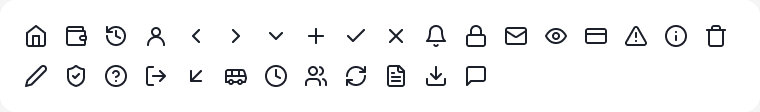

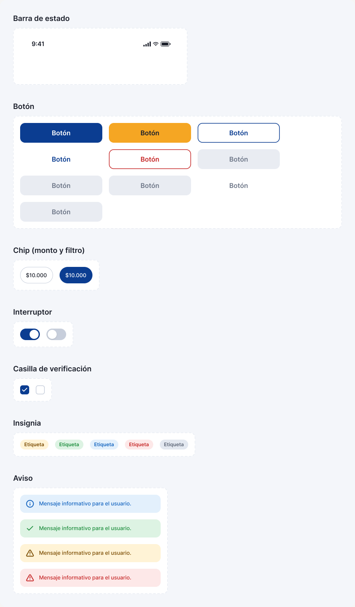

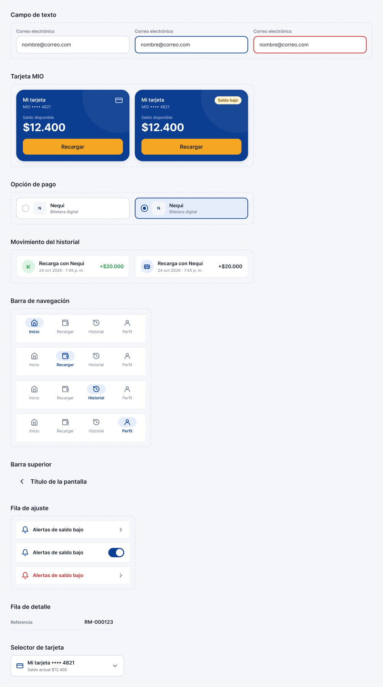

Las mismas secciones, construidas en la app, se ven en la pantalla de catálogo (`/catalogo`), aquí en la versión web con el ancho de Figma (390 px). Es el criterio de aceptación de T9.

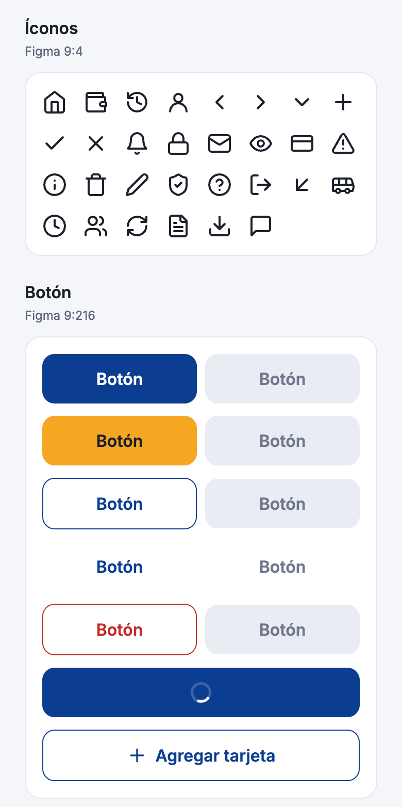

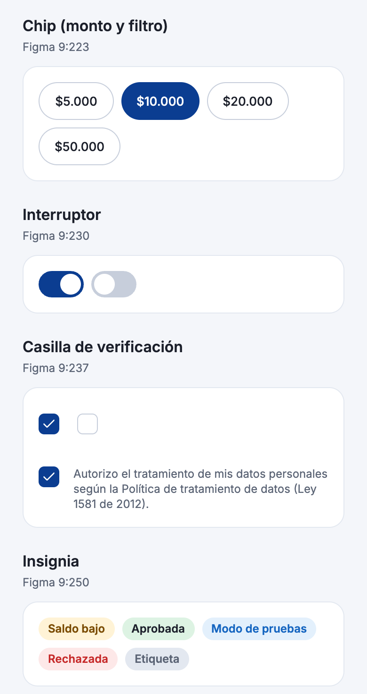

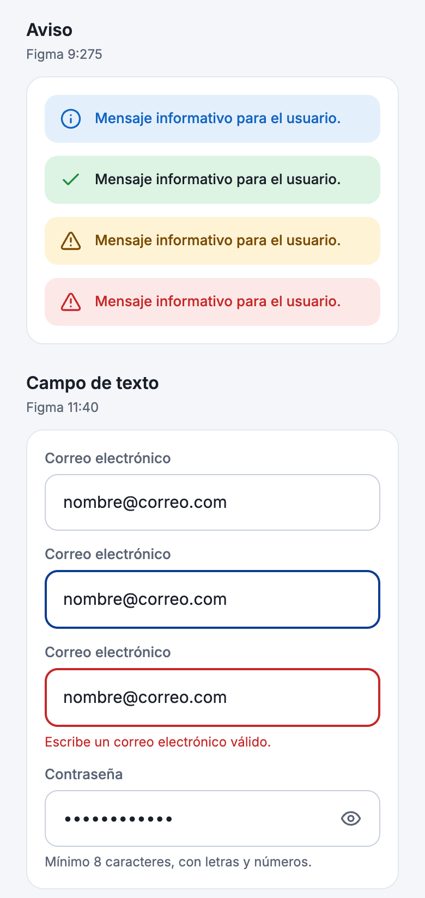

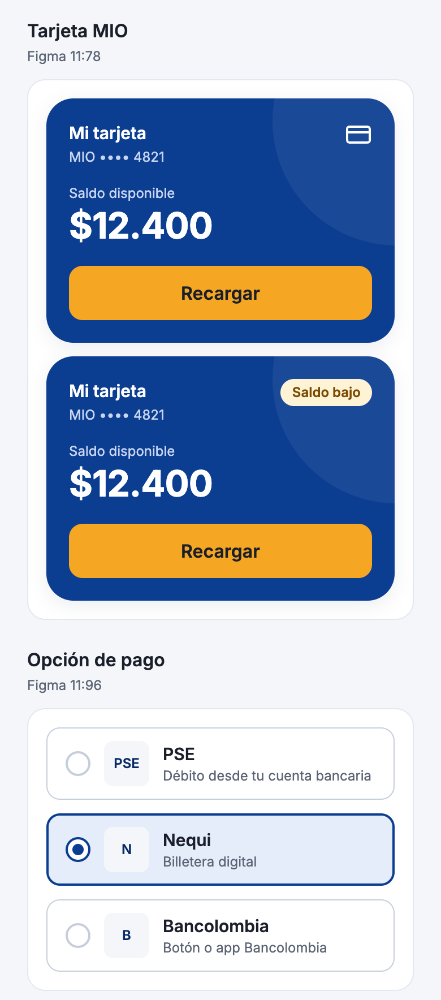

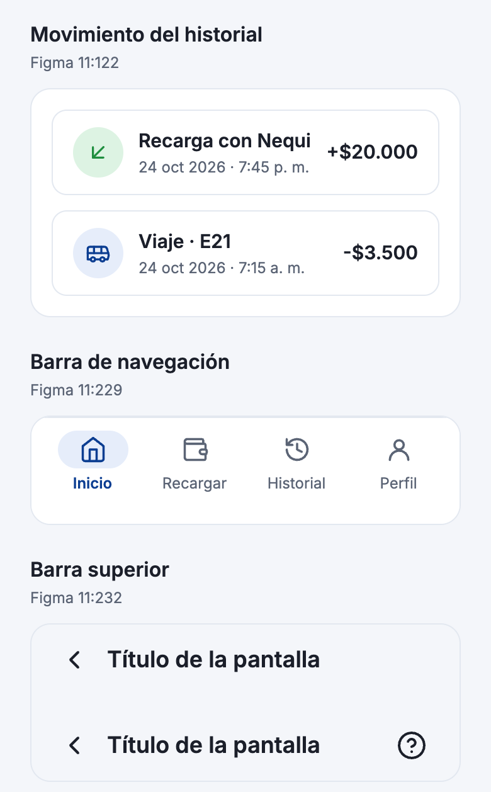

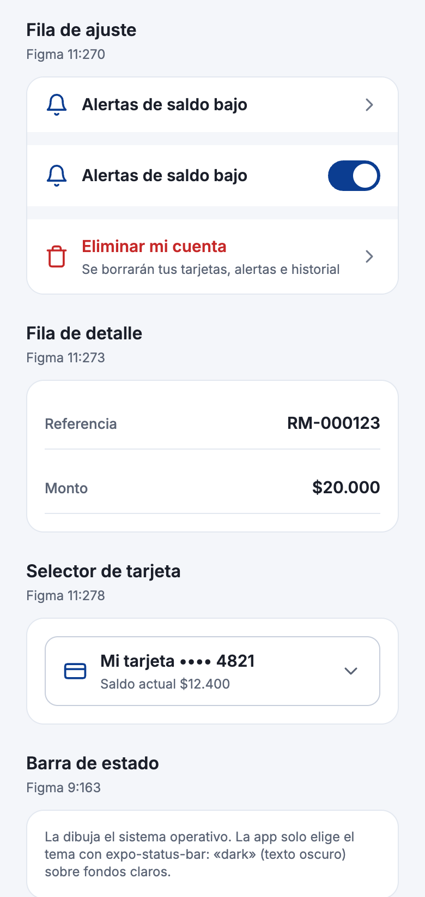

### Sesión en el teléfono

1. Al ingresar, la app guarda el token de renovación en el almacén seguro del teléfono (Keystore en Android) y deja el de acceso en memoria.
2. Cada petición lleva el token de acceso. Treinta segundos antes de que venza, o si la API responde 401, el cliente lo renueva con `POST /auth/renovar` y repite la petición una sola vez.
3. Si varias peticiones necesitan renovar a la vez, hacen **una sola** renovación: el token de renovación es de un solo uso y dos renovaciones simultáneas cerrarían la sesión.
4. Si la renovación falla (sesión cerrada, vencida o cuenta eliminada), la app borra el token y vuelve a la pantalla 1.1.
5. Al abrir la app, si hay un token guardado, la sesión se recupera sin pedir la contraseña. Sin conexión, la sesión se conserva para intentarlo después.

### Navegación y pantallas (T10)

<!-- tabla: Rutas de la app y pantallas de Figma -->
| Ruta | Pantallas de Figma | Qué usa de la API |
|---|---|---|
| `/` sin sesión, `/registro`, `/recuperar` | 1.1 (con su estado de error 1.2), 1.3 y 1.4 | `/auth/ingreso`, `/auth/registro`, `/auth/recuperar` |
| `/politica` | Política de tratamiento de datos (borrador; sin pantalla en Figma) | — |
| `/` con sesión | 2.1 Mis tarjetas | `GET /tarjetas`, `GET /notificaciones` |
| `/tarjetas/agregar`, `/tarjetas/[id]` | 2.2 y 2.4, y 2.3 | `POST /tarjetas`, `GET`, `PATCH` y `DELETE /tarjetas/:id`, `PUT /tarjetas/:id/alerta` |
| `/recargar`, `/recarga/tercero` | 3.1 y 3.2 | `GET /pasarela/bancos` y `/terminos`, `POST /recargas` |
| `/recarga/[id]` | 3.3, 3.4 y 3.5, según el estado | `GET /recargas/:id` cada 2 s; `?actualizar=1` |
| `/historial` | 4.1 | `GET /tarjetas/:id/movimientos` |
| `/alertas`, `/notificaciones` | 4.2 y la bandeja de avisos | `PUT /tarjetas/:id/alerta`, `GET /notificaciones`, `POST /notificaciones/leidas` |
| `/perfil`, `/privacidad`, `/datos-personales`, `/ayuda` | 5.1, 5.2, rectificación y 5.3 | `GET`, `PATCH` y `DELETE /me` |
| `/catalogo` | Página 02 · Sistema de diseño (solo en desarrollo) | — |

Las rutas son protegidas (`Stack.Protected`): sin sesión, cualquier ruta de `(app)` lleva a la 1.1. Las decisiones sobre lo que Figma no dibuja están en el ADR 0018:
- Datos de Nequi y PSE debajo del medio elegido.
- Términos de la pasarela.
- «Volver al inicio» en lugar de «Cancelar recarga».
- El borrador de la política.
- Los diálogos.

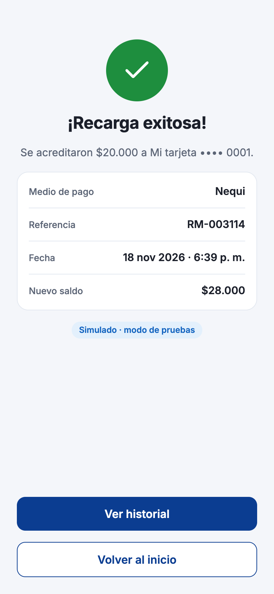

### Notificaciones push en la app

En una *development build* de Android, la app pide el permiso, crea el canal `alertas` y registra el token de FCM en `POST /dispositivos`. Al cerrar sesión lo quita con `DELETE /dispositivos`. Al tocar un aviso se abre el comprobante de la recarga o la recarga de la tarjeta con saldo bajo.

En Expo Go y en la web no hay push: los avisos quedan en la bandeja de la app.

## Seguridad y privacidad implementadas

<!-- tabla: Controles de seguridad y privacidad implementados -->
| Control | Cómo se cumple | Dónde | Norma |
|---|---|---|---|
| Secretos fuera del código | Todo sale de `.env`, que está en `.gitignore`. La configuración se valida con `zod` al arrancar | `src/config.ts` | MASVS-STORAGE |
| Contraseñas | Hash argon2id. Mínimo 8 caracteres, con letras y números | `modulos/auth/servicio.ts` | MASVS-CRYPTO, RNF-03 |
| Sesiones | Token de acceso JWT de 15 minutos. Token de renovación opaco de 7 días, rotativo, con detección de reúso. En la base solo se guarda su HMAC | `seguridad/tokens.ts`, `middleware/autenticar.ts` (ADR 0011) | MASVS-AUTH, RNF-03 |
| Bloqueo por intentos | Cinco intentos fallidos bloquean el ingreso 15 minutos | `modulos/auth/servicio.ts` | MASVS-AUTH, HU-06 CA-4 |
| Recuperación de contraseña | Enlace de un uso y 30 minutos. Respuesta idéntica exista o no el correo. Al restablecer se cierran todas las sesiones | `modulos/auth/servicio.ts` | MASVS-AUTH, HU-06 CA-5 |
| Límite de peticiones | Por IP: 10 ingresos cada 15 minutos, 5 recuperaciones cada 15 minutos y 300 peticiones generales | `middleware/limites.ts` | MASVS-RESILIENCE |
| Auditoría | Registro, ingresos exitosos y fallidos, bloqueos, renovaciones, reúso de tokens, recuperación y salida. Sin contraseñas ni tokens | `auditoria.ts` | RF-12 |
| Registros sin secretos | Se ocultan el encabezado `Authorization` y el token de la URL de `/restablecer` | `app.ts` | MASVS-STORAGE |
| Número de la tarjeta MIO | Cifrado AES-256-GCM con IV aleatorio y HMAC-SHA256 para detectar duplicados. Solo se muestran los últimos 4 dígitos | `src/seguridad/cifradoTarjeta.ts` (ADR 0009) | MASVS-STORAGE, Ley 1581 |
| Autorización de datos | No se crea un usuario sin `aceptaPolitica: true`. Se registran la versión de la política (1.0), la fecha y la IP | Tabla `autorizacion_datos` | Ley 1581 de 2012, HU-06 CA-2 |
| Comunicación entre la API y el recaudo | Llave `X-Api-Key` comparada en tiempo constante. Desde T11 el recaudo no la escribe en sus registros | `recaudo-sim/src/autenticacion.ts`, `recaudo-sim/src/app.ts` | MASVS-NETWORK, MASVS-STORAGE |
| Validación de entradas | Esquemas `zod` en cada ruta. Prisma usa consultas parametrizadas: no hay SQL concatenado | Rutas de la API y del recaudo | MASVS-CODE |
| Encabezados HTTP | `helmet` y sin `x-powered-by` | `app.ts` de ambos servicios | MASVS-NETWORK |
| Idempotencia del saldo | Restricción única en `credito.referencia`, probada con 10 peticiones simultáneas | `recaudo-sim/src/servicio.ts` | Regla 3 de `CLAUDE.md` |
| Datos bancarios | La app y la API nunca guardan números de cuentas ni de tarjetas bancarias | Diseño del modelo de datos | Regla 2 de `CLAUDE.md` |
| Acceso a tarjetas ajenas | Cada consulta filtra por el usuario de la sesión. La tarjeta de otro usuario responde 404, sin revelar que existe | `modulos/tarjetas/servicio.ts` | MASVS-AUTH (control de acceso) |
| Límite de cinco tarjetas | Se verifica dos veces, la segunda dentro de una transacción con bloqueo por usuario, para que no lo superen peticiones simultáneas | `modulos/tarjetas/servicio.ts` | HU-07 CA-3 |
| Respuestas del recaudo | Validadas con `zod`, tiempo máximo de 3 segundos y registros con el número enmascarado | `integraciones/recaudo.ts` | MASVS-CODE, MASVS-NETWORK |
| Credenciales de Wompi | La API no arranca si una llave no tiene prefijo de prueba (`pub_test_`, `prv_test_`, `test_events_`, `test_integrity_`) | `config.ts` | Regla 1 de `CLAUDE.md` |
| Webhook firmado | Checksum SHA256 verificado antes de usar el evento, comparado en tiempo constante. Firma falsa: 401 y auditoría | `integraciones/pasarela/firmas.ts`, `modulos/recargas/rutas.ts` | Regla 4 de `CLAUDE.md`, MASVS-NETWORK |
| Acreditación segura | Solo con `APPROVED` y con el monto exacto. Idempotente por referencia. Los eventos repetidos se descartan | `modulos/recargas/servicio.ts` | Regla 3 de `CLAUDE.md`, RNF-02 |
| Datos de pago solo en tránsito | El celular de Nequi y el documento de PSE no se guardan ni se registran. Del evento se guarda una versión sin `payment_method` | `modulos/recargas/servicio.ts` | Regla 2 de `CLAUDE.md`, HU-02 CA-3, RNF-03 |
| Firma de integridad | SHA256(referencia + centavos + COP + secreto), calculada en el servidor | `integraciones/pasarela/firmas.ts` | Documentación de Wompi |
| Base de pruebas aislada | Las pruebas solo corren en bases que terminan en `_pruebas` | `tests/preparar-base.ts` | — |
| Avisos sin datos sensibles | La notificación solo lleva el identificador de la tarjeta o de la recarga. El token de FCM viaja en el cuerpo, nunca en la URL, y no aparece en los registros | `modulos/notificaciones/` (ADR 0014) | MASVS-STORAGE, MASVS-PRIVACY |
| Aviso interno del recaudo | `/internos/recaudo/viajes` exige la llave compartida, comparada en tiempo constante; la API vuelve a consultar el saldo en lugar de confiar en el aviso | `modulos/alertas/rutas.ts` | MASVS-NETWORK |
| Credenciales de Firebase | El archivo de la cuenta de servicio vive en `secrets/`, que está en `.gitignore` | `server.ts` | Regla 1 de `CLAUDE.md` |
| Eliminación de la cuenta | Se confirma con la contraseña. Borra tarjetas, alertas, notificaciones y dispositivos, revoca las sesiones y anonimiza el nombre, el correo y el número de destino de las recargas. Verificado buscando los datos en todas las tablas | `modulos/me/servicio.ts` (ADR 0015) | RNF-04, Ley 1581 (supresión), MASVS-PRIVACY |
| Rectificación de datos | Cambiar el correo exige la contraseña actual y avisa al correo anterior. La auditoría guarda qué campos cambiaron, no sus valores | `modulos/me/servicio.ts` | Ley 1581 (art. 8), MASVS-AUTH |
| Contenedores | Imágenes de producción con usuario sin privilegios | Dockerfiles | — |
| Límites desactivables solo para pruebas | `LIMITES_PETICIONES=desactivados` se rechaza con `NODE_ENV=production`, la API lo advierte en el registro y `npm run pruebas` restaura los límites al terminar | `config.ts`, `scripts/pruebas.mjs` (ADR 0016) | MASVS-RESILIENCE |
| Sesión en el teléfono | El token de renovación va en `expo-secure-store` con `WHEN_UNLOCKED_THIS_DEVICE_ONLY`; el de acceso solo en memoria; nunca AsyncStorage. La app no guarda ni muestra el número completo de la tarjeta | `apps/mobile/src/sesion/almacen.ts` (ADR 0017) | MASVS-STORAGE, RNF-03 |
| Renovación única del token | Una sola renovación aunque varias peticiones la necesiten, para no invalidar la sesión por la rotación del token | `apps/mobile/src/api/cliente.ts` (ADR 0017) | MASVS-AUTH |
| Accesibilidad de los componentes | Rol, etiqueta y estado (`aria-*`) en cada control; área táctil de 44 px o más; texto escalable hasta el doble; contraste de 4,5:1 o más; avisos de error anunciados; la app gira con el teléfono. Una prueba recorre las 20 pantallas y axe-core analiza la versión web | `apps/mobile/src/components/` (ADR 0017 y 0019) | WCAG 2.1 AA, regla 7 de `CLAUDE.md` |
| CORS cerrado por defecto | Ningún sitio web puede llamar la API desde un navegador, salvo los orígenes de `CORS_ORIGENES` | `app.ts` (ADR 0016) | MASVS-NETWORK |
| Documentación de la API | `/docs` no existe en producción, para no publicar el mapa de la API | `app.ts` (ADR 0016) | MASVS-RESILIENCE |
| Escaneo de seguridad | OWASP ZAP ataca la API con el contrato OpenAPI y una sesión válida. Los resultados están en el capítulo «Pruebas y resultados» | `tests/seguridad/` (ADR 0016) | RNF-03 |
| Dependencias auditadas | `npm audit` en cada corrida de pruebas; un aviso alto o crítico sin justificación la hace fallar. `nodemailer` se actualizó a la versión 10 en T11 | `scripts/auditar-dependencias.mjs` (ADR 0019) | MASVS-CODE |
| Registros revisados | Después de las pruebas se buscan tokens, contraseñas, celulares, correos, documentos y llaves en los registros de Docker | `scripts/revisar-registros.mjs` (ADR 0019) | MASVS-STORAGE, MASVS-PRIVACY |

## Decisiones de arquitectura

Cada decisión que no estaba en el plan inicial se registra como ADR en `docs/adr/`:

<!-- tabla: Decisiones de arquitectura registradas -->
| ADR | Decisión |
|---|---|
| 0001 | Expo con TypeScript para la app móvil |
| 0002 | TypeScript en el backend (5.9, compatible con ts-jest) |
| 0003 | Prisma 6 para el acceso a datos |
| 0004 | Qué corre en Docker |
| 0005 | La app móvil corre fuera de Docker |
| 0006 | API directa de Wompi |
| 0007 | Notificaciones con FCM solo en Android |
| 0008 | Confirmación del pago por webhook y por reconciliación |
| 0009 | Número de la tarjeta cifrado con AES-256-GCM y HMAC |
| 0010 | Reglas del recaudo simulado (saldo negativo, migración automática, base de pruebas) |
| 0011 | Autenticación, sesiones y recuperación de contraseña (HU-06) |
| 0012 | Tarjetas, saldo e historial: borrado lógico, sin alerta automática y respuesta degradada (HU-07, HU-03) |
| 0013 | Recargas y pasarela: pasarela simulada, Bancolombia, referencia doble, webhook y reconciliación (HU-01, HU-02, HU-04) |
| 0014 | Alertas y notificaciones: aviso del recaudo tras cada viaje, bandeja en la base, ventana de 12 horas y aviso de recarga exitosa (HU-05) |
| 0015 | Perfil y eliminación de la cuenta: solo el PMV, recargas conservadas anonimizadas y correo con contraseña (RNF-04) |
| 0016 | Pruebas de API, integración, carga y seguridad: límites desactivables fuera de producción, OpenAPI a mano con prueba de cobertura, datos de prueba aislados y reportes fuera del repositorio |
| 0017 | Base de la app móvil: íconos SVG de Figma, sesión en el almacén seguro con renovación única, rutas protegidas y verificación del catálogo en la web |
| 0018 | Pantallas de la app: datos de Nequi y PSE, términos de la pasarela, «Volver al inicio» en la 3.3, borrador de la política y diálogos |
| 0019 | Validación TRL 5: entorno de pruebas local, participantes sin datos reales, accesibilidad en tres partes, SUS en papel y contraste con tokens existentes |
