# Manual de usuario

Este capítulo explica cómo usar la app RecargaMIO para recargar la tarjeta MIO desde el celular.

> **Capturas reales.** Las imágenes de este capítulo son capturas de la app funcionando contra la API, tomadas en la versión web de desarrollo con el ancho de un teléfono (390 px). Dos imágenes siguen siendo del prototipo de Figma porque no se pueden capturar así: el límite de cinco tarjetas (2.4) y la notificación del sistema (4.3).

> **Modo de pruebas.** RecargaMIO es un prototipo académico de la UNAD. Los pagos se hacen en el entorno de pruebas de la pasarela y **no se realizan cobros reales**. Las pantallas lo recuerdan con la insignia «Prototipo académico · Pagos en modo de pruebas».

## Antes de empezar

- Necesitas un celular con Android o iOS y conexión a Internet.
- Ten a la mano tu tarjeta MIO: el número de 10 dígitos está impreso en el reverso.
- Para pagar con Nequi necesitas la app de Nequi. Para PSE, una cuenta en un banco que tenga PSE.

La app tiene cuatro secciones, que se abren desde la barra inferior:

<!-- tabla: Secciones de la app -->
| Sección | Para qué sirve |
|---|---|
| **Inicio** | Ver tus tarjetas y su saldo |
| **Recargar** | Recargar una tarjeta propia o de otra persona |
| **Historial** | Consultar recargas y viajes |
| **Perfil** | Datos personales, alertas, privacidad, ayuda y cerrar sesión |

## 1. Acceso y cuenta

### 1.1 Iniciar sesión

1. Abre RecargaMIO.
2. Escribe tu **correo electrónico** y tu **contraseña**. Toca el ícono del ojo si quieres ver la contraseña mientras la escribes.
3. Toca **Ingresar**.

Si todavía no tienes cuenta, toca **Crear cuenta**. Al continuar aceptas el tratamiento de tus datos personales conforme a la Ley 1581 de 2012.

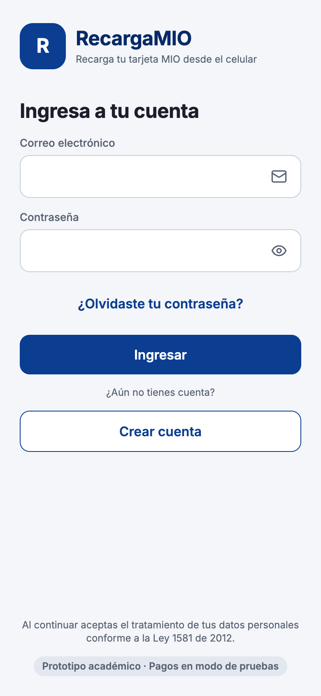

### 1.2 Si la contraseña es incorrecta

La app te dice cuántos intentos te quedan. **Por seguridad, después de 5 intentos fallidos el ingreso se bloquea durante 15 minutos.** Si no recuerdas la contraseña, toca **¿Olvidaste tu contraseña?** antes de agotar los intentos.

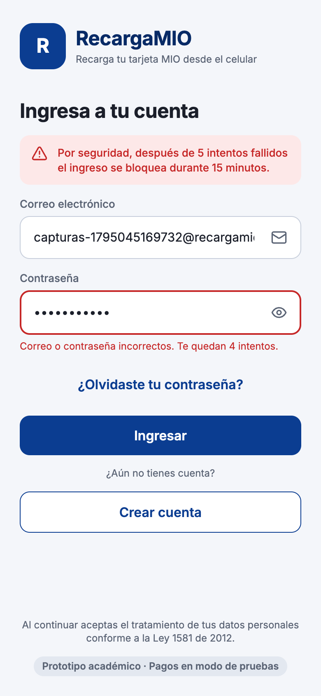

### 1.3 Crear una cuenta

1. En la pantalla de inicio, toca **Crear cuenta**.
2. Escribe tu **nombre completo** y tu **correo electrónico**.
3. Crea una **contraseña** de mínimo 8 caracteres, con letras y números, y escríbela otra vez en **Confirmar contraseña**.
4. Lee la *Política de tratamiento de datos* con el botón **Leer la política de tratamiento de datos** y marca la casilla **Autorizo el tratamiento de mis datos personales**. Sin esta autorización no es posible crear la cuenta (Ley 1581 de 2012).
5. Toca **Crear cuenta**.

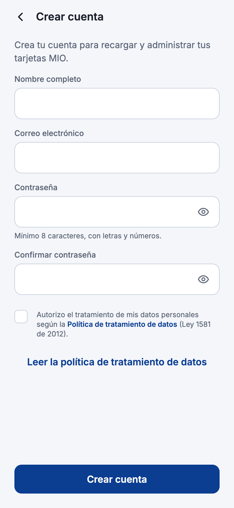

### 1.4 Recuperar la contraseña

1. En la pantalla de inicio, toca **¿Olvidaste tu contraseña?**
2. Escribe el correo con el que te registraste y toca **Enviar enlace**.
3. Revisa tu correo. Llega un mensaje con el asunto «Restablece tu contraseña de RecargaMIO».
4. Abre el enlace **Crear una nueva contraseña**. **Es válido por 30 minutos y solo funciona una vez.** Si pides otro enlace, el anterior deja de funcionar.
5. En la página que se abre, escribe la nueva contraseña dos veces y toca **Guardar contraseña**.
6. Vuelve a la app e ingresa con la nueva contraseña. Por seguridad, se cierran las sesiones que tenías abiertas en otros teléfonos.

Por seguridad, la app muestra el mismo mensaje exista o no el correo: «Si el correo está registrado, recibirás un enlace».

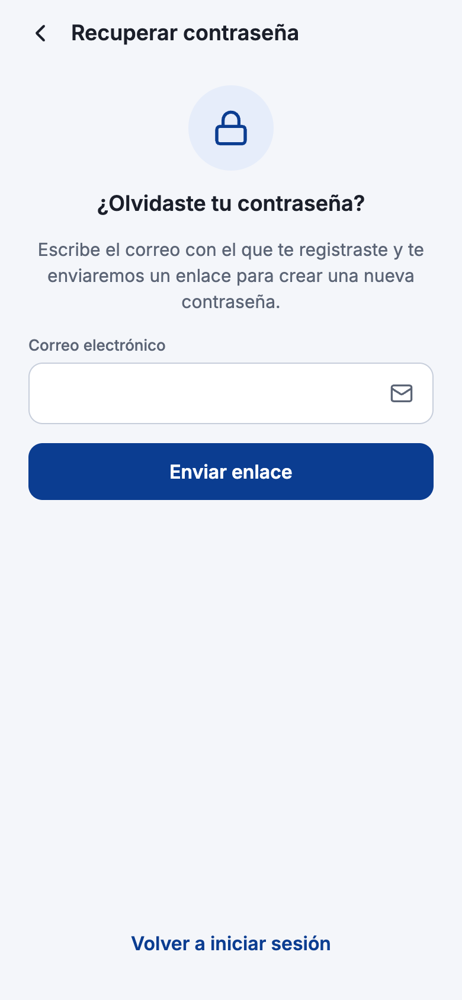

### 1.5 Crear la nueva contraseña desde el correo

El enlace del correo abre una página de RecargaMIO en el navegador del teléfono o del computador. No necesitas tener la app abierta. Si el enlace ya se usó o venció, la página te lo indica: pide uno nuevo desde la app.

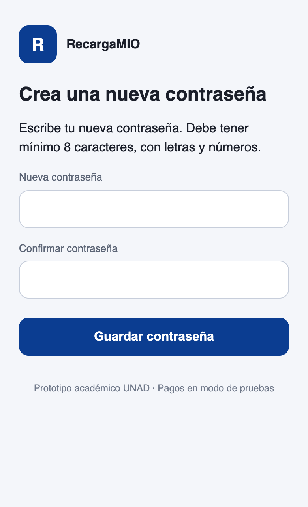

### 1.6 Cuánto dura tu sesión

- Mientras uses la app, la sesión se mantiene abierta hasta **7 días**. Después la app te pide ingresar de nuevo.
- Al tocar **Cerrar sesión** en **Perfil**, la sesión se cierra de inmediato en ese teléfono.
- Si cambias la contraseña, se cierran todas tus sesiones.

## 2. Tus tarjetas

### 2.1 Ver tus tarjetas y su saldo

En **Inicio** ves todas tus tarjetas, con su nombre, los últimos cuatro dígitos (por ejemplo, `MIO •••• 4821`) y el **saldo disponible**. Arriba se indica cuántas tienes registradas, de un máximo de 5.

- La etiqueta **Saldo bajo** aparece cuando el saldo está por debajo del valor que elegiste en las alertas.
- Toca **Recargar** en una tarjeta para recargarla directamente.
- Toca la tarjeta para ver su detalle.
- La campana de arriba abre tus **avisos** (recargas exitosas y alertas de saldo bajo). Un punto rojo indica que hay avisos sin leer.

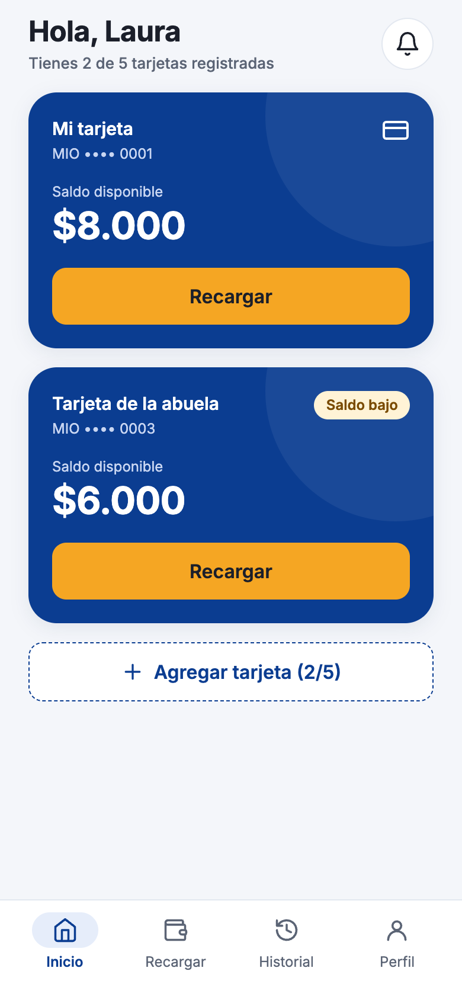

### 2.2 Agregar una tarjeta

1. En **Inicio**, toca **Agregar tarjeta**.
2. Escribe el **número de 10 dígitos** que está en el reverso de tu tarjeta MIO.
3. Ponle un **nombre para identificarla**, por ejemplo «Mi tarjeta» o «Tarjeta de mamá».
4. Toca **Guardar tarjeta**.

La app verifica con el sistema de recaudo que la tarjeta exista y esté activa. Te avisará si:

- El número no corresponde a una tarjeta MIO.
- La tarjeta está bloqueada.
- Ya la tienes registrada.
- El sistema de recaudo no responde. En ese caso, intenta de nuevo en unos minutos.

Una misma tarjeta puede estar registrada en varias cuentas. Por ejemplo, dos hermanos pueden recargar la tarjeta de su mamá, cada uno desde su cuenta.

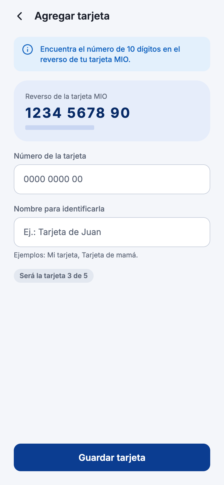

### 2.3 Ver el detalle de una tarjeta

Al tocar una tarjeta ves su número enmascarado, la última recarga y la alerta configurada. Desde aquí puedes:

- **Renombrar tarjeta:** cambiarle el nombre. También puedes tocar el lápiz de arriba.
- **Alerta de saldo bajo:** activarla o desactivarla con el interruptor.
- **Eliminar tarjeta:** quitarla de tu cuenta. La app te pide confirmar. La tarjeta física y su saldo no cambian. Solo deja de aparecer en la app y libera un cupo de los cinco. Si la vuelves a agregar, recuperas su historial.

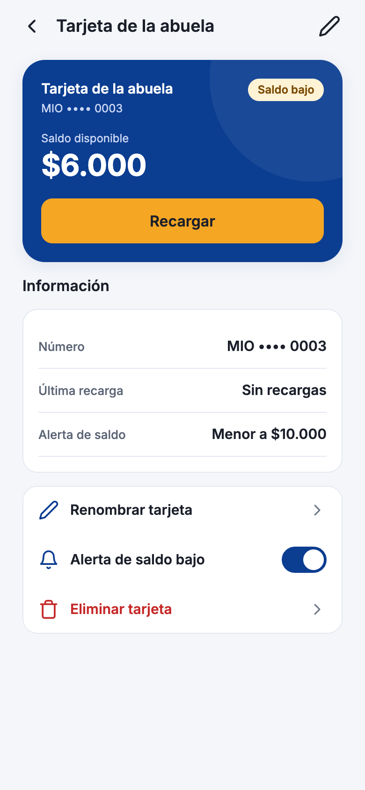

### 2.4 Límite de cinco tarjetas

Puedes registrar **hasta 5 tarjetas**. Si ya tienes 5, el botón **Guardar tarjeta** se desactiva y la app te invita a eliminar una que ya no uses. Toca **Administrar mis tarjetas** para hacerlo.

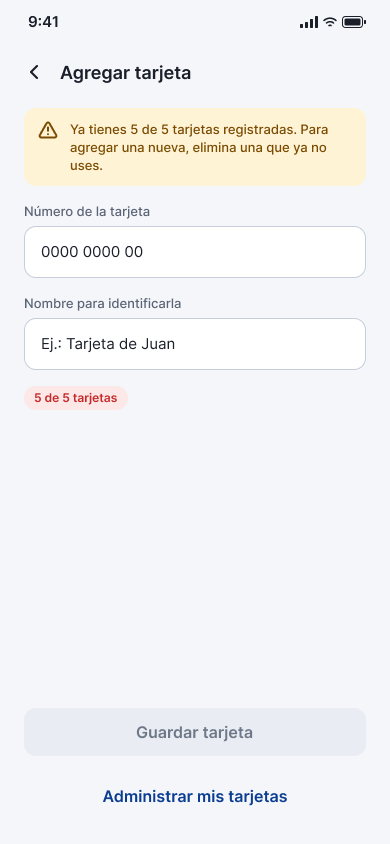

## 3. Recargar

### 3.1 Recargar tu tarjeta

1. Toca **Recargar** en la barra inferior, o el botón **Recargar** de una tarjeta.
2. En **Tarjeta**, elige cuál quieres recargar. Verás su saldo actual.
3. Elige el **monto**: $5.000, $10.000, $20.000 o $50.000.
4. Elige el **medio de pago**:
   - **PSE:** débito desde tu cuenta bancaria.
   - **Nequi:** pago desde tu billetera Nequi.
   - **Bancolombia:** botón o app de Bancolombia.
5. Revisa el **total a pagar**: es exactamente el valor de la recarga, sin comisiones.
6. Acepta los **términos y la autorización de datos de la pasarela de pagos**. Es un requisito de la pasarela. Puedes leerlos antes de aceptar con los botones **Leer los términos** y **Leer la autorización de datos**, que están debajo de la casilla.
7. Toca **Pagar**.

Según el medio de pago, al elegirlo aparecen debajo los datos que pide la pasarela:
- **Nequi:** tu número de celular de Nequi. En modo de pruebas, el 3991111111 aprueba y el 3992222222 rechaza.
- **PSE:** si eres persona natural o jurídica, tu tipo y número de documento, tu banco (de una lista) y tu celular.
- **Bancolombia:** nada más. Te llevará a la página de Bancolombia.

Estos datos se envían directamente a la pasarela para procesar el pago. **RecargaMIO no los guarda.**

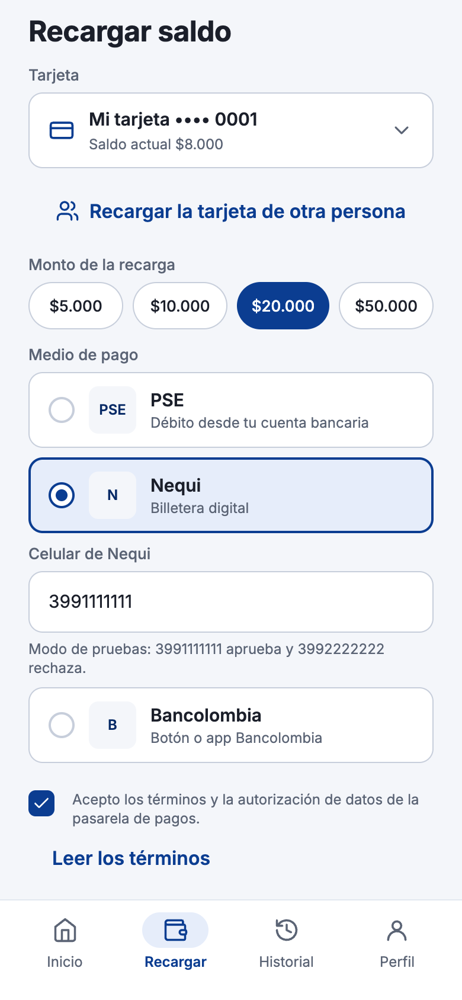

### 3.2 Recargar la tarjeta de otra persona

1. En **Recargar**, toca **Recargar la tarjeta de otra persona**.
2. Escribe el **número de la tarjeta de destino** y confírmalo en el segundo campo. Los dos deben coincidir.
3. Elige el monto y el medio de pago.
4. Si quieres que esa tarjeta quede en tu cuenta, activa **Guardar esta tarjeta**. Si no, no se guarda.
5. Toca **Pagar**.

La app verifica con el sistema de recaudo que el número corresponda a una tarjeta MIO activa antes de cobrarte.

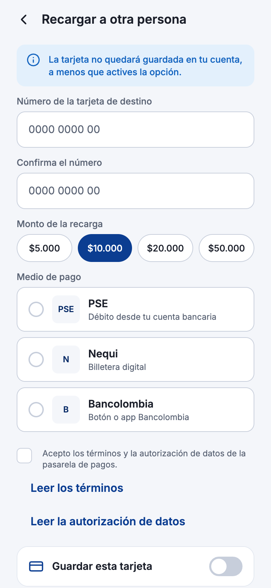

### 3.3 Mientras se confirma el pago

Después de tocar **Pagar**, la app espera la confirmación de la pasarela:

- **Con Nequi:** autoriza el pago en la app de Nequi, en la notificación que te llega.
- **Con PSE o Bancolombia:** la app abre la página de tu banco. Termina el pago allí y vuelve a RecargaMIO.

**No cierres esta pantalla.** Si tocas Pagar dos veces seguidas, la app no te cobrará dos veces: te avisa que ya hay una recarga igual en curso. Verás la referencia de la recarga (por ejemplo, `RM-000124`), el medio de pago, el monto y el estado. La app consulta el estado sola cada 2 segundos, pero puedes tocar **Actualizar estado**. La recarga se acredita solo cuando la pasarela confirma el pago.

- **Si cerraste la página del banco** antes de terminar, toca **Abrir de nuevo la página del banco**.
- **Si no quieres esperar,** toca **Volver al inicio**. La recarga **no se cancela**: sigue en proceso y el resultado te llega a los avisos. Una vez enviado a la pasarela, un pago no se puede cancelar desde la app.

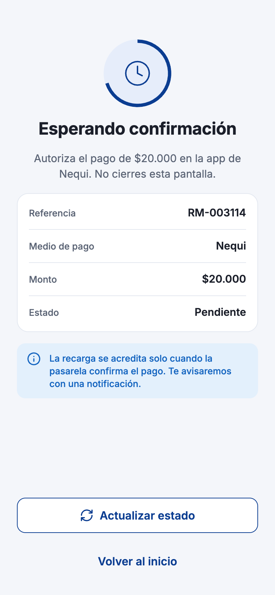

### 3.4 Recarga exitosa

Cuando el pago se aprueba y el saldo queda acreditado, verás **¡Recarga exitosa!** con el medio de pago, la referencia, la fecha y el **nuevo saldo**. Desde aquí puedes **Ver historial** o **Volver al inicio**. La meta del proyecto es que la recarga tarde menos de 3 minutos.

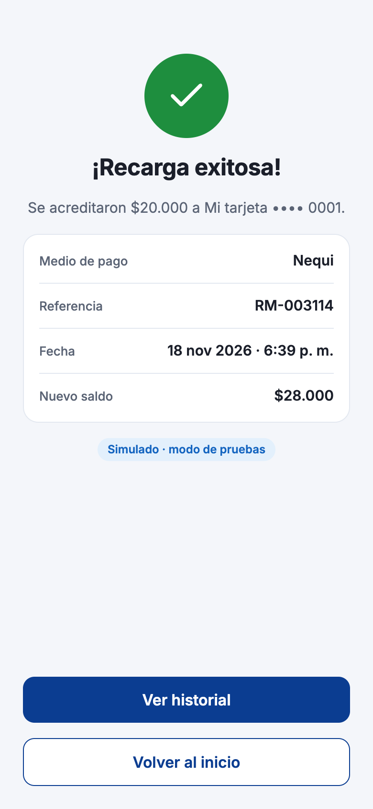

### 3.5 Pago rechazado

Si tu banco o Nequi no aprueban el pago, verás **Pago rechazado** con el motivo (por ejemplo, fondos insuficientes). **El saldo de tu tarjeta no cambia y no se hace ningún cobro.** Puedes:

- **Intentar de nuevo** con el mismo medio.
- **Elegir otro medio de pago.**
- **Volver al inicio.**

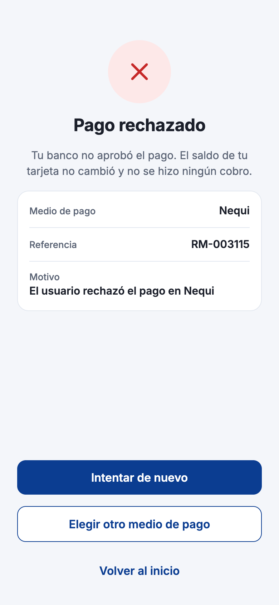

## 4. Historial y alertas

### 4.1 Consultar el historial

1. Toca **Historial** en la barra inferior.
2. Toca el selector de arriba para elegir la tarjeta. Verás su saldo actual.
3. Filtra con **Todo**, **Recargas** o **Viajes**.

Las recargas aparecen en verde con signo **+** y el medio de pago. Solo se muestran las recargas acreditadas: un pago rechazado no cambia el saldo y no aparece. Los viajes aparecen con signo **−**, la estación o ruta y el valor del pasaje ($3.500). Los movimientos se agrupan por **Hoy**, **Esta semana** y por mes. Desliza hacia abajo para actualizar.

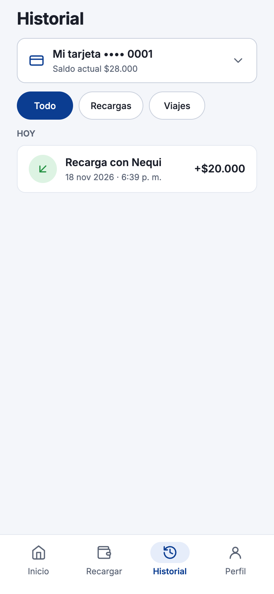

### 4.2 Configurar alertas de saldo bajo

1. En **Perfil**, toca **Alertas de saldo bajo**. También puedes activarla o desactivarla desde el detalle de cada tarjeta.
2. Activa el interruptor de cada tarjeta que quieras vigilar.
3. Elige el valor: **$3.500, $5.000 o $10.000**. La app te avisará cuando el saldo baje de ese valor.
4. Toca **Guardar cambios**.

Para recibir las alertas, permite las notificaciones de RecargaMIO en tu teléfono. La app envía como máximo **un aviso cada 12 horas por tarjeta**, para no llenarte de notificaciones.

- **Para dejar de recibir avisos de una tarjeta,** apaga su interruptor y toca **Guardar cambios**. El valor elegido se conserva por si la vuelves a activar.
- **Si cambias el valor o vuelves a activar la alerta,** la cuenta de 12 horas empieza de nuevo.
- **En el inicio,** las tarjetas con alerta activa y saldo por debajo del valor muestran la etiqueta **Saldo bajo**.

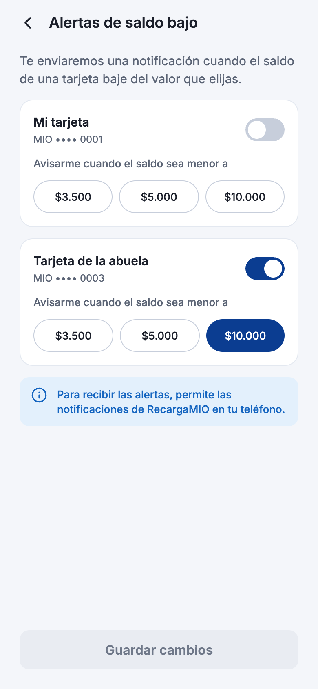

### 4.3 Recibir una notificación de saldo bajo

Cuando el saldo de una tarjeta baja del valor elegido, recibes una notificación como «Saldo bajo en Tarjeta de mamá: Te quedan $3.200». Tócala para abrir la recarga de esa tarjeta.

- **Cuándo llega:** justo después del viaje que deja el saldo por debajo. Si en ese momento no fue posible revisarlo, llega en máximo 5 minutos.
- **También recibes un aviso de «Recarga exitosa»** cada vez que se acredita una recarga.
- **Si no permitiste las notificaciones,** o el teléfono es un iPhone, los avisos igual quedan guardados: tócalos desde la **campana de Inicio**.
- **Si otra persona también registró esa tarjeta** en su cuenta (por ejemplo, tú y tu hermana con la tarjeta de mamá), cada una recibe su propio aviso según el valor que eligió.

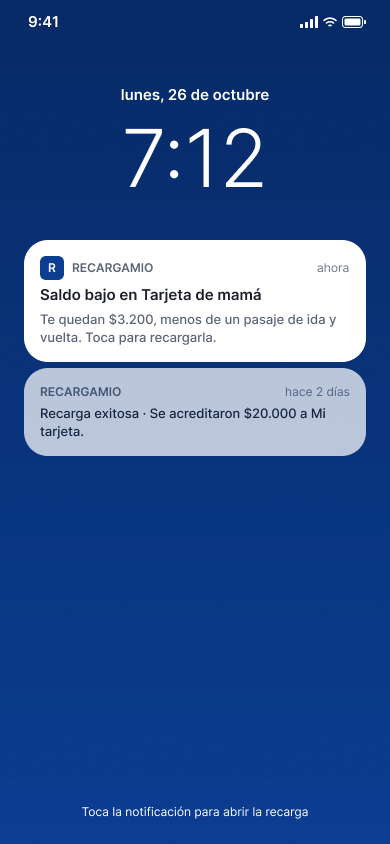

### 4.4 Tus avisos

La campana de **Inicio** abre tus avisos: las recargas exitosas y las alertas de saldo bajo, del más reciente al más antiguo. Los nuevos aparecen resaltados y quedan leídos al abrir la bandeja.

- **Toca un aviso de recarga exitosa** para ver su comprobante.
- **Toca un aviso de saldo bajo** para recargar esa tarjeta.

Aunque las notificaciones del teléfono no lleguen (por ejemplo, si no las permitiste), los avisos siempre quedan aquí.

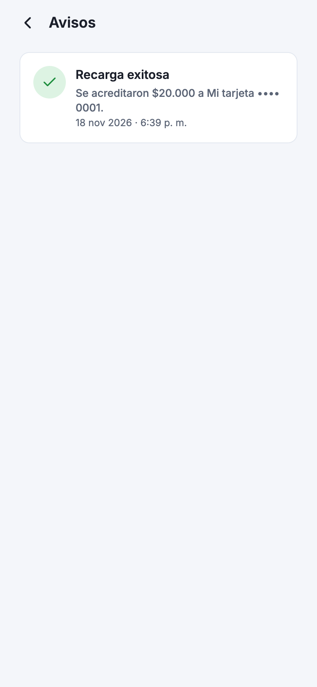

## 5. Perfil, privacidad y ayuda

### 5.1 Perfil

En **Perfil** encuentras:

- **Cuenta:** datos personales (para corregir tu nombre o tu correo), mis tarjetas y alertas de saldo bajo.
- **Privacidad y ayuda:** privacidad y datos, ayuda y PQR.
- **Cerrar sesión:** sal de la app en este teléfono. Hazlo siempre que uses un celular prestado.

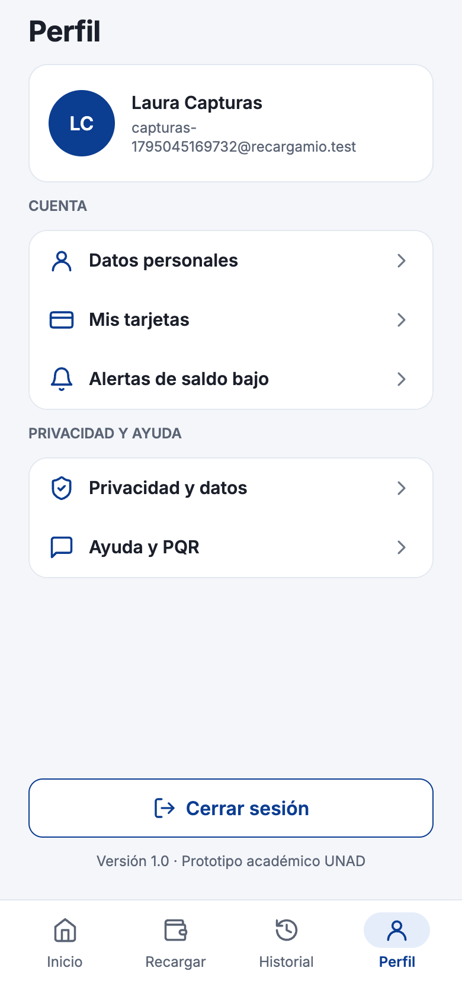

### 5.2 Privacidad y tus datos

Aquí ejerces los derechos que te da la Ley 1581 de 2012 sobre tus datos personales:

- Ver la fecha y la versión de la **política de tratamiento de datos** que aceptaste, y leer la política.
- **Actualizar o rectificar mis datos:** cambia tu nombre o tu correo. Para cambiar el correo, la app te pide tu contraseña y te avisa al correo anterior.
- **Eliminar mi cuenta:** se borran tus tarjetas, alertas e historial. Esta acción no se puede deshacer.

> **En esta versión del prototipo** todavía no están disponibles «Descargar mis datos» ni la radicación de PQR: aparecen como «Próximamente». El texto de la política es un borrador que el equipo debe revisar.

**Para eliminar tu cuenta:**

1. Toca **Eliminar mi cuenta**. La app te explica qué se borra y qué se conserva; toca **Continuar**.
2. Escribe tu contraseña y toca **Eliminar cuenta**. Si la contraseña no es correcta, la app te lo dice y no elimina nada.
3. La app vuelve a la pantalla de inicio de sesión. Recibirás un correo que confirma la eliminación. Tu sesión se cierra en todos tus teléfonos.

- **Si tienes una recarga en proceso,** la app no deja eliminar la cuenta hasta que termine, para que no pierdas dinero.
- **Qué se conserva:** el registro de las recargas que hiciste, sin tu nombre, tu correo ni el número de tu tarjeta. Se necesita para conciliar los pagos y atender reclamos.
- **Puedes volver a registrarte** con el mismo correo cuando quieras. La cuenta nueva empieza vacía.

RecargaMIO **no guarda datos de tus cuentas ni de tus tarjetas bancarias**. El pago lo procesa directamente la pasarela.

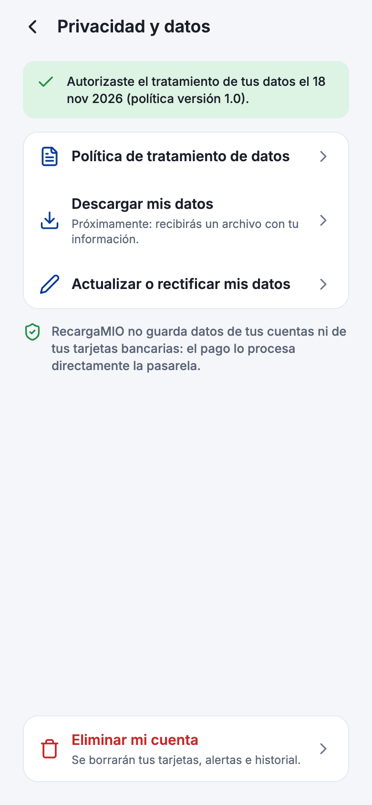

### 5.3 Ayuda y PQR

- **Preguntas frecuentes:** cuánto tarda una recarga, qué hacer si pagaste y no ves el saldo, cómo pedir la reversión de un pago y qué hacer si pierdes la tarjeta. Toca una pregunta para ver la respuesta.
- **Radicar una PQR** *(próximamente)***:** permitirá enviar una petición, queja o reclamo (Ley 1480 de 2011) y recibir un **número de radicado** para hacer seguimiento.
- **Escribir a soporte** *(próximamente)*.

En esta versión del prototipo los dos botones aparecen deshabilitados.

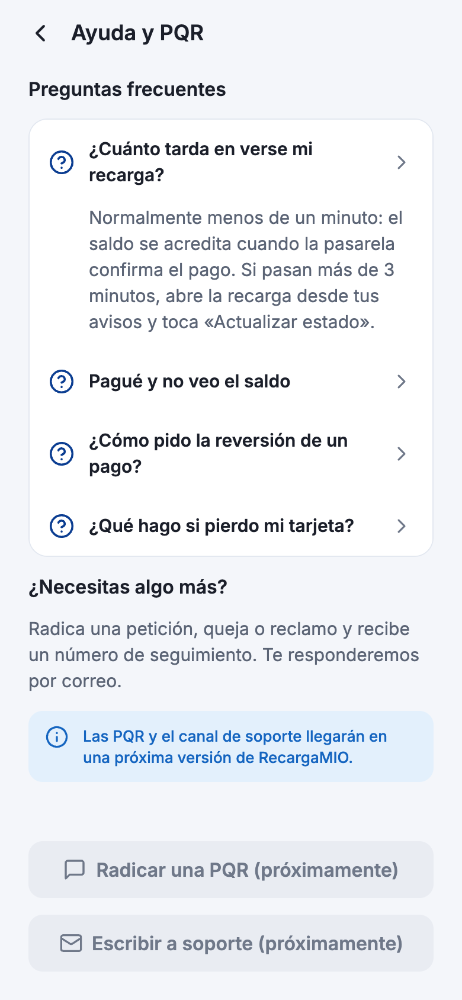

## 6. Accesibilidad

RecargaMIO está hecha para usarse con las herramientas de accesibilidad de Android (WCAG 2.1, nivel AA):
- **Lector de pantalla (TalkBack).** Cada botón, casilla, pestaña y campo se anuncia con su nombre, su tipo y su estado (por ejemplo, si una opción está marcada). Los montos se leen en pesos. Los errores y el resultado de una recarga se anuncian sin que tengas que buscarlos.
- **Letra grande.** El texto crece con el tamaño de letra del teléfono (**Ajustes → Pantalla → Tamaño de fuente**), hasta el doble.
- **Áreas de toque grandes.** Todos los controles miden por lo menos 44 × 44 px, así que son fáciles de tocar.
- **Vertical u horizontal.** La app gira con el teléfono.
- **Contraste.** Los textos tienen un contraste de 4,5:1 o más con su fondo.

## Preguntas frecuentes

<!-- tabla: Preguntas frecuentes -->
| Pregunta | Respuesta |
|---|---|
| ¿Cuánto tarda en verse mi recarga? | Normalmente unos segundos después de que la pasarela confirma el pago. La meta es menos de 3 minutos. |
| ¿Puedo pagar dos veces por error? | No. Si ya hay una recarga igual en curso, la app te lo avisa en lugar de iniciar otra. |
| El pago se aprobó pero dice «estamos terminando de acreditar el saldo» | El sistema de recaudo tardó en responder. La app lo reintenta sola. No pagues de nuevo. |
| Pagué y no veo el saldo | Espera en la pantalla de pago pendiente y toca **Actualizar estado**. La app también confirma los pagos por su cuenta cada 30 segundos. Si después de 3 minutos no ves el saldo, guarda la referencia `RM-…` de la recarga para tu reclamo. |
| ¿Me pueden cobrar dos veces? | No. Cada recarga tiene una referencia única y el saldo se acredita una sola vez, aunque la confirmación llegue repetida. |
| ¿Qué pasa si el pago es rechazado? | No se hace ningún cobro y el saldo no cambia. |
| ¿Cuántas tarjetas puedo registrar? | Hasta 5 por cuenta. Si ya tienes 5, elimina una que no uses para agregar otra. |
| El inicio dice «Saldo no disponible» | El sistema de recaudo no respondió. Tus tarjetas siguen registradas. Intenta de nuevo en unos minutos. |
| Mi saldo está bajo y no me llegó la notificación | Revisa que la alerta de esa tarjeta esté activa y que hayas permitido las notificaciones. Solo llega un aviso cada 12 horas por tarjeta. Los avisos también quedan en la campana de **Inicio**. |
| ¿Puedo cancelar una recarga que está esperando confirmación? | No. Una vez enviada a la pasarela, sigue su curso. Si la rechazas en Nequi o en tu banco, no se hace ningún cobro. |
| ¿Puedo elegir un valor de alerta distinto a $3.500, $5.000 o $10.000? | La app ofrece esos tres valores. Cada tarjeta puede tener el suyo. |
| ¿Las alertas funcionan en iPhone? | Por ahora las notificaciones en el teléfono solo llegan a Android. En iPhone puedes ver los avisos en la campana de **Inicio**. |
| ¿Por qué veo solo los últimos cuatro dígitos? | Por seguridad, la app nunca muestra el número completo de la tarjeta. |
| Olvidé mi contraseña | Usa **¿Olvidaste tu contraseña?** en la pantalla de inicio. El enlace dura 30 minutos. |
| Me bloquearon el ingreso | Ocurre después de 5 intentos fallidos. Espera 15 minutos o recupera tu contraseña: al restablecerla se quita el bloqueo. |
| ¿Por qué la app me pide ingresar otra vez? | La sesión dura hasta 7 días, y se cierra antes si cierras sesión o cambias la contraseña. Es una medida de seguridad. |
