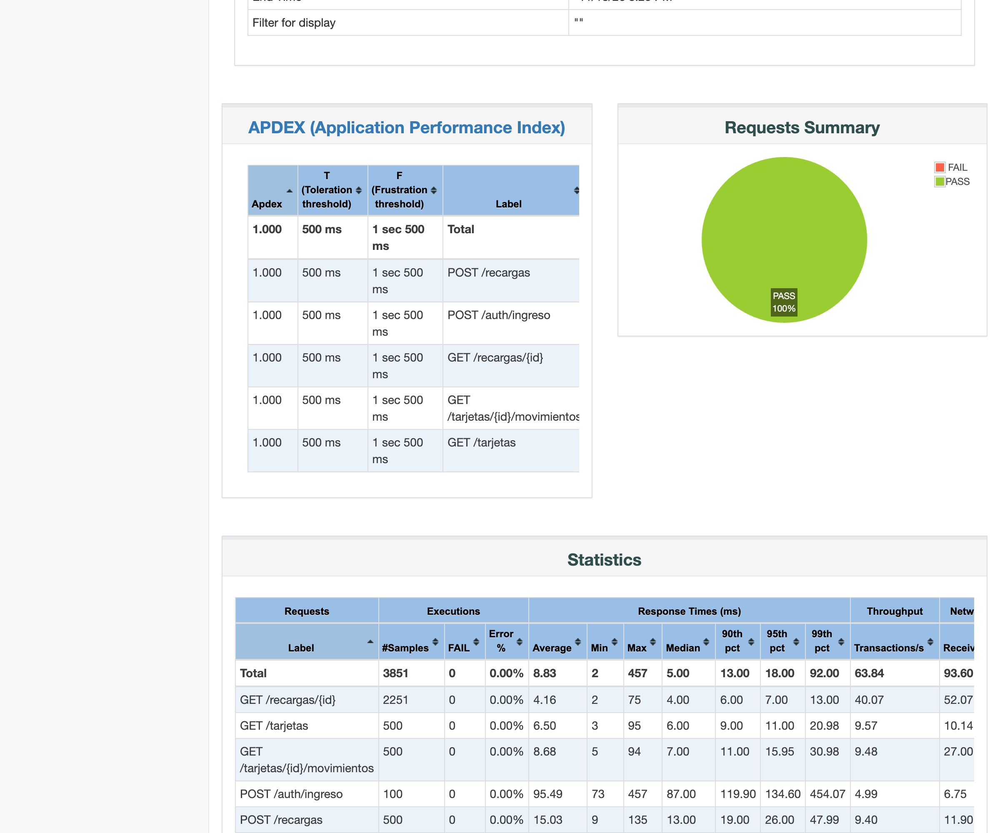
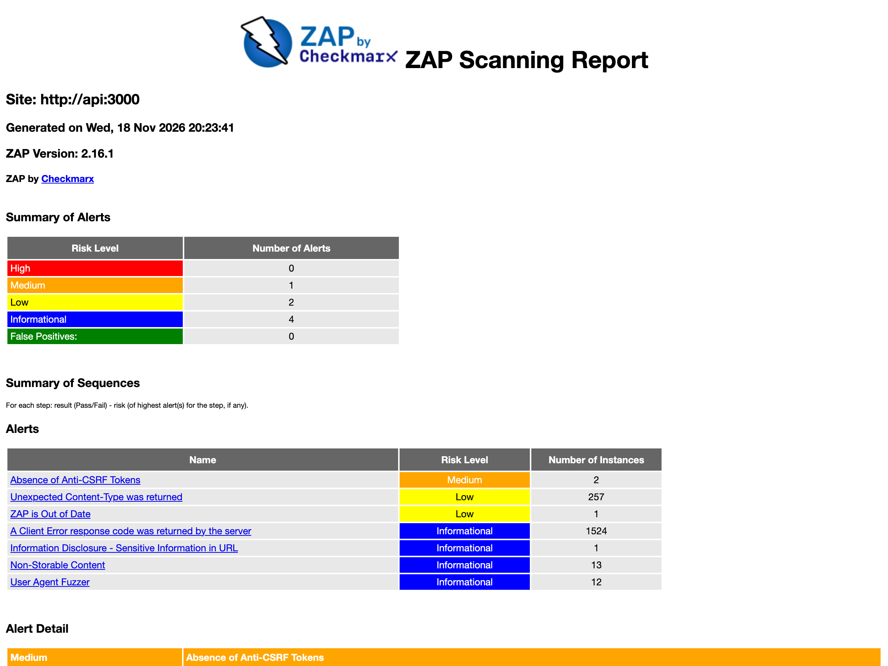
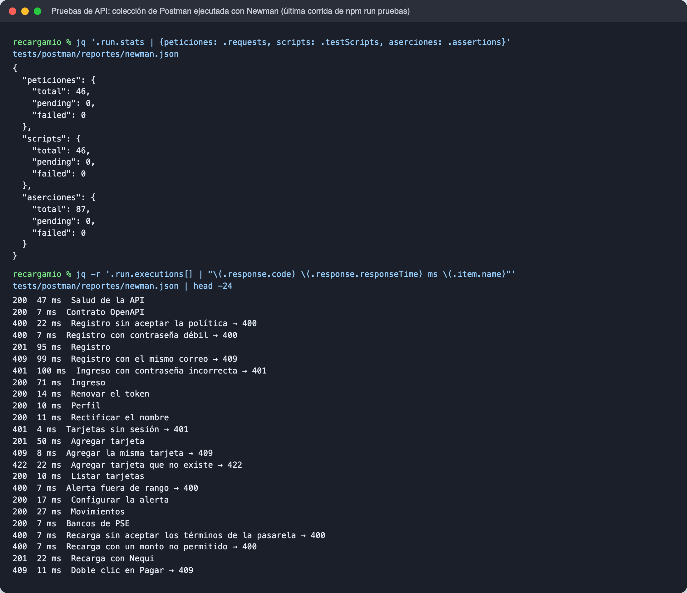

# Pruebas y resultados

Este capítulo presenta las pruebas del prototipo y sus resultados frente a las metas de la Tabla 9 del documento maestro. Las pruebas siguen el plan de la Tabla 18. Las decisiones están en el ADR 0016 y los comandos, en el capítulo «Manual de instalación y operación».

## Plan de pruebas

<!-- tabla: Plan de pruebas del prototipo y su estado -->
| Tipo de prueba (Tabla 18) | Alcance | Herramienta | Criterio de aceptación | Estado |
|---|---|---|---|---|
| Unitarias | Validaciones, estados de la recarga, firmas, reglas de negocio y criterios de aceptación de cada historia | Jest y Supertest | Todas aprobadas | Corren en cada tarea |
| De API | Autenticación, perfil, tarjetas, alerta, recargas, historial, notificaciones y eliminación de la cuenta | Postman y Newman | Respuestas y códigos según el contrato OpenAPI | T8 |
| De integración | Recarga completa: pasarela en modo de pruebas, webhook firmado, acreditación en el recaudo simulado | Script de Node | 200 transacciones o más, 98 % o más aprobadas | T8 con la pasarela simulada; se repite con Wompi Sandbox en T5b |
| De carga | API con 100 usuarios simultáneos | JMeter 5.6.3 | Percentil 95 de 2 s o menos | T8 |
| De seguridad | Autenticación, sesiones, encabezados, validación de entradas, exposición de datos, dependencias y registros | OWASP ZAP 2.16.1, `npm audit`, revisión de registros y lista OWASP MASVS | Cero hallazgos críticos o altos | ZAP en T8; dependencias, registros y lista MASVS en T11 (capítulo «Validación TRL 5») |
| De accesibilidad | Las 20 pantallas y estados de la app | Prueba automática con Jest, axe-core y TalkBack (VoiceOver queda fuera: iOS no está en el PMV, decisión D7) | Cero incumplimientos críticos de nivel A y AA | Automáticas en T11; TalkBack, el equipo |
| De usabilidad | Tareas de registro, recarga y consulta con 15 usuarios | Cuestionario SUS y registro de tiempos | SUS de 68 o más; recarga en 180 s o menos | Protocolo y cálculo en T11; las sesiones, el equipo |

## Contrato de la API

El contrato de la API está escrito en OpenAPI 3.1 en `services/api/openapi.yaml` y se publica con Swagger UI en `http://localhost:3000/docs`, solo fuera de producción. Documenta las 33 operaciones, sus cuerpos, sus respuestas y sus códigos de error. La prueba `tests/openapi.test.ts` falla en tres casos:
- Si se agrega una ruta sin documentarla.
- Si se documenta una ruta que no existe.
- Si una referencia interna del contrato está rota.

Así el contrato no se desactualiza.

## Cómo se obtienen los resultados

Los resultados de este capítulo se generan solos:
- `npm run pruebas` corre las cuatro pruebas desde Docker y, desde T11, la prueba automática de accesibilidad, `npm audit` y la revisión de registros.
- `npm run metricas` calcula las estadísticas y escribe `docs/metricas/resultados.md`, que se inserta a continuación.

Cada indicador va con su meta y con «Cumple» o «No cumple». Ningún número se escribe a mano.

- El **tiempo de recarga** es `acreditadaEn − iniciadaEn`, medido por la API.
- La **tasa de éxito** se informa con su intervalo de confianza del 95 % (Wilson). Este intervalo se comporta bien cuando la proporción está cerca de 1.
- Los **percentiles** usan el método del rango más cercano, el mismo de JMeter.

<!-- incluir: ../metricas/resultados.md -->

## Evidencias

Las capturas de las 18 pantallas de la app, que también son las que analiza axe-core, están en el capítulo «Manual de usuario».
