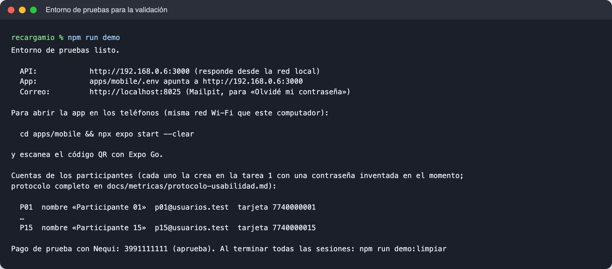

# Validación TRL 5

En la escala de madurez tecnológica (TRL), el nivel 5 es la validación de los componentes integrados en un **entorno relevante**, es decir, uno que reproduce las condiciones reales de uso. En RecargaMIO eso significa:
- La app, la API, el recaudo simulado y la pasarela en modo de pruebas funcionan juntos.
- Personas que usan el MIO la prueban en teléfonos Android reales.
- Los resultados se comparan con las metas de la Tabla 9 del documento maestro.

Este capítulo reúne la preparación de esa validación (T11, ADR 0019):
- El entorno de pruebas.
- La revisión de accesibilidad.
- La lista OWASP MASVS.
- El protocolo de la prueba de usabilidad.

Los resultados medidos están en el capítulo «Pruebas y resultados».

## Estado de la validación

<!-- tabla: Criterios de la validación TRL 5 y su estado -->
| Criterio | Evidencia | Estado |
|---|---|---|
| Los componentes funcionan integrados | Flujo 1.1 → 2.1 → 3.1 → 3.3 → 3.4 → 4.1 de T10 en la web contra Docker; 200 recargas de punta a punta (T8) | Cumplido con la pasarela simulada |
| Entorno de pruebas con datos de prueba (HT-03) | `npm run demo`, tarjetas reservadas para 15 participantes y limpieza con `npm run demo:limpiar` | Cumplido |
| Desempeño frente a las metas de la Tabla 9 | Tiempo de recarga, éxito de pagos, carga y API, en «Pruebas y resultados» | Cumplido con la pasarela simulada; se repite con Wompi Sandbox en T5b |
| Seguridad | ZAP sin hallazgos altos; lista MASVS de este capítulo; `npm audit` y revisión de registros | Cumplido con observaciones |
| Accesibilidad (WCAG 2.1 AA) | Prueba automática de 20 pantallas y axe-core en 18, con las correcciones de T11 | Pruebas automáticas cumplidas; **falta la revisión con TalkBack del equipo** |
| Uso en un teléfono Android real | Flujo del criterio de T10 en Expo Go contra Docker | **Pendiente del equipo** |
| Usabilidad con usuarios (SUS ≥ 68) | Protocolo, cuestionario y plantilla de este capítulo | **Pendiente del equipo**: necesita el borrador de la política aprobado |

## Entorno de pruebas

El entorno es el computador del equipo con Docker. Los teléfonos se conectan a él por la misma red Wi-Fi (decisión A del ADR 0019). No se despliega en la nube.

<!-- tabla: Comandos del entorno de pruebas para la validación -->
| Paso | Comando | Qué hace |
|---|---|---|
| Preparar | `npm run demo` | Levanta Docker, migra y siembra la base, escribe la IP del computador en `apps/mobile/.env` y comprueba que la API responde en la red local |
| Abrir la app | `cd apps/mobile && npx expo start --clear` | Muestra el código QR para Expo Go |
| Guardar los tiempos | `npm run demo:exportar` | Guarda en `docs/metricas/datos/validacion.json` las recargas de cada participante, con su código y sin correos |
| Limpiar | `npm run demo:limpiar` | Exporta, borra las cuentas de los participantes y devuelve sus tarjetas a $5.000. No toca a Viviana ni a los usuarios de las pruebas automatizadas |
| Calcular | `npm run metricas` y `npm run manual` | Agrega los resultados al capítulo «Pruebas y resultados» y regenera el Word y el PDF |

<!-- tabla: Cuentas y tarjetas reservadas para la validación con usuarios -->
| Participante | Nombre en la app | Correo | Tarjeta MIO | Saldo inicial |
|---|---|---|---|---|
| P01 | Participante 01 | `p01@usuarios.test` | `7740000001` | $5.000 |
| … | … | … | … | … |
| P15 | Participante 15 | `p15@usuarios.test` | `7740000015` | $5.000 |

## Accesibilidad

<!-- incluir: ../metricas/wcag.md -->

## Seguridad: lista OWASP MASVS

<!-- incluir: ../metricas/masvs.md -->

## Usabilidad

<!-- incluir: ../metricas/protocolo-usabilidad.md -->

## Lo que falta para cerrar la validación

1. **Teléfono Android:** recorrer el flujo del criterio de T10 en Expo Go contra Docker.
2. **TalkBack:** llenar `docs/metricas/datos/talkback.csv` siguiendo la sección «Accesibilidad».
3. **Política de datos:** el equipo revisa y aprueba el borrador, y define el correo de contacto.
4. **Usabilidad:** hacer las 15 sesiones y pasar las respuestas a `docs/metricas/datos/sus.csv`.
5. **Figma:** cambiar a «secundario» y «texto principal» los textos que usaban «terciario» y «éxito».
6. **Wompi Sandbox (T5b):** con las llaves en `.env`, repetir `npm run pruebas`.
7. Correr `npm run metricas` y `npm run manual`.
